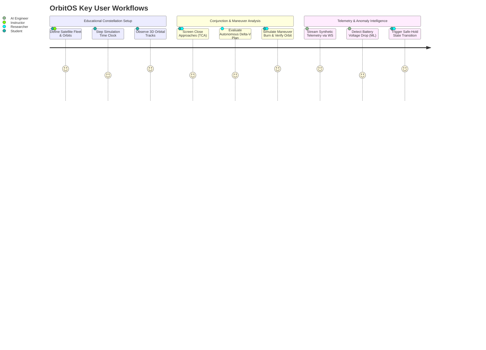
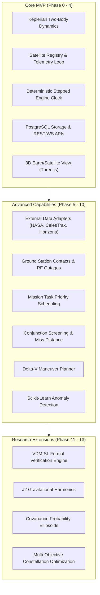

# 01 — OrbitOS Project Charter

> **Document Status:** Baseline Approved  
> **Owner:** Principal Systems Architect & Lead Software Product Strategist  
> **Target Path:** `docs/00-project-foundation/01-project-charter.md`  
> **Last Updated:** 2026-11-03  
> **Traceability Anchor:** `DOC-CHARTER-001`

---

## 1. Executive Summary & Purpose

OrbitOS is an open, educational, and research-grade autonomous space mission management simulator. It provides a local, reproducible software platform designed to model, simulate, and supervise virtual satellite constellations operating in Earth orbit.

OrbitOS bridges the pedagogical and architectural gap between theoretical orbital mechanics, software-intensive mission control systems, autonomous planning algorithms, and formal software verification. The platform models satellite orbital motion, bus telemetry, power/battery balance, communication contact windows with virtual ground stations, orbital conjunction screening, autonomous collision avoidance maneuver planning, and AI/ML-driven telemetry anomaly detection.

OrbitOS is intentionally engineered to run entirely on a standard developer workstation or laptop using containerized services, providing a single coherent platform for students, academic researchers, and software engineers.

---

## 2. Problem Statement

Modern satellite operations are transitioning from manually supervised single-spacecraft missions to large, automated, and autonomous satellite constellations (e.g., mega-constellations in Low Earth Orbit). This transition introduces several critical challenges:

1. **Computational & Algorithmic Complexity:** Managing conjunction risks, communication schedules, and resource contention across tens or hundreds of satellites exceeds human operator cognitive capacity.
2. **Pedagogical Barrier:** Existing aerospace flight-dynamics tools (such as NASA GMAT or commercial STK/FreeFlyer) are either closed-source, prohibitively expensive, overly specialized, or lack modern software engineering architectures (REST APIs, WebSockets, reactive WebGL frontends).
3. **Lack of Formal Rigor in Simulation:** Educational simulation projects frequently omit formal methods, leaving state machine transitions and safety-critical resource invariants (e.g., fuel non-negativity, battery limits) unverified.
4. **Disconnection Between AI and Safety:** Machine learning models are often introduced as opaque black boxes without formal fallback rules or explicit safety boundaries.

OrbitOS solves these problems by providing an open, modular, formally specified simulator featuring an intuitive modern web interface, transparent mathematical dynamics, and rigorous safety boundaries.

---

## 3. Project Vision & Goals

### 3.1 Vision
To deliver the definitive open-source educational simulator for autonomous spacecraft constellation operations, enabling students and researchers to experiment with orbital mechanics, autonomous planning, and machine learning within a mathematically verified safety framework.

### 3.2 Measurable Objectives

| Objective ID | Objective Description | Metric Target | Verification Method |
| :--- | :--- | :--- | :--- |
| **OBJ-001** | Deterministic orbital propagation of a multi-satellite constellation. | Support $\ge 20$ satellites propagating at $\ge 10\times$ real-time speed on a 4-core laptop. | Automated benchmark test in [17-testing-and-validation-strategy.md](file:///home/kashifhm333/Desktop/Project/orbit/docs/04-quality-and-operations/17-testing-and-validation-strategy.md) |
| **OBJ-002** | Automated conjunction screening and time-of-closest-approach (TCA) calculation. | Detect conjunctions within a configurable 24-hour lookahead horizon in $< 500\text{ ms}$. | Benchmarked screening test suite |
| **OBJ-003** | Autonomous avoidance maneuver generation with fuel constraints. | Generate dynamically feasible candidate $\Delta v$ maneuvers satisfying fuel invariants. | Formal VDM-SL proof & test assertion |
| **OBJ-004** | Formal state verification of critical subsystem invariants. | 100% of defined state transitions and resource invariants formally verified. | VDM-SL type check & pytest assertions |
| **OBJ-005** | Fully local deployment without external network dependencies. | Zero failed startups when disconnected from internet (offline synthetic mode). | CI offline containerized test run |

---

## 4. Target Users & Representative User Journeys

### 4.1 Target User Personas

1. **Aerospace / Computer Science Student:** Learning orbital coordinate transformations, Keplerian orbital elements, ground station contact geometry, and reactive web development.
2. **Academic Researcher / Instructor:** Designing scenarios to evaluate multi-agent task scheduling, collision avoidance policies, or formal verification in space systems.
3. **Software / AI Engineer:** Developing predictive models for spacecraft telemetry anomaly detection and testing autonomous recommendation engines.

### 4.2 Representative User Journeys

- **Journey 1: Educational LEO Constellation Setup:** A student launches OrbitOS via Docker Compose, creates three Earth-observation satellites in sun-synchronous orbits, configures ground stations in Svalbard and Singapore, advances the simulation clock, and visualizes pass geometries and contact windows in 3D.
- **Journey 2: Conjunction Screening & Avoidance Maneuver:** OrbitOS imports a secondary debris object, screens an impending close-approach event ($< 2\text{ km}$ miss distance), proposes an autonomous in-track prograde burn, validates fuel sufficiency, and executes the simulated burn upon user approval.
- **Journey 3: Telemetry Anomaly Detection & Safe Mode:** Simulated sensor degradation causes unexpected battery discharge; the Scikit-learn anomaly detector flags an out-of-distribution event, prompting the satellite finite state machine to transition to `SAFE_STANDBY` mode.

---

## 5. System Scope & Phased Capabilities

### 5.1 In-Scope Capabilities
- Virtual satellite modeling: mass, battery capacity, fuel budget, operational state.
- Keplerian two-body orbital dynamics and Cartesian state vector propagation (ECI J2000).
- Earth-rotation coordinate frame conversions (ECI to ECEF).
- Discrete-time deterministic simulation engine with pause, play, step, and reset.
- Ground station line-of-sight elevation and contact window calculations.
- Conjunction screening (geometric miss distance and Time of Closest Approach).
- Autonomous avoidance maneuver candidate generation and fuel-balance evaluation.
- Machine-learning-based telemetry anomaly detection using Scikit-learn.
- Formal specification of critical safety invariants using VDM-SL.
- 3D WebGL interactive visualization using React Three Fiber.
- External reference data adapters for NASA DONKI, CelesTrak, and NASA JPL Horizons.

### 5.2 Explicit Out-of-Scope Boundaries
- **Real Spacecraft Command & Telemetry:** OrbitOS possesses zero interfaces to physical satellites, software-defined radios, or real ground stations.
- **Flight-Certified Operations:** No claims of compliance with NASA-STD-8739 or ESA ECSS flight certification standards.
- **Centimeter-Grade Astrodynamics:** OrbitOS does not model relativistic perturbations, atmospheric density micro-variations, solar radiation pressure, or ocean tidal forces in the MVP.
- **Autonomous Weaponization / Offensive ASAT:** All orbital mechanics and maneuver algorithms are strictly defensive, civil, and educational.

---

## 6. Critical Limitations and Responsible Use Declaration

> [!CAUTION]
> ### NON-NEGOTIABLE SAFETY BOUNDARY
> 1. **Purely Synthetic Simulation:** OrbitOS is designed strictly for educational and academic simulation purposes.
> 2. **No Hardware Uplink:** Under no circumstances should any component of OrbitOS be connected to physical radio transmitters, ground station uplinks, or operational spacecraft telemetry decoders.
> 3. **Non-Authoritative Predictions:** Calculated conjunction events and maneuver plans must never be utilized as real-world space traffic management or collision avoidance recommendations.
> 4. **Data Isolation:** All simulation records are flagged with `is_synthetic = true` to preserve complete separation from imported external reference data.

---

## 7. Project Constraints and Assumptions

### 7.1 Development & Hardware Constraints
- **Laptop-Friendly Local Environment:** The system must run smoothly within 4 GB RAM and 2 CPU cores on modern Linux, macOS, or Windows machines.
- **Containerized Infrastructure:** The entire stack must initialize with a single command: `docker compose up --build`.
- **Zero Cloud Incurred Cost:** No paid cloud APIs, external database hosting, or proprietary licenses are permitted for MVP operation.

### 7.2 Technical Assumptions
- The primary central gravitational body is Earth ($\mu = 3.986004418 \times 10^{14}\ \text{m}^3/\text{s}^2$, $R_{\text{Earth}} = 6378.137\ \text{km}$).
- Satellites are modeled as spherical point masses with uniform cross-sectional properties for simplified drag.
- Impulsive maneuvers are modeled as instantaneous velocity changes ($\Delta \vec{v}$).

---

## 8. Risk Management & Mitigations

| Risk ID | Description | Severity | Likelihood | Mitigation Strategy |
| :--- | :--- | :--- | :--- | :--- |
| **RSK-001** | External API rate limits or downtime (NASA / CelesTrak). | High | High | Multi-tier persistent caching in PostgreSQL and fully offline synthetic dataset fallbacks (ADR-007). |
| **RSK-002** | Numerical drift in long-running orbital propagations. | Medium | Medium | Fixed-step Runge-Kutta numerical integration combined with periodic Keplerian re-normalization; user documentation detailing drift bounds. |
| **RSK-003** | Excessive WebGL rendering load causing frontend UI freezes. | Medium | Low | Level-of-Detail (LOD) management, batched Three.js geometry instances, and optional 2D fallback telemetry view (ADR-004). |
| **RSK-004** | Misinterpretation of synthetic output as certified space data. | High | Low | Persistent UI safety banner, strict telemetry provenance metadata, and automated safety warnings in exported reports. |

---

## 9. Academic and Formal Methods Relevance

OrbitOS treats formal methods not as an afterthought, but as an architectural cornerstone. In safety-critical aerospace software, runtime errors can lead to total mission loss. OrbitOS demonstrates how formal techniques apply directly to mission simulation:

- **State Invariant Enforcement:** Proving that resource variables (e.g., fuel mass $m_f \ge 0$, battery state of charge $0\% \le \text{SoC} \le 100\%$) can never be violated by any sequence of simulation ticks.
- **Preconditions & Postconditions:** Ensuring maneuvers can only execute if the satellite is in `ACTIVE` or `STANDBY` state, sufficient propellant exists, and thermal constraints are met.
- **Executable Specifications:** Utilizing VDM-SL models to generate formal proof obligations and directly cross-validating them against automated `pytest` test suites.

---

## 10. Acceptance Criteria for Charter Baseline

1. Clear demarcation between simulated entities and external reference datasets.
2. Complete agreement on the 3-tier scope: Core MVP, Advanced, and Research extensions.
3. Adoption of the laptop-friendly monolithic modular architecture ([ADR-001](file:///home/kashifhm333/Desktop/Project/orbit/docs/ARCHITECTURE_DECISIONS.md#adr-001-modular-monolith-architecture-over-distributed-microservices)).
4. Approval of the formal verification strategy using VDM-SL ([ADR-005](file:///home/kashifhm333/Desktop/Project/orbit/docs/ARCHITECTURE_DECISIONS.md#adr-005-vdm-sl-for-formal-specification-of-invariants-and-critical-safety-contracts)).

---

## 11. Cross-Document Traceability Links

- **Requirements:** [02-requirements-specification.md](file:///home/kashifhm333/Desktop/Project/orbit/docs/00-project-foundation/02-requirements-specification.md)
- **Terminology:** [03-domain-glossary.md](file:///home/kashifhm333/Desktop/Project/orbit/docs/00-project-foundation/03-domain-glossary.md)
- **System Architecture:** [04-system-architecture.md](file:///home/kashifhm333/Desktop/Project/orbit/docs/01-system-design/04-system-architecture.md)
- **Formal Methods:** [13-formal-specification-and-verification.md](file:///home/kashifhm333/Desktop/Project/orbit/docs/03-engineering-contracts/13-formal-specification-and-verification.md)
- **Implementation Roadmap:** [20-implementation-roadmap.md](file:///home/kashifhm333/Desktop/Project/orbit/docs/20-implementation-roadmap.md)

