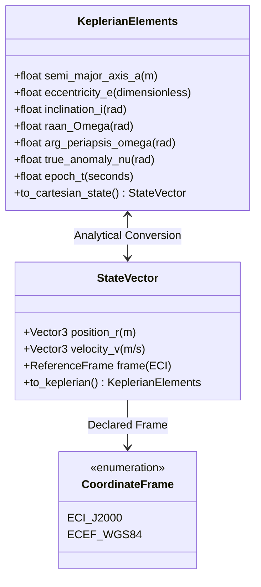

# 03 — OrbitOS Domain Glossary & Conceptual Model

> **Document Status:** Baseline Approved  
> **Owner:** Technical Domain Analyst & Aerospace Software Systems Engineer  
> **Target Path:** `docs/00-project-foundation/03-domain-glossary.md`  
> **Last Updated:** 2026-11-03  
> **Traceability Anchor:** `DOC-GLOSS-001`

---

## 1. Overview & Units Policy

This document establishes the canonical terminology, coordinate frame definitions, mathematical symbols, and conceptual relationships used throughout the OrbitOS software suite. All team members, technical specifications, database schemas, code variables, and AI coding agents must adhere strictly to these definitions.

### 1.1 Units Policy (SI Standard)
OrbitOS enforces the International System of Units (SI) internally across all computational kernels, REST endpoints, and database models:
- **Length / Distance:** Meters ($\text{m}$) internally; Kilometers ($\text{km}$) permitted in documentation and UI displays when explicitly labeled.
- **Velocity:** Meters per second ($\text{m/s}$).
- **Time:** Seconds ($\text{s}$) for simulation delta-time; ISO-8601 UTC strings (`YYYY-MM-DDTHH:MM:SSZ`) or Julian Date ($\text{JD}$) for absolute simulation epochs.
- **Angles:** Radians ($\text{rad}$) internally for all trigonometric and orbital algorithms; Degrees ($^\circ$) for user-facing UI visualization.
- **Mass:** Kilograms ($\text{kg}$).
- **Energy & Power:** Joules ($\text{J}$) / Watt-hours ($\text{Wh}$) for energy; Watts ($\text{W}$) for power generation and load.
- **Specific Impulse ($I_{\text{sp}}$):** Seconds ($\text{s}$).

---

## 2. Orbital Mechanics & Astrodynamics

- **Semi-Major Axis ($a$):** The average orbital distance defining the size of the orbit ($\text{m}$). For Earth orbits, $a = R_{\text{Earth}} + h_p + h_a$, where $h_p$ and $h_a$ are perigee and apogee altitudes.
- **Eccentricity ($e$):** Dimensionless parameter defining the shape of the conic section ($0 \le e < 1$ for bound elliptical orbits; $e = 0$ is circular).
- **Inclination ($i$):** Tilt of the orbital plane with respect to the Earth's equatorial plane ($0 \le i \le \pi\text{ rad}$).
- **Right Ascension of the Ascending Node ($\Omega$ or RAAN):** Angle in the equatorial plane from the vernal equinox to the point where the satellite crosses from south to north ($0 \le \Omega < 2\pi\text{ rad}$).
- **Argument of Periapsis ($\omega$):** Angle measured along the orbital plane from the ascending node to the point of closest approach (perigee) ($0 \le \omega < 2\pi\text{ rad}$).
- **True Anomaly ($\nu$ or $\theta$):** Angular position of the satellite along the orbital ellipse measured from periapsis ($0 \le \nu < 2\pi\text{ rad}$).
- **Mean Anomaly ($M$):** Fraction of an orbital period elapsed since periapsis expressed as an angle ($M = n(t - t_0)$, where $n = \sqrt{\mu / a^3}$ is mean motion).
- **Earth-Centered Inertial (ECI):** Non-rotating Cartesian reference frame with origin at Earth's center of mass, fundamental plane on the equator, and X-axis pointing toward the vernal equinox (J2000/GCRF). Primary frame for orbital dynamics.
- **Earth-Centered, Earth-Fixed (ECEF):** Rotating Cartesian reference frame co-rotating with the Earth (ITRF/WGS84). Used for ground station positions and calculating sub-satellite coordinates.
- **Earth Gravitational Parameter ($\mu$):** Constant $\mu = G M_{\text{Earth}} = 3.986004418 \times 10^{14}\ \text{m}^3/\text{s}^2$.
- **Two-Body Problem:** Classical Newtonian formulation assuming only two point masses interacting through gravity, yielding conservation of specific energy $\mathcal{E} = \frac{v^2}{2} - \frac{\mu}{r}$ and angular momentum $\vec{h} = \vec{r} \times \vec{v}$.
- **J2 Perturbation:** First zonal gravitational harmonic ($J_2 \approx 1.08263 \times 10^{-3}$) capturing Earth's oblateness, driving secular precession of the orbital plane ($\dot{\Omega}$) and line of apsides ($\dot{\omega}$).

---

## 3. Spacecraft Bus & Subsystems

- **Spacecraft Bus:** The structural and functional housing providing power, thermal control, propulsion, and telemetry for payloads.
- **Dry Mass ($m_{\text{dry}}$):** Mass of the spacecraft structure, avionics, and payload excluding usable propellant ($\text{kg}$).
- **Propellant Mass ($m_f$):** Mass of onboard usable propellant ($\text{kg}$). Enforced by invariant: $m_f \ge 0$.
- **Total Wet Mass ($m_0$):** $m_0 = m_{\text{dry}} + m_f$.
- **Battery State of Charge ($\text{SoC}$):** Ratio of stored electrical energy to total battery capacity expressed as a percentage ($0\% \le \text{SoC} \le 100\%$).
- **Bus Power Balance:** Net power rate $\dot{E} = P_{\text{solar}} - P_{\text{load}}$. When satellite is in Earth's shadow (eclipse), $P_{\text{solar}} = 0\text{ W}$, discharging the battery.
- **Specific Impulse ($I_{\text{sp}}$):** Measure of propulsion efficiency in seconds ($\text{s}$). Related to effective exhaust velocity by $c = I_{\text{sp}} g_0$ ($g_0 = 9.80665\text{ m/s}^2$).
- **Delta-V ($\Delta v$):** Change in velocity magnitude achieved by thrust burns ($\text{m/s}$). Governed by the Tsiolkovsky rocket equation: $\Delta v = I_{\text{sp}} g_0 \ln(m_0 / m_{\text{final}})$.

---

## 4. Conjunction Analysis & Collision Risk

- **Conjunction:** An event where two orbiting objects achieve close geometric proximity within a specified screening threshold.
- **Time of Closest Approach (TCA):** The precise future simulation timestamp $t_{\text{TCA}}$ at which the relative distance $|\vec{r}_A(t) - \vec{r}_B(t)|$ reaches a local minimum.
- **Miss Distance ($d_{\text{miss}}$):** The minimum Euclidean separation between two satellite centers of mass at TCA: $d_{\text{miss}} = |\vec{r}_A(t_{\text{TCA}}) - \vec{r}_B(t_{\text{TCA}})|$.
- **Relative Velocity ($\vec{v}_{\text{rel}}$):** $\vec{v}_{\text{rel}} = \vec{v}_A - \vec{v}_B$. The relative velocity vector at TCA.
- **Combined Hard-Body Radius ($R_{\text{HBR}}$):** Sum of the equivalent spherical collision radii of both spacecraft ($R_{\text{HBR}} = R_A + R_B$).
- **Collision Risk Category:** Qualitative classification:
  - `INFO`: $d_{\text{miss}} \ge 10\text{ km}$
  - `WATCH`: $5\text{ km} \le d_{\text{miss}} < 10\text{ km}$
  - `WARNING`: $1\text{ km} \le d_{\text{miss}} < 5\text{ km}$
  - `CRITICAL`: $d_{\text{miss}} < 1\text{ km}$

---

## 5. Communications & Ground Stations

- **Virtual Ground Station:** Simulated Earth-fixed tracking and communications facility defined by latitude ($\phi$), longitude ($\lambda$), altitude ($h$), and minimum elevation mask ($\theta_{\text{mask}}$).
- **Sub-Satellite Point (SSP):** The point on Earth's reference ellipsoid directly beneath the satellite (geodetic latitude and longitude).
- **Elevation Angle ($\theta_{\text{elev}}$):** Angle of the satellite above the local horizontal plane of the ground station ($-90^\circ \le \theta_{\text{elev}} \le 90^\circ$).
- **Contact Window:** Contiguous interval of simulation time $[t_{\text{AOS}}, t_{\text{LOS}}]$ where $\theta_{\text{elev}}(t) \ge \theta_{\text{mask}}$.
- **Acquisition of Signal (AOS):** Timestamp when satellite rises above the ground station's elevation mask.
- **Loss of Signal (LOS):** Timestamp when satellite descends below the elevation mask.

---

## 6. Formal Methods & Invariant Terminology

- **State Invariant:** A boolean predicate over the system state that must evaluate to `TRUE` before and after every state transition or simulation tick:
  $$\forall \sigma \in \Sigma, \quad \text{Invariant}(\sigma) \equiv \text{True}$$
- **Precondition (`req`):** Conditions that must hold true before an operation or state transition is permitted to execute.
- **Postcondition (`ens`):** Conditions guaranteed to hold true upon successful completion of an operation.
- **Proof Obligation (PO):** A mathematical theorem generated by formal tooling (VDM-SL / VDMJ) proving that a function never divides by zero, respects sub-ranges, and preserves state invariants.
- **Safety Property:** An invariant asserting that "bad things never happen" (e.g., fuel never becomes negative: $m_f \ge 0$).
- **Liveness Property:** An assertion that "something good will eventually happen" (e.g., a scheduled maneuver will eventually execute or transition to an explicit cancelled state).

---

## 7. Terms That Must Not Be Confused

| Term A | Term B | Distinction |
| :--- | :--- | :--- |
| **ECI (Inertial)** | **ECEF (Fixed)** | ECI does not rotate with Earth; used for orbital motion equations. ECEF co-rotates with Earth; used for ground station tracking. |
| **True Anomaly ($\nu$)** | **Mean Anomaly ($M$)** | True anomaly is physical geometric angle. Mean anomaly is a fictitious uniform angle progressing linearly with time. |
| **Conjunction** | **Collision** | A conjunction is merely a close approach passing screening criteria. A collision is a catastrophic physical contact ($d_{\text{miss}} \le R_{\text{HBR}}$). |
| **Simulation Clock** | **Wall Clock** | Simulation clock represents virtual mission time ($t_{\text{sim}}$), which can be paused, stepped, or accelerated relative to computer real-world time. |
| **Synthetic Data** | **External Reference** | Synthetic data is calculated by OrbitOS simulation models. External reference data is imported from external agencies (NASA DONKI, CelesTrak TLE). |

---

## 8. Cross-Document References

- **Requirements:** [02-requirements-specification.md](file:///home/kashifhm333/Desktop/Project/orbit/docs/00-project-foundation/02-requirements-specification.md)
- **Orbital Mechanics Model:** [05-orbital-mechanics-model.md](file:///home/kashifhm333/Desktop/Project/orbit/docs/01-system-design/05-orbital-mechanics-model.md)
- **Simulation Engine Design:** [06-simulation-engine-design.md](file:///home/kashifhm333/Desktop/Project/orbit/docs/01-system-design/06-simulation-engine-design.md)
- **Formal Verification:** [13-formal-specification-and-verification.md](file:///home/kashifhm333/Desktop/Project/orbit/docs/03-engineering-contracts/13-formal-specification-and-verification.md)

