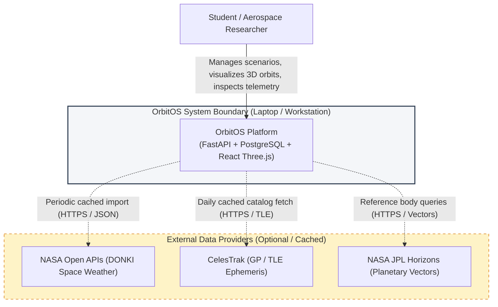
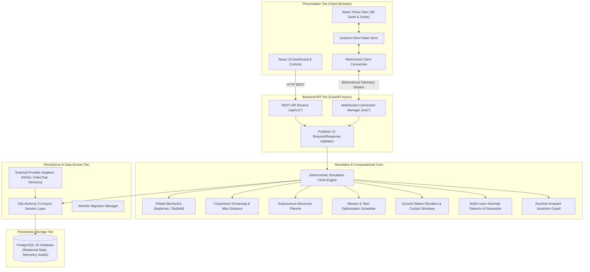
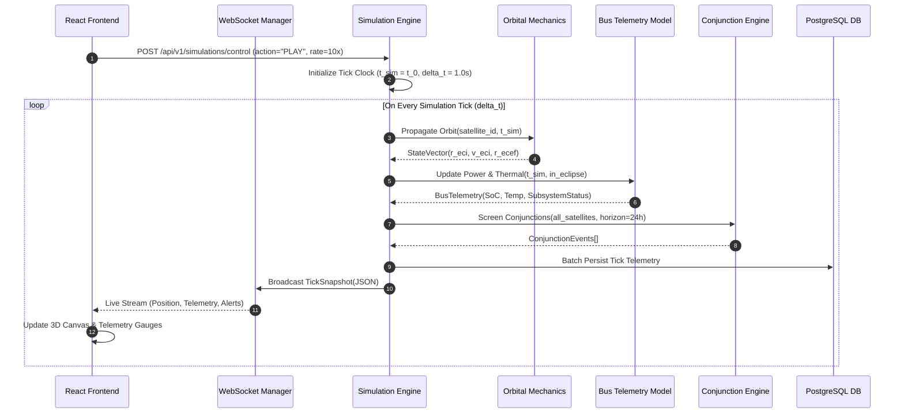
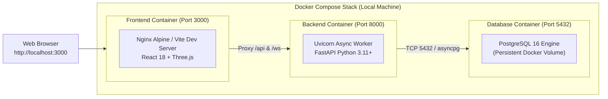

# 04 — OrbitOS System Architecture Specification

> **Document Status:** Baseline Approved  
> **Owner:** Principal Software Architect & Systems Engineering Team  
> **Target Path:** `docs/01-system-design/04-system-architecture.md`  
> **Last Updated:** 2026-11-03  
> **Traceability Anchor:** `DOC-ARCH-001`

---

## 1. Architectural Style & Core Design Principles

OrbitOS is architected as a **Layered Modular Monolith** implemented in Python (FastAPI backend) and TypeScript (React/Three.js frontend). 

As established in [ADR-001](file:///home/kashifhm333/Desktop/Project/orbit/docs/ARCHITECTURE_DECISIONS.md#adr-001-modular-monolith-architecture-over-distributed-microservices), a modular monolith was chosen over a distributed microservice architecture to satisfy the fundamental constraint of laptop-friendly local execution ($< 4\text{ GB}$ RAM, zero cloud infrastructure cost). Subsystems communicate through strictly typed programmatic Python interfaces and clear transaction boundaries rather than asynchronous network message brokers.

### Core Architectural Principles
1. **Single Source of Scientific Truth:** The backend simulation engine is the absolute authority on time, physics, orbital positions, and satellite states. The frontend UI is strictly a reactive presentation layer and never computes orbital trajectories.
2. **Deterministic Time Authority:** Simulation time ($t_{\text{sim}}$) advances in discrete ticks ($\Delta t$) decoupled from physical wall-clock time, enabling exact replay, pause, and time acceleration.
3. **Formal Invariant Verification:** State mutations must satisfy formal pre/post-conditions and state invariants ([ADR-005](file:///home/kashifhm333/Desktop/Project/orbit/docs/ARCHITECTURE_DECISIONS.md#adr-005-vdm-sl-for-formal-specification-of-invariants-and-critical-safety-contracts)).
4. **Simulation-Only Isolation:** All telemetry, maneuvers, and commands are synthetic and isolated within the local PostgreSQL instance.

---

## 2. System Context (C4 Level 1)

---

## 3. Container & Component Topology (C4 Level 2 & 3)

The architecture is decomposed into five distinct operational tiers:

---

## 4. Subsystem Responsibilities & Boundary Rules

| Component | Responsibility | Permitted Inbound Callers | Permitted Outbound Calls |
| :--- | :--- | :--- | :--- |
| **Simulation Engine** | Discrete tick loop, time advancing, event queue management, state synchronization. | REST Routers, WebSocket Controller | Orbital Engine, Bus Models, Conjunction, Maneuver, DB Layer |
| **Orbital Mechanics** | Analytical Kepler solver, Cartesian state vector propagation, ECI $\leftrightarrow$ ECEF coordinate transforms. | Simulation Engine, Maneuver Planner | NumPy, SciPy, Skyfield (No DB access) |
| **Conjunction Service** | Multi-satellite close-approach screening, TCA calculation, geometric miss-distance evaluation. | Simulation Engine, REST Routers | Orbital Mechanics (No state mutation) |
| **Maneuver Planner** | Evaluates risk, calculates impulsive $\Delta \vec{v}$, validates propellant constraints, records audit logs. | Simulation Engine, REST Routers | Orbital Mechanics, Formal Invariant Guard, DB Layer |
| **Mission Scheduler** | Priority-based task scheduling, conflict resolution, resource availability verification. | Simulation Engine, REST Routers | Formal Invariant Guard, DB Layer |
| **AI/ML Service** | Isolation Forest inference for telemetry anomaly detection, battery/fuel trend forecasting. | Simulation Engine, REST Routers | Scikit-learn, NumPy (Read-only data) |
| **Formal Verifier** | Enforces runtime pre/post-conditions and state invariants (`SPEC-INV-*`). | Simulation Engine, State Machines | Exception Handlers, Audit Logger |
| **External Adapters** | Normalizes and caches external data from NASA DONKI, CelesTrak, and Horizons. | Background Tasks, Admin REST | Database Layer, Third-party HTTPS |

### Circular Dependency Prevention
- The **Orbital Mechanics Engine** is purely functional and stateless; it never imports or calls the Simulation Engine or Database layer.
- The **Presentation Tier** never executes physical calculations; it merely consumes state vectors generated by the backend.

---

## 5. Simulation Execution & WebSocket Data Flow

The simulation follows a strict discrete-time execution pipeline on every tick:

---

## 6. Local Development & Deployment Topology

As documented in [ADR-001](file:///home/kashifhm333/Desktop/Project/orbit/docs/ARCHITECTURE_DECISIONS.md#adr-001-modular-monolith-architecture-over-distributed-microservices) and [ADR-003](file:///home/kashifhm333/Desktop/Project/orbit/docs/ARCHITECTURE_DECISIONS.md#adr-003-fastapi-pydantic-v2-and-sqlalchemy-postgresql-for-core-backend-services), the system deploys via a multi-container Docker Compose configuration:

---

## 7. Architecture Fitness Functions & Acceptance Criteria

1. **Memory Ceiling:** Total resident set size (RSS) of backend, frontend, and PostgreSQL combined must not exceed $2.5\text{ GB}$ during a 50-satellite simulation run (`NFR-PORT-002`).
2. **Tick Calculation Budget:** Backend tick computation loop must complete in $< 50\text{ ms}$ for 20 satellites (`NFR-PERF-001`).
3. **Stateless Orbital Kernel:** The orbital propagation package must have zero database or network dependencies.
4. **Clean Shutdown:** Issuing `SIGINT` to the backend cleanly flushes buffered telemetry, commits pending transactions, and halts the simulation clock without data corruption.

---

## 8. Cross-Document References

- **Orbital Mechanics Model:** [05-orbital-mechanics-model.md](file:///home/kashifhm333/Desktop/Project/orbit/docs/01-system-design/05-orbital-mechanics-model.md)
- **Simulation Engine Design:** [06-simulation-engine-design.md](file:///home/kashifhm333/Desktop/Project/orbit/docs/01-system-design/06-simulation-engine-design.md)
- **Database & API Contracts:** [14-database-and-api-contracts.md](file:///home/kashifhm333/Desktop/Project/orbit/docs/03-engineering-contracts/14-database-and-api-contracts.md)
- **Security & Safety Model:** [18-security-and-safety-model.md](file:///home/kashifhm333/Desktop/Project/orbit/docs/04-quality-and-operations/18-security-and-safety-model.md)
- **Deployment & Operations:** [19-deployment-and-operations.md](file:///home/kashifhm333/Desktop/Project/orbit/docs/04-quality-and-operations/19-deployment-and-operations.md)

