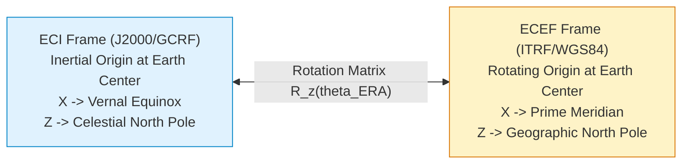
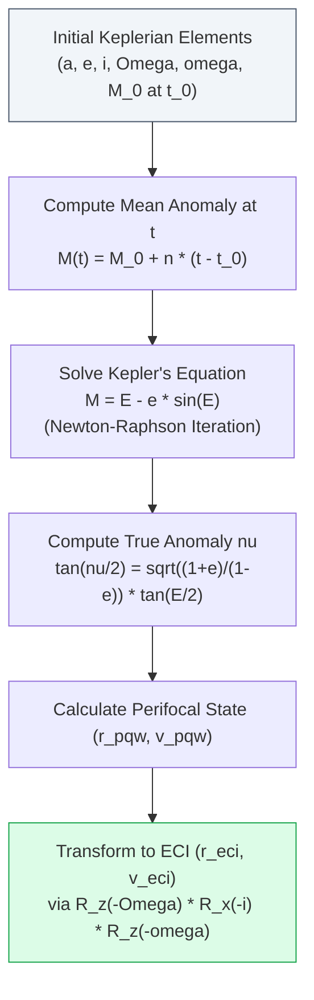

# 05 — OrbitOS Orbital Mechanics Mathematical & Physical Model

> **Document Status:** Baseline Approved  
> **Owner:** Orbital Mechanics Engineer & Scientific Computing Specialist  
> **Target Path:** `docs/01-system-design/05-orbital-mechanics-model.md`  
> **Last Updated:** 2026-11-03  
> **Traceability Anchor:** `DOC-ORB-001`

---

## 1. Executive Summary & Purpose

This document specifies the authoritative mathematical, physical, and numerical foundations for orbital motion modeling in **OrbitOS**. OrbitOS utilizes a deterministic Newtonian two-body central-force formulation as its Core MVP baseline ([ADR-002](file:///home/kashifhm333/Desktop/Project/orbit/docs/ARCHITECTURE_DECISIONS.md#adr-002-simplified-two-body-dynamics-with-keplerian-orbit-propagation-for-mvp)), coupled with an analytical Kepler solver and optional $J_2$ geopotential perturbations.

The model provides deterministic, laptop-friendly propagation while rigorously maintaining conservation of energy and angular momentum.

---

> [!CAUTION]
> **SIMULATION FIDELITY & SAFETY NOTICE**  
> The orbital mechanics models described herein are educational approximations. They do **not** model high-order gravitational harmonics ($J_3, J_4+$), atmospheric drag micro-variations, solar radiation pressure, lunar/solar third-body gravity, or relativistic effects. They must **never** be used for real operational flight guidance, active satellite navigation, or real-world conjunction assessment.

---

## 2. Astrodynamic Constants & Reference Frames

### 2.1 Standard Physical Constants
OrbitOS standardizes on WGS84 and IAU astrodynamic constants:

| Symbol | Parameter | Value | Units | Source |
| :--- | :--- | :--- | :--- | :--- |
| $\mu$ | Earth Gravitational Parameter | $3.986004418 \times 10^{14}$ | $\text{m}^3/\text{s}^2$ | WGS84 |
| $R_{\text{Earth}}$ | Earth Mean Equatorial Radius | $6378137.0$ | $\text{m}$ | WGS84 |
| $J_2$ | Second Zonal Harmonic (Oblateness) | $1.08262668 \times 10^{-3}$ | dimensionless | EGM96 / WGS84 |
| $\omega_{\text{Earth}}$| Earth Nominal Rotation Rate | $7.2921150 \times 10^{-5}$ | $\text{rad/s}$ | IAU |
| $c$ | Speed of Light in Vacuum | $299792458$ | $\text{m/s}$ | CODATA |

### 2.2 Coordinate Reference Frames

OrbitOS standardizes on two primary coordinate systems:

1. **Earth-Centered Inertial (ECI — GCRF/J2000):**
   - Origin: Center of mass of the Earth.
   - Fundamental Plane: Equatorial plane at epoch J2000.0 (2000-01-01 12:00:00 TT).
   - $+X$ Axis: Directed toward the Vernal Equinox ($\Upsilon$).
   - $+Z$ Axis: Directed along Earth's rotational axis toward the North Celestial Pole.
   - $+Y$ Axis: Completes the right-handed orthogonal triad ($+Y = +Z \times +X$).
   - *Application:* Used for all orbital dynamic propagation, equations of motion, and conjunction detection.

2. **Earth-Centered, Earth-Fixed (ECEF — ITRF/WGS84):**
   - Origin: Center of mass of the Earth.
   - $+X$ Axis: Directed toward the intersection of the equator and the Greenwich Prime Meridian.
   - $+Z$ Axis: Directed toward the true Earth rotational pole (CTP).
   - *Application:* Used for virtual ground station positions and sub-satellite coordinates (latitude, longitude, geodetic altitude).

### 2.3 Coordinate Transformation (ECI $\leftrightarrow$ ECEF)
For an unperturbed, simplified model, the transformation between ECI and ECEF is governed by the Earth Rotation Angle ($\theta_{\text{ERA}}$):

$$\vec{r}_{\text{ECEF}} = \mathbf{R}_z(\theta_{\text{ERA}}(t)) \, \vec{r}_{\text{ECI}}$$

$$\begin{bmatrix} x_{\text{ECEF}} \\ y_{\text{ECEF}} \\ z_{\text{ECEF}} \end{bmatrix} = \begin{bmatrix} \cos\theta_{\text{ERA}} & \sin\theta_{\text{ERA}} & 0 \\ -\sin\theta_{\text{ERA}} & \cos\theta_{\text{ERA}} & 0 \\ 0 & 0 & 1 \end{bmatrix} \begin{bmatrix} x_{\text{ECI}} \\ y_{\text{ECI}} \\ z_{\text{ECI}} \end{bmatrix}$$

Where $\theta_{\text{ERA}}(t) = \theta_0 + \omega_{\text{Earth}} (t - t_0) \pmod{2\pi}$.

---

## 3. Two-Body Keplerian Dynamics

### 3.1 Equations of Motion
In a spherically symmetric, unperturbed two-body system, the satellite acceleration is governed strictly by Newton's law of universal gravitation:

$$\ddot{\vec{r}} = -\frac{\mu}{r^3} \vec{r}, \quad r = |\vec{r}| = \sqrt{x^2 + y^2 + z^2}$$

### 3.2 Invariants of Motion
The two-body system possesses two exact mathematical integrals of motion that are monitored as formal invariants (`SPEC-INV-011`, `SPEC-INV-012`):

1. **Specific Orbital Energy ($\mathcal{E}$):**
   $$\mathcal{E} = \frac{v^2}{2} - \frac{\mu}{r} = -\frac{\mu}{2a} = \text{constant}$$
2. **Specific Angular Momentum Vector ($\vec{h}$):**
   $$\vec{h} = \vec{r} \times \vec{v} = \text{constant}, \quad h = |\vec{h}| = \sqrt{\mu a (1 - e^2)}$$

---

## 4. Analytical Kepler State Propagation

For the Core MVP, orbital motion is propagated analytically using classical Keplerian orbital elements:
$$\mathbf{OE} = \{a, e, i, \Omega, \omega, \nu\}$$

### 4.1 Mean Motion & Kepler's Equation
The mean motion $n$ is:
$$n = \sqrt{\frac{\mu}{a^3}}$$

At simulation time $t$, the updated Mean Anomaly $M(t)$ is:
$$M(t) = M_0 + n (t - t_0) \pmod{2\pi}$$

Kepler's Equation relates Mean Anomaly $M$ to Eccentric Anomaly $E$:
$$f(E) = E - e \sin E - M = 0$$

### 4.2 Newton-Raphson Numerical Solution
We solve for $E$ iteratively using the Newton-Raphson method with initial guess $E_0 = M + e \sin M$:
$$E_{k+1} = E_k - \frac{E_k - e \sin E_k - M}{1 - e \cos E_k}$$
Iteration terminates when $|E_{k+1} - E_k| < 10^{-12}\text{ rad}$ (typically converging within $4\text{--}6$ iterations).

### 4.3 True Anomaly ($\nu$) Calculation
$$\tan\left(\frac{\nu}{2}\right) = \sqrt{\frac{1 + e}{1 - e}} \tan\left(\frac{E}{2}\right) \implies \nu = 2 \operatorname{atan2}\left(\sqrt{1+e}\sin\frac{E}{2}, \sqrt{1-e}\cos\frac{E}{2}\right)$$

### 4.4 Perifocal to ECI Coordinate Transformation
In the perifocal coordinate frame ($PQW$):
$$\vec{r}_{PQW} = \begin{bmatrix} r \cos\nu \\ r \sin\nu \\ 0 \end{bmatrix}, \quad \vec{v}_{PQW} = \begin{bmatrix} -\sqrt{\frac{\mu}{p}} \sin\nu \\ \sqrt{\frac{\mu}{p}} (e + \cos\nu) \\ 0 \end{bmatrix}$$
where semi-latus rectum $p = a(1 - e^2)$ and $r = \frac{p}{1 + e \cos\nu}$.

The transformation to the ECI Cartesian frame is given by the rotation matrix:
$$\vec{r}_{\text{ECI}} = \mathbf{R}_{PQW \to \text{ECI}} \, \vec{r}_{PQW}$$
$$\mathbf{R}_{PQW \to \text{ECI}} = \mathbf{R}_z(-\Omega) \, \mathbf{R}_x(-i) \, \mathbf{R}_z(-\omega)$$

$$\mathbf{R} = \begin{bmatrix}
\cos\Omega\cos\omega - \sin\Omega\sin\omega\cos i & -\cos\Omega\sin\omega - \sin\Omega\cos\omega\cos i & \sin\Omega\sin i \\
\sin\Omega\cos\omega + \cos\Omega\sin\omega\cos i & -\sin\Omega\sin\omega + \cos\Omega\cos\omega\cos i & -\cos\Omega\sin i \\
\sin\omega\sin i & \cos\omega\sin i & \cos i
\end{bmatrix}$$

---

## 5. Perturbation Modeling ($J_2$ Geopotential Oblateness)

For Advanced Simulation Scenarios (`FR-ORB-004`), the oblateness of the Earth ($J_2$) is modeled.

### 5.1 Perturbing Acceleration Vector
$$\vec{a}_{J_2} = -\frac{3 J_2 \mu R_{\text{Earth}}^2}{2 r^5} \begin{bmatrix}
x \left(1 - \frac{5 z^2}{r^2}\right) \\
y \left(1 - \frac{5 z^2}{r^2}\right) \\
z \left(3 - \frac{5 z^2}{r^2}\right)
\end{bmatrix}$$

The total equations of motion under $J_2$ are:
$$\ddot{\vec{r}} = -\frac{\mu}{r^3}\vec{r} + \vec{a}_{J_2}$$

### 5.2 Secular Orbital Element Rates
The first-order secular rates of change of RAAN ($\Omega$) and argument of periapsis ($\omega$) are:
$$\dot{\Omega}_{J_2} = -\frac{3}{2} J_2 \left(\frac{R_{\text{Earth}}}{p}\right)^2 n \cos i \quad (\text{rad/s})$$
$$\dot{\omega}_{J_2} = \frac{3}{4} J_2 \left(\frac{R_{\text{Earth}}}{p}\right)^2 n (5 \cos^2 i - 1) \quad (\text{rad/s})$$

These secular rates explain why sun-synchronous orbits require an inclination of $i \approx 97\text{--}98^\circ$ to maintain an precession rate equal to Earth's mean orbital motion around the Sun ($\approx 0.9856^\circ/\text{day}$).

---

## 6. Numerical Integration Method (RK4)

When perturbations or maneuvers are active, state vector propagation is integrated numerically using the **Classical 4th-Order Runge-Kutta (RK4)** method:

Given the state vector $\mathbf{y} = [\vec{r}, \vec{v}]^T$ and derivative function $\dot{\mathbf{y}} = [\vec{v}, \vec{a}(\vec{r})]^T$:

$$\begin{aligned}
\mathbf{k}_1 &= f(t_k, \mathbf{y}_k) \\
\mathbf{k}_2 &= f(t_k + \frac{\Delta t}{2}, \mathbf{y}_k + \frac{\Delta t}{2}\mathbf{k}_1) \\
\mathbf{k}_3 &= f(t_k + \frac{\Delta t}{2}, \mathbf{y}_k + \frac{\Delta t}{2}\mathbf{k}_2) \\
\mathbf{k}_4 &= f(t_k + \Delta t, \mathbf{y}_k + \Delta t \, \mathbf{k}_3) \\
\mathbf{y}_{k+1} &= \mathbf{y}_k + \frac{\Delta t}{6}(\mathbf{k}_1 + 2\mathbf{k}_2 + 2\mathbf{k}_3 + \mathbf{k}_4)
\end{aligned}$$

With step size $\Delta t = 1.0\text{ s}$, RK4 maintains relative orbital energy conservation within $< 10^{-6}$ over $10$ orbital revolutions.

---

## 7. Model Validation & Numerical Acceptance Criteria

| Test Identifier | Validation Scenario | Benchmark / Truth Source | Acceptance Criteria |
| :--- | :--- | :--- | :--- |
| **TC-ORB-001** | Circular LEO Orbit (altitude $500\text{ km}$, $e=0$) | Analytical Kepler Period $T = 2\pi\sqrt{a^3/\mu} \approx 5677\text{ s}$ | Position closes to within $< 1.0\text{ m}$ after 1 full period. |
| **TC-ORB-002** | Round-Trip Element Conversion | Synthetic elements ($a=7000\text{ km}, e=0.01, i=45^\circ$) | Round-trip $|\mathbf{OE} - \mathbf{OE}_{\text{recovered}}| < 10^{-6}$. |
| **TC-ORB-003** | Energy Conservation under 2-Body | 100 revolutions with RK4 | $|\Delta \mathcal{E} / \mathcal{E}_0| \le 1.0 \times 10^{-6}$. |
| **TC-ORB-004** | $J_2$ Nodal Regression Benchmark | Sun-synchronous orbit ($a=7178\text{ km}, i=98.6^\circ$) | Simulated $\dot{\Omega}$ matches theoretical rate within $0.5\%$. |

---

## 8. Cross-Document References

- **Requirements:** [02-requirements-specification.md](file:///home/kashifhm333/Desktop/Project/orbit/docs/00-project-foundation/02-requirements-specification.md) (`FR-ORB-001` through `004`)
- **Domain Glossary:** [03-domain-glossary.md](file:///home/kashifhm333/Desktop/Project/orbit/docs/00-project-foundation/03-domain-glossary.md)
- **Simulation Engine:** [06-simulation-engine-design.md](file:///home/kashifhm333/Desktop/Project/orbit/docs/01-system-design/06-simulation-engine-design.md)
- **Collision Screening:** [08-collision-detection-and-risk-analysis.md](file:///home/kashifhm333/Desktop/Project/orbit/docs/02-intelligence-and-planning/08-collision-detection-and-risk-analysis.md)
- **Maneuver Planning:** [09-autonomous-maneuver-planning.md](file:///home/kashifhm333/Desktop/Project/orbit/docs/02-intelligence-and-planning/09-autonomous-maneuver-planning.md)

