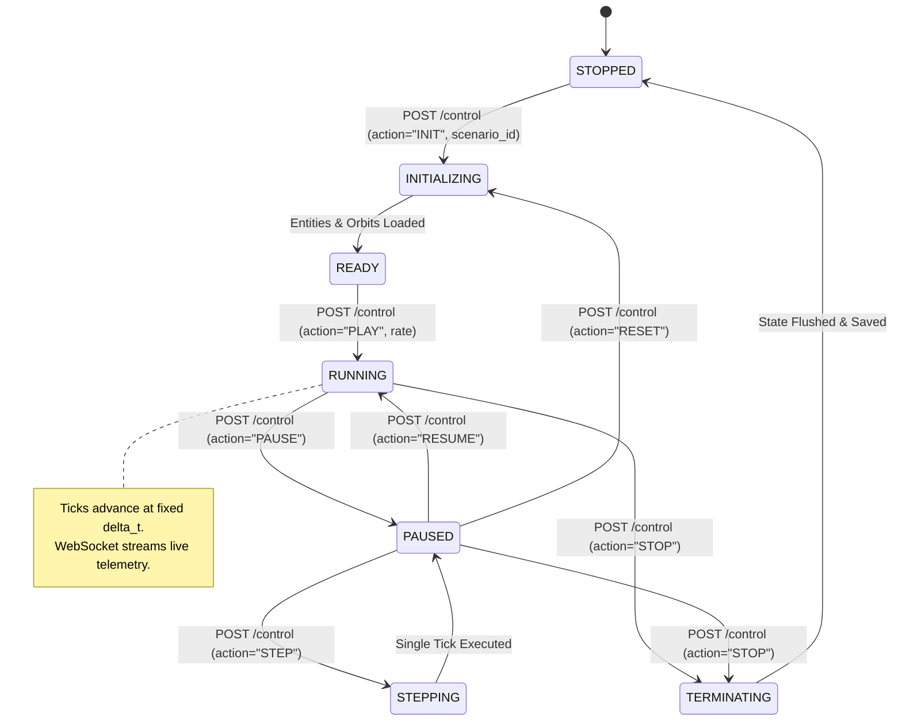
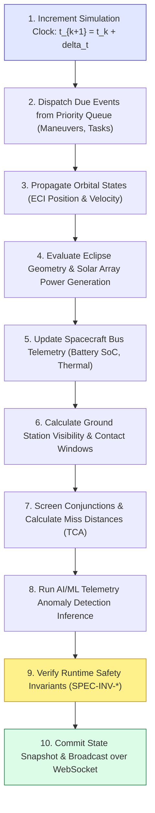

# 06 — OrbitOS Deterministic Simulation Engine Design

> **Document Status:** Baseline Approved  
> **Owner:** Lead Simulation Systems Architect & Real-Time Computing Engineer  
> **Target Path:** `docs/01-system-design/06-simulation-engine-design.md`  
> **Last Updated:** 2026-11-03  
> **Traceability Anchor:** `DOC-SIM-001`

---

## 1. Executive Summary & Purpose

This document specifies the technical design, lifecycle state machines, clock management, event scheduling, and update pipeline of the **OrbitOS Deterministic Simulation Engine**.

The engine is engineered to guarantee **100% deterministic, bitwise-reproducible simulation runs** across independent executions on standard developer laptops ([ADR-009](file:///home/kashifhm333/Desktop/Project/orbit/docs/ARCHITECTURE_DECISIONS.md#adr-009-deterministic-discrete-simulation-clock-with-seeded-pseudorandom-generators)). By strictly decoupling the virtual mission simulation clock ($t_{\text{sim}}$) from the host machine's wall-clock time, OrbitOS supports reproducible research experiments, educational grading, scenario rewinding, and variable-speed time acceleration ($1\times$ to $100\times$).

---

## 2. Simulation Lifecycle & Engine States

The simulation engine operates as a strictly governed finite state machine:



### State Definitions & Permitted Transitions

| Engine State | Description | Permitted Actions | Invariant |
| :--- | :--- | :--- | :--- |
| `STOPPED` | Engine is idle; no active scenario in memory. | `INIT` | No tick loop running. |
| `INITIALIZING` | Loading scenario parameters, satellite entities, and initial Keplerian elements from PostgreSQL. | Internal auto-transition to `READY` | Clock frozen at $t=t_0$. |
| `READY` | Scenario initialized and verified; ready to start. | `PLAY`, `STEP`, `RESET` | $t_{\text{sim}} = t_0$. |
| `RUNNING` | Active execution loop advancing simulation time by $\Delta t$ per cycle. | `PAUSE`, `STOP`, `SET_SPEED` | Clock monotonically increasing. |
| `PAUSED` | Execution loop halted; entity state frozen in memory. | `RESUME`, `STEP`, `RESET`, `STOP` | $t_{\text{sim}}$ static; queries allowed. |
| `STEPPING` | Transient state executing exactly one discrete tick ($\Delta t$). | Auto-transitions to `PAUSED` | Exactly 1 tick processed. |
| `TERMINATING` | Flushing buffered telemetry to database, closing WebSocket broadcasts. | Auto-transitions to `STOPPED` | Transactions committed. |

---

## 3. Clock Authority & Time Advancement

### 3.1 Time Decoupling Model
OrbitOS strictly separates host machine wall-clock time ($t_{\text{wall}}$) from virtual simulation time ($t_{\text{sim}}$):

$$\Delta t_{\text{sim}} = \Delta t_{\text{tick}} \quad (\text{e.g., } 1.0\text{ s})$$
$$t_{\text{sim}}(k + 1) = t_{\text{sim}}(k) + \Delta t_{\text{sim}}$$

The relationship between real-time loop execution delay ($\Delta \tau_{\text{sleep}}$) and simulation time acceleration factor ($k_{\text{accel}} \in [1, 100]$) is:

$$\Delta \tau_{\text{sleep}} = \frac{\Delta t_{\text{sim}}}{k_{\text{accel}}}$$

If the host CPU cannot complete a tick's computation within $\Delta \tau_{\text{sleep}}$, the engine does **not** drop simulation ticks. Instead, it completes the full tick calculation, preserving exact physical fidelity while temporarily throttling the effective playback multiplier.

### 3.2 Seeded Pseudorandom Determinism
All stochastic simulation events (e.g., sensor noise injection, communication link dropouts, space weather disturbances) must obtain random values exclusively from a centralized NumPy random generator:

```python
rng = np.random.default_rng(seed=scenario.random_seed)
```

No module is permitted to call Python's unseeded `random.random()` or `time.time()` for algorithmic logic.

---

## 4. Tick Execution Pipeline & Component Dispatch

Every simulation tick follows an immutable, ordered 10-stage execution pipeline:



### Stage Descriptions

1. **Clock Advance:** Increments $t_{\text{sim}}$ by $\Delta t$; validates monotonic time progression (`SPEC-INV-005`).
2. **Event Queue Dispatch:** Pops scheduled events whose timestamp $t_{\text{event}} \le t_{\text{sim}}$.
3. **Orbital Propagation:** Invokes Keplerian or RK4 propagation kernel for each active satellite (`FR-ORB-001`).
4. **Eclipse Calculation:** Checks cylindrical Earth shadow intersection to determine solar flux ($F_{\text{solar}} \in \{0, 1361\text{ W/m}^2\}$).
5. **Bus Dynamics:** Computes battery charging/discharging and updates subsystem status (`NOMINAL`, `DEGRADED`, etc.).
6. **Ground Station Passes:** Computes azimuth, elevation, and range; activates uplink/downlink buffers if $\theta_{\text{elev}} \ge \theta_{\text{mask}}$.
7. **Conjunction Screening:** Evaluates satellite pair distances; triggers alerts if $d_{\text{miss}} < d_{\text{threshold}}$.
8. **AI/ML Anomaly Detection:** Feeds current telemetry sliding window into Scikit-learn Isolation Forest model (`FR-AIML-001`).
9. **Invariant Verification:** Evaluates formal preconditions, postconditions, and invariants (`SPEC-INV-001` through `010`). If an invariant is violated, flags simulation alert and triggers safe mode.
10. **Persistence & Broadcast:** Writes snapshot to in-memory ring buffer (flushed asynchronously to PostgreSQL every $N$ ticks) and broadcasts JSON payload via WebSocket `/ws/telemetry`.

---

## 5. Event Scheduling Priority Queue

Scheduled events (maneuvers, payload commands, ground passes) are managed via a thread-safe Min-Heap Priority Queue keyed by execution timestamp:

$$\text{PriorityKey} = (\text{timestamp } t, \text{priority\_weight}, \text{event\_id})$$

```python
import heapq

class SimulationEventQueue:
    def __init__(self):
        self._queue = []
        
    def schedule(self, timestamp: float, priority: int, event_data: dict):
        heapq.heappush(self._queue, (timestamp, priority, event_data))
        
    def pop_due_events(self, current_time: float) -> list[dict]:
        due = []
        while self._queue and self._queue[0][0] <= current_time:
            due.append(heapq.heappop(self._queue)[2])
        return due
```

---

## 6. Performance Budget & Laptop Resource Boundaries

To satisfy `NFR-PERF-001` on a 4-core laptop:

| Pipeline Stage | Max Execution Budget (20 Satellites) | Optimization Strategy |
| :--- | :--- | :--- |
| Orbital Propagation | $< 12\text{ ms}$ | Vectorized NumPy array evaluation. |
| Bus Telemetry & Power | $< 5\text{ ms}$ | Vectorized arithmetic in Python. |
| Ground Station Geometry | $< 8\text{ ms}$ | Pre-filtered elevation screening. |
| Conjunction Screening | $< 10\text{ ms}$ | Bounding-sphere distance pre-filter before exact TCA root-finding. |
| AI/ML Inference | $< 8\text{ ms}$ | Scikit-learn CPU batch inference (`model.score_samples`). |
| Serialization & WS Dispatch | $< 5\text{ ms}$ | Pydantic v2 Rust serialization core. |
| **Total Tick Computation** | **$< 48\text{ ms}$** | **Satisfies 50 ms budget ($20\text{ Hz}$ throughput).** |

---

## 7. Acceptance Criteria & Reproducibility Verification

1. **Replay Invariance Test (`TC-SIM-003`):** Two consecutive simulation runs of a 10-satellite scenario initialized with the identical random seed must generate identical SHA-256 telemetry digest hashes over 1000 ticks:
   $$\text{Hash}(\text{Run}_A) \equiv \text{Hash}(\text{Run}_B)$$
2. **Clock Monotonicity (`SPEC-INV-005`):** Simulation time must satisfy $t_{k+1} > t_k$ strictly for all ticks while state is `RUNNING` or `STEPPING`.
3. **State Consistency on Reset:** Triggering `RESET` restores identical initial position, velocity, fuel mass, and battery charge vectors as defined at $t=t_0$.

---

## 8. Cross-Document References

- **System Architecture:** [04-system-architecture.md](file:///home/kashifhm333/Desktop/Project/orbit/docs/01-system-design/04-system-architecture.md)
- **Orbital Dynamics:** [05-orbital-mechanics-model.md](file:///home/kashifhm333/Desktop/Project/orbit/docs/01-system-design/05-orbital-mechanics-model.md)
- **Satellite Lifecycle:** [07-satellite-lifecycle-and-state-machines.md](file:///home/kashifhm333/Desktop/Project/orbit/docs/01-system-design/07-satellite-lifecycle-and-state-machines.md)
- **Conjunction Screening:** [08-collision-detection-and-risk-analysis.md](file:///home/kashifhm333/Desktop/Project/orbit/docs/02-intelligence-and-planning/08-collision-detection-and-risk-analysis.md)
- **Formal Verification:** [13-formal-specification-and-verification.md](file:///home/kashifhm333/Desktop/Project/orbit/docs/03-engineering-contracts/13-formal-specification-and-verification.md)

