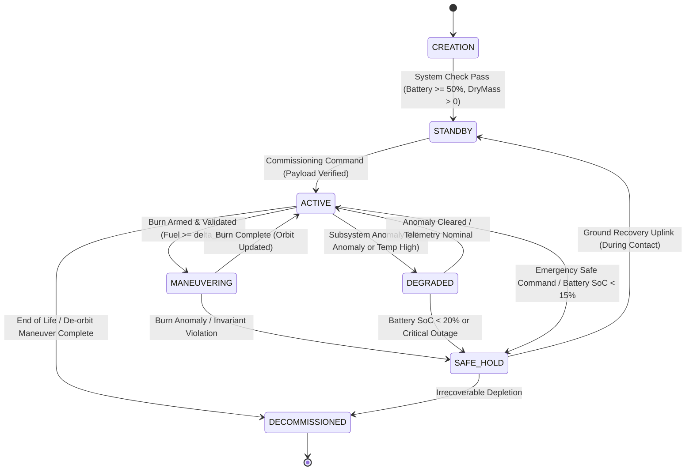
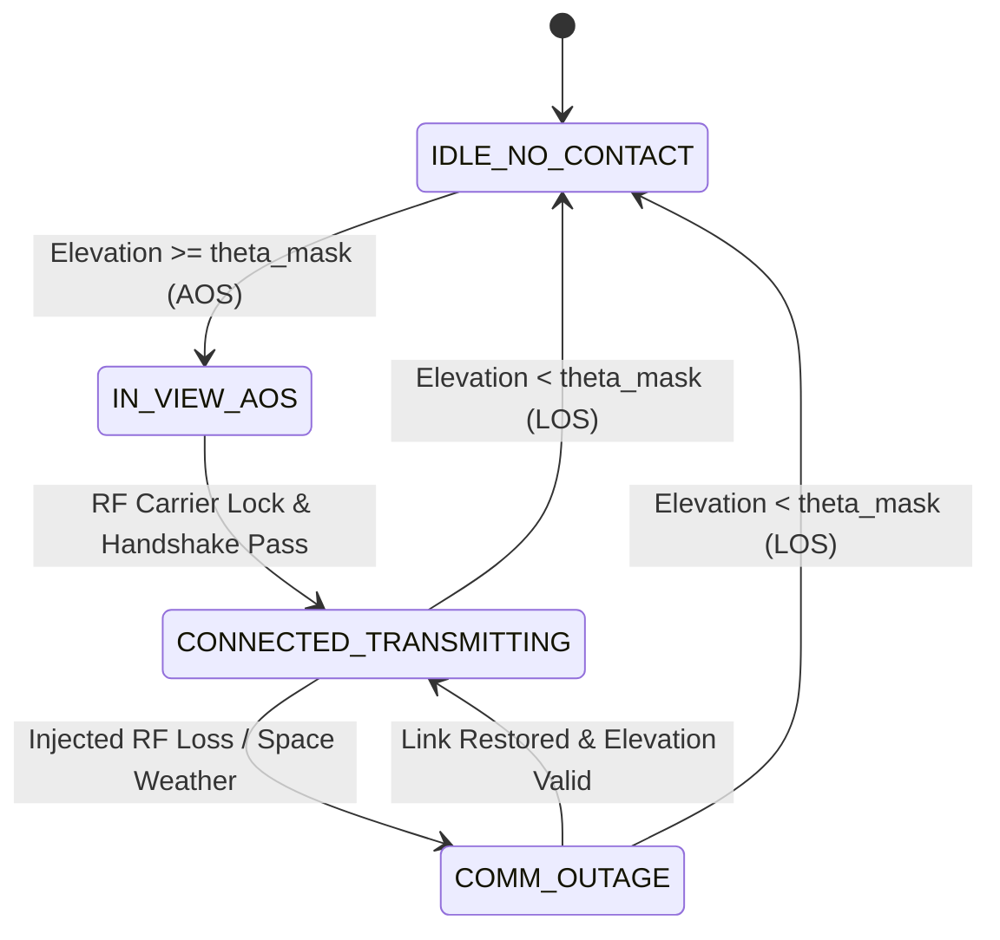
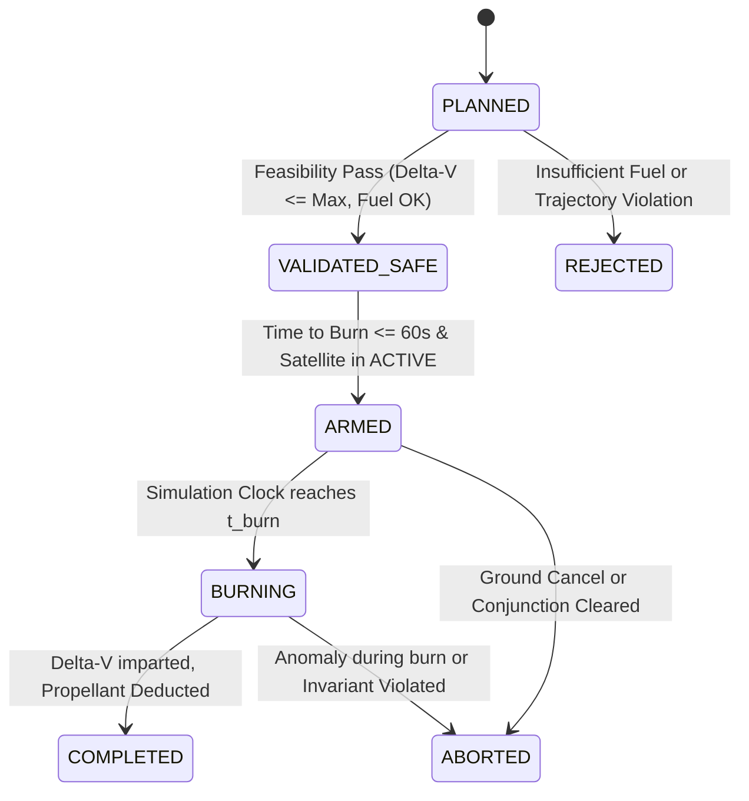
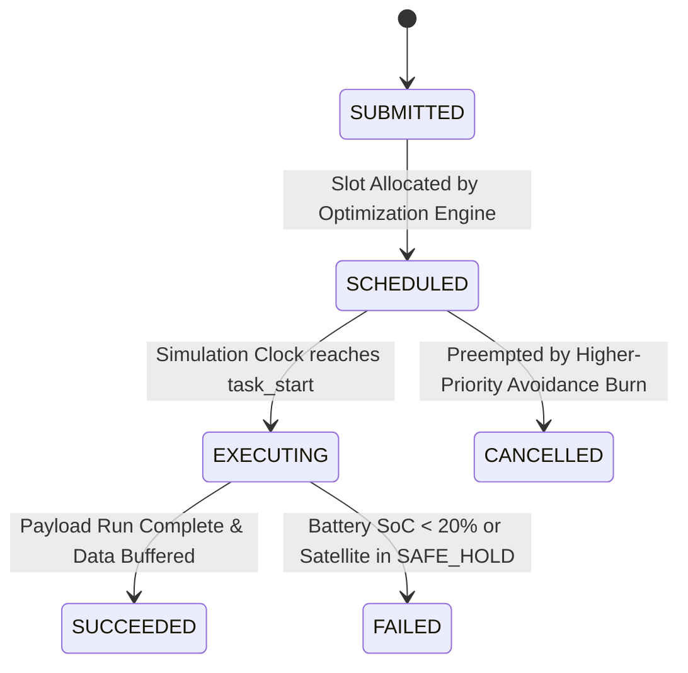

# 07 — OrbitOS Satellite Lifecycle and State Machines Specification

> **Document Status:** Baseline Approved  
> **Owner:** Spacecraft Systems Engineer & Formal Verification Specialist  
> **Target Path:** `docs/01-system-design/07-satellite-lifecycle-and-state-machines.md`  
> **Last Updated:** 2026-11-03  
> **Traceability Anchor:** `DOC-SAT-001`

---

## 1. Executive Summary & Purpose

This document formally specifies the operational lifecycle, finite state machines (FSM), subsystem dynamics, and state transition invariants governing virtual satellites in **OrbitOS**. 

Spacecraft operations require deterministic, predictable mode transitions to prevent catastrophic loss of spacecraft health (e.g., attempting a thruster burn while in power-deficit eclipse or transmitting data without an active ground contact). OrbitOS defines four orthogonal, synchronized state machines governing:
1. **Primary Spacecraft Operational Mode**
2. **Communication Link Status**
3. **Maneuver Execution Lifecycle**
4. **Mission Task Execution Status**

---

## 2. Primary Spacecraft Operational State Machine

### 2.1 State Transition Matrix

| Source State | Trigger / Event | Preconditions | Target State | Postconditions & Invariants |
| :--- | :--- | :--- | :--- | :--- |
| `CREATION` | `SYS_CHECK_PASS` | $m_{\text{dry}} > 0$, $m_f \ge 0$, $\text{SoC} \ge 50\%$ | `STANDBY` | `SPEC-INV-001` (Unique ID registered); Subsystems `NOMINAL`. |
| `STANDBY` | `COMMISSION_CMD` | Solar panels deployed; ADCS = `SUN_POINTING` | `ACTIVE` | Payload enabled; Telemetry publishing at nominal rate. |
| `ACTIVE` | `ARM_MANEUVER` | Maneuver status = `VALIDATED`; $m_f \ge \Delta m$; Not in eclipse | `MANEUVERING` | Payload disabled; ADCS = `THRUST_ALIGNED`; Thrusters warm. |
| `MANEUVERING` | `BURN_COMPLETE` | $\Delta \vec{v}$ applied; $m_f \ge 0$; Propellant deducted | `ACTIVE` | State vector updated; ADCS = `NADIR_POINTING`; Invariant `SPEC-INV-004`. |
| `MANEUVERING` | `MANEUVER_ABORT`| Incomplete $\Delta \vec{v}$ or thermal limit exceeded | `SAFE_HOLD` | Thrusters immediately closed; Safe attitude assumed. |
| `ACTIVE` | `ANOMALY_DETECTED`| ML anomaly score $> 0.85$ or subsystem status = `DEGRADED` | `DEGRADED` | Secondary non-critical payload tasks suspended. |
| `DEGRADED` | `ANOMALY_CLEARED` | Telemetry within 3-sigma normal baseline for $\ge 10$ ticks | `ACTIVE` | Full operational payload capabilities restored. |
| `ACTIVE` / `DEGRADED`| `CRITICAL_FAULT` | Battery SoC $< 15\%$ or total loss of attitude lock | `SAFE_HOLD` | Payloads powered off; ADCS = `SUN_POINTING`; Low-power radio. |
| `SAFE_HOLD` | `RECOVERY_CMD` | In active ground station contact; SoC $> 40\%$ | `STANDBY` | Subsystems re-verified before returning to active mode. |
| `ACTIVE` | `DECOMMISSION_CMD`| De-orbit burn executed or propellant exhausted | `DECOMMISSIONED`| Radio transmitters silenced; final orbit recorded; read-only. |

---

## 3. Orthogonal Subsystem State Machines

### 3.1 Communication Link Subsystem FSM

- **Invariants:**
  - `SPEC-INV-009`: Telemetry downlink and telecommand uplinks are strictly forbidden when state is `IDLE_NO_CONTACT` or `COMM_OUTAGE`.
  - Data transfer rate is forced to $0\text{ bps}$ whenever $\theta_{\text{elev}} < \theta_{\text{mask}}$.

---

### 3.2 Maneuver Execution Subsystem FSM

- **Invariants:**
  - `SPEC-PRE-002`: A maneuver cannot transition to `ARMED` unless required propellant $\Delta m \le m_f$.
  - `SPEC-POST-004`: Transition to `COMPLETED` requires new state vector energy $\mathcal{E}^+$ and momentum $\vec{h}^+$ to be mathematically consistent with imparted $\Delta \vec{v}$.

---

### 3.3 Mission Task Lifecycle FSM

---

## 4. Spacecraft Bus Subsystem Physical Models

### 4.1 Electrical Power Subsystem (EPS)
The battery state of charge ($\text{SoC} \in [0, 100]\%$) updates dynamically on every tick:

$$\text{SoC}(t + \Delta t) = \text{SoC}(t) + \frac{(P_{\text{solar}}(t) \cdot \eta_{\text{charge}} - P_{\text{load}}(t)) \cdot \Delta t}{C_{\text{battery}}} \times 100\%$$

Where:
- $C_{\text{battery}}$: Total battery energy capacity in Joules (default $1.08 \times 10^6\text{ J} = 300\text{ Wh}$).
- $\eta_{\text{charge}}$: Battery charging efficiency ($\eta = 0.90$).
- $P_{\text{solar}}$: Solar array generation:
  $$P_{\text{solar}} = \begin{cases} A_{\text{panel}} \cdot \Phi_{\text{solar}} \cdot \eta_{\text{panel}} \cdot \cos\theta_{\text{sun}}, & \text{if in sunlight} \\ 0, & \text{if in Earth shadow (eclipse)} \end{cases}$$
  (Solar flux $\Phi_{\text{solar}} = 1361\text{ W/m}^2$, $\eta_{\text{panel}} = 0.28$, $A_{\text{panel}} = 0.5\text{ m}^2$).
- $P_{\text{load}}$: Power consumed based on operational state:
  - `STANDBY`: $20\text{ W}$
  - `ACTIVE`: $45\text{ W}$ (Bus $20\text{ W}$ + Payload $25\text{ W}$)
  - `MANEUVERING`: $80\text{ W}$ (Bus $20\text{ W}$ + Thruster Valves/Heaters $60\text{ W}$)
  - `SAFE_HOLD`: $8\text{ W}$ (Minimal survival avionics)

---

### 4.2 Propulsion Subsystem Model
Maneuvers are modeled as impulsive $\Delta \vec{v}$ burns using the Tsiolkovsky equation:

$$\Delta m = m_{\text{wet}} \left(1 - \exp\left(-\frac{|\Delta \vec{v}|}{I_{\text{sp}} g_0}\right)\right)$$

Where $g_0 = 9.80665\text{ m/s}^2$ and $I_{\text{sp}} = 220\text{ s}$ (hydrazine monopropellant baseline).
The updated satellite masses post-burn are:
$$m_f(t^+) = m_f(t^-) - \Delta m$$
$$m_{\text{wet}}(t^+) = m_{\text{dry}} + m_f(t^+)$$

---

## 5. Formal Subsystem Invariants

| Invariant ID | Formal Property (Mathematical Form) | Enforcement Point | Violation Action |
| :--- | :--- | :--- | :--- |
| `SPEC-INV-001` | $\forall s \in \text{Satellites}, \quad s.m_{\text{dry}} > 0 \land s.\text{id} \neq \emptyset$ | Creation / REST | Rejection (HTTP 422) |
| `SPEC-INV-002` | $\forall s \in \text{Satellites}, \quad s.\text{state} \in \text{ValidStates}$ | State Transitions | Exception / Abort |
| `SPEC-INV-003` | $\forall s \in \text{Satellites}, \quad 0 \le s.\text{SoC} \le 100$ | Every Tick | Numerical Clamping & Alert |
| `SPEC-INV-004` | $\forall s \in \text{Satellites}, \quad s.m_f \ge 0$ | Maneuver Burn | Burn Abort & Flag Alert |
| `SPEC-INV-009` | $\forall s, g: \text{DownlinkActive}(s, g) \implies \theta_{\text{elev}}(s, g) \ge \theta_{\text{mask}}$ | Every Tick | Immediate Disconnect |

---

## 6. Acceptance Criteria & State Machine Validation

1. **State Preservation Test (`TC-SAT-005`):** Unit tests must attempt all 36 possible state transitions in the primary FSM matrix; only the 10 valid transitions must succeed, and all 26 invalid transitions must raise an explicit `InvalidStateTransitionException`.
2. **Battery SoC Bounding Test (`TC-SAT-003`):** 1000 simulated ticks in continuous eclipse must cause battery SoC to approach, but never drop below $0.0\%$, successfully triggering `SAFE_HOLD` at $15\%$.
3. **Propellant Exhaustion Test (`TC-SAT-004`):** An authorized maneuver requiring $\Delta m > m_f$ must be rejected before execution with an `InsufficientPropellantException`.

---

## 7. Cross-Document References

- **Requirements:** [02-requirements-specification.md](file:///home/kashifhm333/Desktop/Project/orbit/docs/00-project-foundation/02-requirements-specification.md) (`FR-SAT-001` through `005`)
- **System Architecture:** [04-system-architecture.md](file:///home/kashifhm333/Desktop/Project/orbit/docs/01-system-design/04-system-architecture.md)
- **Simulation Engine:** [06-simulation-engine-design.md](file:///home/kashifhm333/Desktop/Project/orbit/docs/01-system-design/06-simulation-engine-design.md)
- **Maneuver Planning:** [09-autonomous-maneuver-planning.md](file:///home/kashifhm333/Desktop/Project/orbit/docs/02-intelligence-and-planning/09-autonomous-maneuver-planning.md)
- **Formal Verification:** [13-formal-specification-and-verification.md](file:///home/kashifhm333/Desktop/Project/orbit/docs/03-engineering-contracts/13-formal-specification-and-verification.md)

