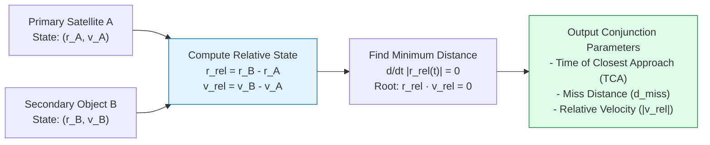
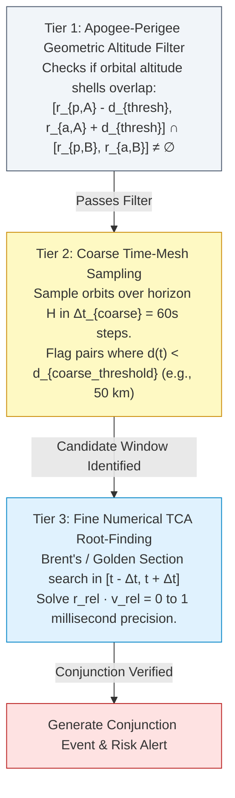

# 08 — OrbitOS Collision Detection and Conjunction Risk Analysis

> **Document Status:** Baseline Approved  
> **Owner:** Space Situational Awareness (SSA) Algorithm Engineer  
> **Target Path:** `docs/02-intelligence-and-planning/08-collision-detection-and-risk-analysis.md`  
> **Last Updated:** 2026-11-03  
> **Traceability Anchor:** `DOC-COL-001`

---

## 1. Executive Summary & Purpose

This document specifies the algorithmic architecture, mathematical formulations, screening pipelines, and risk classification tiers of the **OrbitOS Conjunction Detection & Risk Analysis Subsystem**.

In orbital flight operations, a conjunction is defined as a close physical encounter between two resident space objects (satellites or orbital debris). OrbitOS provides an automated, reproducible screening module that monitors all active virtual satellites against simulated secondary objects across a configurable lookahead horizon ($H \in [1, 72]\text{ hours}$).

---

> [!CAUTION]
> **SIMULATION-ONLY CONJUNCTION DISCLAIMER**  
> OrbitOS conjunction screening is strictly an educational tool. It utilizes simplified two-body orbital dynamics and geometric miss-distance thresholds. It does **not** ingest real-world tracking covariances, space surveillance network sensor errors, or atmospheric drag stochasticity. It must **never** be used for real-world space traffic management or collision avoidance.

---

## 2. Mathematical Formulation & Coordinate Conventions

All calculations are evaluated in the Earth-Centered Inertial (ECI J2000) frame:

### 2.1 Relative State Vectors
For a candidate pair consisting of Primary Satellite $A$ and Secondary Object $B$:
$$\vec{r}_{\text{rel}}(t) = \vec{r}_B(t) - \vec{r}_A(t)$$
$$\vec{v}_{\text{rel}}(t) = \vec{v}_B(t) - \vec{v}_A(t)$$

The instantaneous separation distance $d(t)$ is the Euclidean norm:
$$d(t) = |\vec{r}_{\text{rel}}(t)| = \sqrt{\vec{r}_{\text{rel}}(t) \cdot \vec{r}_{\text{rel}}(t)}$$

### 2.2 Time of Closest Approach (TCA) Condition
The Time of Closest Approach ($t_{\text{TCA}}$) occurs when the derivative of squared distance with respect to time vanishes:
$$\frac{d}{dt}\left(d^2(t)\right) = 2 \, \vec{r}_{\text{rel}}(t) \cdot \vec{v}_{\text{rel}}(t) = 0$$

At $t = t_{\text{TCA}}$:
$$\vec{r}_{\text{rel}}(t_{\text{TCA}}) \cdot \vec{v}_{\text{rel}}(t_{\text{TCA}}) = 0 \quad \text{and} \quad \frac{d^2}{dt^2}\left(d^2(t)\right) > 0$$

The geometric **Miss Distance** is:
$$d_{\text{miss}} = d(t_{\text{TCA}}) = |\vec{r}_{\text{rel}}(t_{\text{TCA}})|$$

---

## 3. Screening Pipeline & Computational Optimization

To evaluate $N$ satellites against $M$ secondary debris objects without incurring prohibitive $O(N \times M)$ numerical propagation costs on a laptop, OrbitOS employs a 3-tier hierarchical screening filter:

### 3.1 Tier 1: Apogee-Perigee Altitude Sieve
Let perigee and apogee radii be $r_p = a(1 - e)$ and $r_a = a(1 + e)$. Two orbits can only intersect or have a close approach within distance threshold $d_{\text{thresh}}$ if their radial envelopes overlap:
$$\max(r_{p,A}, r_{p,B}) - d_{\text{thresh}} \le \min(r_{a,A}, r_{a,B}) + d_{\text{thresh}}$$
If this inequality is not satisfied, the pair is discarded immediately in $O(1)$ arithmetic operations without numerical orbit propagation.

### 3.2 Tier 2: Coarse Time-Mesh Screening
Pairs passing Tier 1 are propagated at coarse time steps ($\Delta t_{\text{coarse}} = 60.0\text{ s}$) over the lookahead horizon (default $H = 24\text{ hours} = 1440\text{ steps}$). If any step detects:
$$d(t) \le d_{\text{filter}} \quad (d_{\text{filter}} = 50.0\text{ km})$$
a candidate encounter window $[t - \Delta t_{\text{coarse}}, t + \Delta t_{\text{coarse}}]$ is recorded.

### 3.3 Tier 3: Fine Root-Finding Minimization
Within the candidate window, OrbitOS applies Brent's 1D root-finding method on the scalar function $g(t) = \vec{r}_{\text{rel}}(t) \cdot \vec{v}_{\text{rel}}(t)$. The root $t_{\text{TCA}}$ is located with convergence tolerance:
$$|g(t_{\text{TCA}})| \le 10^{-4}\text{ m}^2/\text{s} \quad \implies |t - t_{\text{TCA}}| < 0.001\text{ s}$$

---

## 4. Risk Classification Tiers & Action Thresholds

OrbitOS classifies conjunctions into four standardized operational tiers based on geometric miss distance:

| Risk Category | Miss Distance Range ($d_{\text{miss}}$) | System Response | Autonomous Recommendation |
| :--- | :--- | :--- | :--- |
| `INFO` | $d_{\text{miss}} \ge 10.0\text{ km}$ | Log event to audit history; no active alerts. | `NO_ACTION` |
| `WATCH` | $5.0\text{ km} \le d_{\text{miss}} < 10.0\text{ km}$ | Publish advisory notification on frontend dashboard. | `MONITOR_TRACK` |
| `WARNING` | $1.0\text{ km} \le d_{\text{miss}} < 5.0\text{ km}$ | Trigger orange UI alert; calculate candidate maneuver plans. | `PLAN_AVOIDANCE` |
| `CRITICAL` | $d_{\text{miss}} < 1.0\text{ km}$ | Trigger red emergency alert; auto-stage evasion burn candidate. | `EXECUTE_AVOIDANCE` |

### Geometric vs. Covariance-Based Probability ($P_c$)
> [!NOTE]
> In real-world operational space safety (e.g., NASA CARA), collision probability $P_c$ requires 3D Gaussian position covariance matrices ($\mathbf{C}_A, \mathbf{C}_B$) integrated over the combined hard-body collision cross-section on the B-plane (encounter plane). Because covariance estimation requires sensor error modeling that is outside the Core MVP scope, OrbitOS uses deterministic geometric miss distance as its primary baseline and explicitly marks $P_c$ integration as an advanced research extension ([ADR-002](file:///home/kashifhm333/Desktop/Project/orbit/docs/ARCHITECTURE_DECISIONS.md#adr-002-simplified-two-body-dynamics-with-keplerian-orbit-propagation-for-mvp)).

---

## 5. Worked Synthetic Conjunction Example

Consider two synthetic Low Earth Orbit objects:
- **Satellite A (Primary):** $a_A = 6878.137\text{ km}$ (altitude $500\text{ km}$), $e_A = 0.001$, $i_A = 97.4^\circ$.
- **Object B (Debris):** $a_B = 6879.000\text{ km}$ (altitude $500.86\text{ km}$), $e_B = 0.002$, $i_B = 97.4^\circ$, $\Omega_B = \Omega_A + 0.05^\circ$.

### Calculated Encounter Parameters:
- **Time to TCA:** $\Delta t_{\text{TCA}} = 14320.45\text{ s}$ ($\approx 3.97\text{ hours}$ from epoch).
- **Relative Position Vector at TCA:** $\vec{r}_{\text{rel}} = [312.4, -450.2, 120.8]\text{ m}$ in ECI J2000.
- **Miss Distance:** $d_{\text{miss}} = \sqrt{312.4^2 + (-450.2)^2 + 120.8^2} = 561.3\text{ m}$.
- **Relative Velocity at TCA:** $|\vec{v}_{\text{rel}}| = 14210.5\text{ m/s}$ (hyperbolic crossing angle).
- **Assigned Risk Classification:** **`CRITICAL`** ($d_{\text{miss}} < 1000\text{ m}$).
- **Triggered Pipeline Action:** Dispatches event to Autonomous Maneuver Planner ([09-autonomous-maneuver-planning.md](file:///home/kashifhm333/Desktop/Project/orbit/docs/02-intelligence-and-planning/09-autonomous-maneuver-planning.md)).

---

## 6. Verification Test Scenarios & Acceptance Criteria

| Test Identifier | Test Scenario Description | Expected Outcome |
| :--- | :--- | :--- |
| **TC-COL-001** | Co-planar distant orbits ($a_A = 6878\text{ km}$, $a_B = 7500\text{ km}$) | Tier 1 altitude filter rejects pair in $0\text{ ms}$; zero false positives. |
| **TC-COL-002** | Synthetic head-on collision scenario ($d_{\text{miss}} \approx 200\text{ m}$) | Correctly identifies TCA within $0.1\text{ s}$; assigns `CRITICAL` risk tier. |
| **TC-COL-003** | Parallel co-orbiting cluster ($10\text{ km}$ constant separation) | Flags `WATCH` tier continuously without re-triggering duplicate alert records. |
| **TC-COL-004** | 20 satellites screened over 24-hour horizon | Complete screening pipeline executes in $< 100\text{ ms}$ on laptop CPU. |

---

## 7. Cross-Document References

- **Requirements:** [02-requirements-specification.md](file:///home/kashifhm333/Desktop/Project/orbit/docs/00-project-foundation/02-requirements-specification.md) (`FR-COL-001`, `002`)
- **Orbital Mechanics:** [05-orbital-mechanics-model.md](file:///home/kashifhm333/Desktop/Project/orbit/docs/01-system-design/05-orbital-mechanics-model.md)
- **Simulation Engine:** [06-simulation-engine-design.md](file:///home/kashifhm333/Desktop/Project/orbit/docs/01-system-design/06-simulation-engine-design.md)
- **Maneuver Planning:** [09-autonomous-maneuver-planning.md](file:///home/kashifhm333/Desktop/Project/orbit/docs/02-intelligence-and-planning/09-autonomous-maneuver-planning.md)
- **Database Contracts:** [14-database-and-api-contracts.md](file:///home/kashifhm333/Desktop/Project/orbit/docs/03-engineering-contracts/14-database-and-api-contracts.md)

