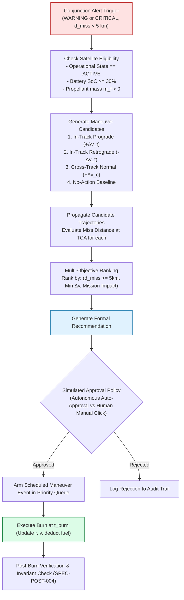
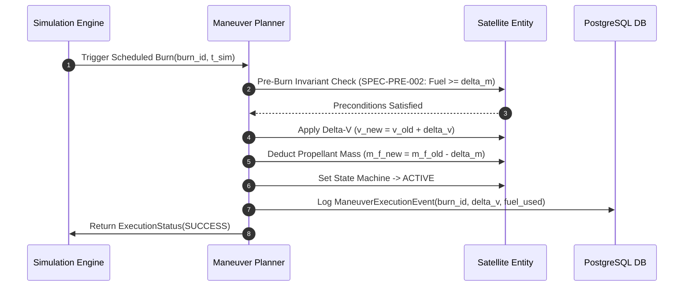

# 09 — OrbitOS Autonomous Maneuver Planning Specification

> **Document Status:** Baseline Approved  
> **Owner:** Flight Dynamics & Autonomous Planning Systems Engineer  
> **Target Path:** `docs/02-intelligence-and-planning/09-autonomous-maneuver-planning.md`  
> **Last Updated:** 2026-11-03  
> **Traceability Anchor:** `DOC-MAN-001`

---

## 1. Executive Summary & Purpose

This document specifies the algorithmic architecture, delta-v ($\Delta v$) optimization algorithms, candidate generation strategies, and execution guardrails for the **OrbitOS Autonomous Maneuver Planning Subsystem**.

When the Conjunction Analysis module flags an impending collision threat (`WARNING` or `CRITICAL` risk), the Autonomous Maneuver Planner evaluates candidate orbital adjustments to ensure safe separation ($d_{\text{miss}} \ge 5.0\text{ km}$) while strictly minimizing propellant consumption and preserving spacecraft lifetime.

---

> [!CAUTION]
> **SIMULATION-ONLY MANEUVER DISCLAIMER**  
> OrbitOS maneuver planning executes exclusively within simulated software environments. It possesses **zero** authority over physical spacecraft thrusters, attitude control gyroscopes, or propellant valves. All maneuver commands are simulated mathematical state vector modifications stored in PostgreSQL.

---

## 2. Maneuver Planning Workflow

---

## 3. Mathematical Maneuver Dynamics & Candidate Strategies

### 3.1 Local Vertical, Local Horizontal (LVLH) Thrust Frame
Maneuver velocity increments $\Delta \vec{v}$ are formulated in the satellite-centered orbital frame (LVLH):
- **Radial ($\hat{r}$):** Unit vector pointing from Earth center to satellite: $\hat{r} = \frac{\vec{r}}{|\vec{r}|}$.
- **In-Track / Transverse ($\hat{t}$):** Unit vector in the orbital plane along the direction of motion: $\hat{t} = \hat{c} \times \hat{r}$.
- **Cross-Track / Normal ($\hat{c}$):** Unit vector perpendicular to orbital plane: $\hat{c} = \frac{\vec{r} \times \vec{v}}{|\vec{r} \times \vec{v}|}$.

$$\Delta \vec{v}_{\text{LVLH}} = \Delta v_r \, \hat{r} + \Delta v_t \, \hat{t} + \Delta v_c \, \hat{c}$$

### 3.2 Candidate Evasion Strategies

1. **In-Track Prograde Evasion ($+\Delta v_t \, \hat{t}$):**
   - Applies positive velocity increment along velocity vector.
   - Increases semi-major axis: $a^+ = a + \Delta a$.
   - Increases orbital period: $T^+ = 2\pi\sqrt{(a^+)^3/\mu} > T$.
   - Causes the satellite to decelerate in mean anomaly rate, arriving **later** at the junction point.
   - *Advantage:* Highly propellant-efficient; maximum miss-distance leverage per $\text{m/s}$ when executed $\ge 1$ orbit prior to TCA.

2. **In-Track Retrograde Evasion ($-\Delta v_t \, \hat{t}$):**
   - Decreases semi-major axis: $a^+ = a - \Delta a$.
   - Decreases orbital period: $T^+ < T$.
   - Causes the satellite to arrive **earlier** at the junction point.
   - *Advantage:* Efficient; useful when orbital altitude ceiling constraints prevent raising perigee.

3. **Cross-Track Out-of-Plane Evasion ($\pm \Delta v_c \, \hat{c}$):**
   - Modifies orbital inclination ($i$) and ascending node ($\Omega$).
   - Creates lateral displacement at encounter node.
   - *Drawback:* Expensive propellant cost ($\Delta v \approx 2 v \sin(\Delta i / 2)$); used only when in-track timing cannot resolve geometry.

4. **`NO_ACTION` Baseline:**
   - Evaluates trajectory if no burn is performed.
   - Mandatory reference baseline for trade-off evaluation.

---

## 4. Delta-V Optimization & Propellant Budgeting

The planner solves a constrained scalar optimization problem for in-track impulse $\Delta v_t$:

$$\min |\Delta v_t| \quad \text{subject to:}$$
1. $d_{\text{miss}}(t_{\text{TCA}}, \Delta v_t) \ge d_{\text{safe}} = 5000\text{ m}$
2. $\Delta m(\Delta v_t) \le m_f - m_{f,\text{reserve}}$ (where $m_{f,\text{reserve}} = 0.5\text{ kg}$)
3. $t_{\text{burn}} \le t_{\text{TCA}} - 1800\text{ s}$ (Burn must complete at least 30 minutes before TCA)

### Propellant Mass Consumption
Using the Tsiolkovsky rocket equation:
$$\Delta m = m_{\text{wet}} \left(1 - \exp\left(-\frac{|\Delta \vec{v}|}{I_{\text{sp}} g_0}\right)\right)$$
Where $I_{\text{sp}} = 220\text{ s}$ and $g_0 = 9.80665\text{ m/s}^2$.

---

## 5. Candidate Ranking & Decision Engine

Candidate maneuvers are scored using a normalized utility function:

$$\mathcal{U} = w_1 \cdot \min\left(1.0, \frac{d_{\text{miss}}}{d_{\text{safe}}}\right) - w_2 \cdot \frac{|\Delta \vec{v}|}{\Delta v_{\text{max}}} - w_3 \cdot \mathcal{C}_{\text{mission}}$$

Where weights $w_1 = 0.60$ (Safety Margin), $w_2 = 0.30$ (Propellant Efficiency), and $w_3 = 0.10$ (Payload Disruption).

### Simulated Approval Policy Modes
- **Policy 1: Human-in-the-Loop (`MANUAL_APPROVAL`):** The system generates and ranks candidates, displaying the top recommendation on the frontend dashboard. Execution requires an authenticated user button click (`POST /api/v1/maneuvers/{id}/approve`).
- **Policy 2: Autonomous Execution (`AUTONOMOUS_AUTO_APPROVE`):** If time-to-TCA is $< 2\text{ hours}$ and the top candidate satisfies all safety invariants, the decision engine automatically transitions the maneuver to `ARMED` and logs an autonomous action record.

---

## 6. Maneuver Execution & State Verification

---

## 7. Acceptance Criteria & Test Cases

| Test Identifier | Test Scenario | Acceptance Criteria |
| :--- | :--- | :--- |
| **TC-MAN-001** | Impending conjunction with $d_{\text{miss}} = 400\text{ m}$ | Planner generates $\ge 2$ feasible candidates achieving $d_{\text{miss}} \ge 5.0\text{ km}$. |
| **TC-MAN-002** | Propellant Exhaustion Boundary | Maneuver requiring $1.5\text{ kg}$ on satellite with $1.0\text{ kg}$ fuel is rejected with `SPEC-PRE-002` error. |
| **TC-MAN-003** | Eclipse Burn Invalidation | Candidate burn scheduled during Earth shadow is rejected or rescheduled for post-eclipse sunlight. |
| **TC-MAN-004** | Post-Burn Trajectory Verification | Post-burn orbital energy and period match theoretical analytical values within $10^{-6}$ relative error. |

---

## 8. Cross-Document References

- **Requirements:** [02-requirements-specification.md](file:///home/kashifhm333/Desktop/Project/orbit/docs/00-project-foundation/02-requirements-specification.md) (`FR-MAN-001`, `002`, `003`)
- **Orbital Mechanics:** [05-orbital-mechanics-model.md](file:///home/kashifhm333/Desktop/Project/orbit/docs/01-system-design/05-orbital-mechanics-model.md)
- **Satellite Lifecycle:** [07-satellite-lifecycle-and-state-machines.md](file:///home/kashifhm333/Desktop/Project/orbit/docs/01-system-design/07-satellite-lifecycle-and-state-machines.md)
- **Collision Detection:** [08-collision-detection-and-risk-analysis.md](file:///home/kashifhm333/Desktop/Project/orbit/docs/02-intelligence-and-planning/08-collision-detection-and-risk-analysis.md)
- **Formal Verification:** [13-formal-specification-and-verification.md](file:///home/kashifhm333/Desktop/Project/orbit/docs/03-engineering-contracts/13-formal-specification-and-verification.md)

