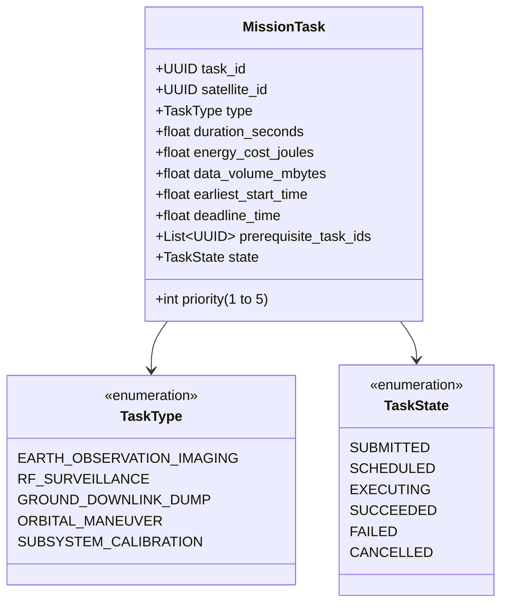
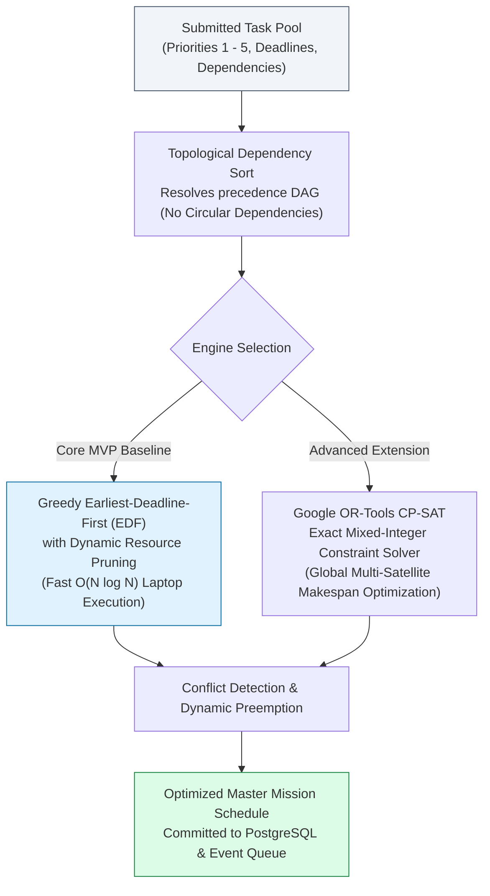
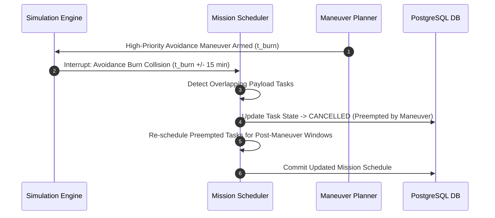

# 10 — OrbitOS Mission Planning and Optimization Specification

> **Document Status:** Baseline Approved  
> **Owner:** Autonomous Systems & Mission Operations Architect  
> **Target Path:** `docs/02-intelligence-and-planning/10-mission-planning-and-optimization.md`  
> **Last Updated:** 2026-11-03  
> **Traceability Anchor:** `DOC-MIS-001`

---

## 1. Executive Summary & Purpose

This document specifies the data models, constraint formulations, scheduling heuristics, and conflict-resolution algorithms of the **OrbitOS Mission Planning and Optimization Subsystem**.

The Mission Planner coordinates constellation-level activities (Earth observation imagery, RF payload tracking, ground station data downlinks, and orbital station-keeping) across virtual satellites. It ensures that mission objectives are fulfilled efficiently without violating spacecraft subsystem constraints (battery depth-of-discharge, onboard data buffer limits, thermal envelopes, and maneuver commitments).

---

## 2. Mission Task Model & Constraint Formulation



### 2.1 Mathematical Constraint Formulation

Let $\mathcal{T} = \{\tau_1, \tau_2, \dots, \tau_N\}$ be the set of submitted mission tasks. For each task $\tau_i$, the planner assigns a scheduled start time $s_i \in \mathbb{R}^+$:

1. **Time Window Constraint:**
   $$t_{\text{earliest}, i} \le s_i \le t_{\text{deadline}, i} - d_i$$
   where $d_i$ is the task duration in seconds.

2. **No-Overlap Mutual Exclusion Constraint (Per Satellite):**
   For any two tasks $\tau_i, \tau_j$ assigned to the same satellite requiring mutually exclusive subsystem resources (e.g., optical payload and laser communication terminal):
   $$(s_i + d_i \le s_j) \quad \lor \quad (s_j + d_j \le s_i)$$

3. **Prerequisite Dependency Constraint:**
   If task $\tau_j$ depends on task $\tau_i$ ($\tau_i \prec \tau_j$):
   $$s_j \ge s_i + d_i$$

4. **Energy Balance & Battery Depth-of-Discharge Invariant:**
   At all points along the mission timeline $t \in [s_i, s_i + d_i]$:
   $$\text{SoC}_s(t) \ge \text{SoC}_{\text{min}} \quad (\text{SoC}_{\text{min}} = 25.0\%)$$

5. **Solid-State Data Recorder Capacity Constraint:**
   Let $B(t)$ be the onboard data buffer in Megabytes ($B_{\text{max}} = 10000\text{ MB}$):
   $$0 \le B(t) + \Delta B_{\tau_i} \le B_{\text{max}}$$

---

## 3. Scheduling Architecture & Optimization Algorithms

OrbitOS implements a two-tier scheduling engine:



### 3.1 Core MVP: Priority-Weighted Greedy EDF Algorithm
The baseline scheduler sorts tasks using a composite ranking score:
$$\mathcal{R}(\tau_i) = w_p \cdot \text{priority}_i - w_d \cdot \left(\frac{t_{\text{deadline}, i} - t_{\text{current}}}{H}\right)$$

Algorithm Execution Steps:
1. Construct Directed Acyclic Graph (DAG) of task dependencies; verify cycle-freedom.
2. Order tasks by descending ranking score $\mathcal{R}(\tau_i)$.
3. For each candidate task, locate the earliest available continuous time interval $[t_{\text{start}}, t_{\text{start}} + d_i]$ satisfying all satellite subsystem constraints (battery SoC, ground station visibility if downlink task, and maneuver blackout windows).
4. If a conflict occurs with a lower-priority task ($\text{priority}_{\text{conflict}} < \text{priority}_i$), the lower-priority task is preempted and returned to the scheduling queue.
5. If no valid window exists before $t_{\text{deadline}}$, mark task as `UNSCHEDULED_REJECTED` and log human-readable diagnostic rationale.

### 3.2 Advanced Phase: Constraint Programming (CP-SAT)
For multi-satellite constellations with $> 50$ overlapping tasks, the solver minimizes schedule makespan while maximizing priority-weighted value:
$$\max \sum_{i=1}^N \text{priority}_i \cdot x_i - \lambda \cdot \max_{i} (s_i + d_i)$$
where $x_i \in \{0, 1\}$ indicates whether task $\tau_i$ is scheduled, and $\lambda$ is a makespan penalty factor.

---

## 4. Conflict Resolution & Maneuver Preemption

Autonomous collision avoidance maneuvers (`Priority 5 — CRITICAL`) possess absolute preemption authority over all payload activities:



---

## 5. Explainable Scheduling Diagnostic Logs

To facilitate student learning and research auditing, every scheduling decision produces an explainable diagnostic payload:

```json
{
  "task_id": "7c9e6679-7425-40de-944b-e07fc1f90ae7",
  "satellite_id": "SAT-001",
  "scheduled_start": "2026-11-04T14:22:00Z",
  "duration_seconds": 600.0,
  "status": "SCHEDULED",
  "decision_rationale": {
    "algorithm": "Greedy-EDF-v1",
    "priority_rank": 4,
    "candidate_window_evaluated": "2026-11-04T14:15:00Z to 2026-11-04T15:00:00Z",
    "constraints_verified": {
      "battery_soc_margin": "+42.5% (Nominal)",
      "ground_contact_required": false,
      "maneuver_blackout_conflict": false
    },
    "preempted_tasks": []
  }
}
```

---

## 6. Acceptance Criteria & Test Cases

| Test Identifier | Scenario Description | Expected Outcome |
| :--- | :--- | :--- |
| **TC-MIS-001** | Circular Task Dependency ($A \to B \to C \to A$) | Topological sort detects cycle; rejects submission with HTTP 422 error. |
| **TC-MIS-002** | Battery Depletion Rejection | Task demanding $500\text{ Wh}$ on satellite with $200\text{ Wh}$ battery is rejected with clear power deficiency message. |
| **TC-MIS-003** | Priority Avoidance Preemption | Scheduled imaging task overlapping with emergency avoidance burn is cleanly preempted and rescheduled. |
| **TC-MIS-004** | Ground Downlink Contact Binding | Ground station downlink task is strictly scheduled within computed contact window $[t_{\text{AOS}}, t_{\text{LOS}}]$. |

---

## 7. Cross-Document References

- **Requirements:** [02-requirements-specification.md](file:///home/kashifhm333/Desktop/Project/orbit/docs/00-project-foundation/02-requirements-specification.md) (`FR-MIS-001`, `002`)
- **Simulation Engine:** [06-simulation-engine-design.md](file:///home/kashifhm333/Desktop/Project/orbit/docs/01-system-design/06-simulation-engine-design.md)
- **Maneuver Planning:** [09-autonomous-maneuver-planning.md](file:///home/kashifhm333/Desktop/Project/orbit/docs/02-intelligence-and-planning/09-autonomous-maneuver-planning.md)
- **Ground Stations:** [11-ground-station-and-communications.md](file:///home/kashifhm333/Desktop/Project/orbit/docs/02-intelligence-and-planning/11-ground-station-and-communications.md)
- **Database Contracts:** [14-database-and-api-contracts.md](file:///home/kashifhm333/Desktop/Project/orbit/docs/03-engineering-contracts/14-database-and-api-contracts.md)

