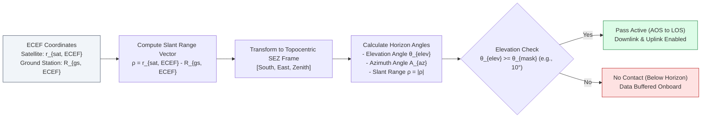
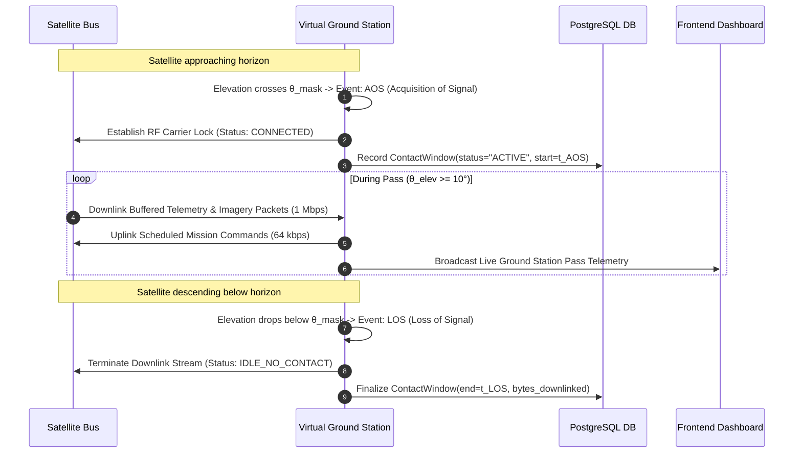

# 11 — OrbitOS Ground Station and Communications Specification

> **Document Status:** Baseline Approved  
> **Owner:** Communications Systems & Ground Segment Engineer  
> **Target Path:** `docs/02-intelligence-and-planning/11-ground-station-and-communications.md`  
> **Last Updated:** 2026-11-03  
> **Traceability Anchor:** `DOC-GND-001`

---

## 1. Executive Summary & Purpose

This document specifies the mathematical geometry, tracking visibility algorithms, contact window generation, and simulated RF communications architecture for the **OrbitOS Ground Station and Communications Subsystem**.

In real space missions, Low Earth Orbit (LEO) satellites cannot communicate continuously with mission control; contact occurs only when the spacecraft passes within direct line-of-sight of an Earth-based ground station antenna. OrbitOS accurately models these geometric passes, transmission latencies, data buffer downlinks, and simulated atmospheric/space-weather link outages.

---

> [!CAUTION]
> **SIMULATION-ONLY RADIO FREQUENCY BOUNDARY**  
> OrbitOS simulates communications strictly in software data structures and PostgreSQL queues. It does **not** interface with real Software Defined Radios (SDR), physical tracking dishes, Yagi antennas, or physical radio transmitters. No real RF radiation is produced.

---

## 2. Ground Station Geodesy & Topocentric Horizon Frame

### 2.1 Ground Station Geodetic Position (WGS84)
Each virtual ground station $G$ is configured by geodetic latitude $\phi$, longitude $\lambda$, and height $h$ above the reference ellipsoid. Its ECEF position $\vec{R}_{\text{gs}} = [X, Y, Z]^T$ is:

$$X = (N(\phi) + h) \cos\phi \cos\lambda$$
$$Y = (N(\phi) + h) \cos\phi \sin\lambda$$
$$Z = \left(N(\phi)(1 - e^2) + h\right) \sin\phi$$

Where $N(\phi) = \frac{R_{\text{Earth}}}{\sqrt{1 - e^2 \sin^2\phi}}$ is prime vertical radius of curvature ($R_{\text{Earth}} = 6378137.0\text{ m}$, $e^2 = 0.00669437999014$).

### 2.2 South-East-Zenith (SEZ) Horizon Frame Transformation
The topocentric slant range vector $\vec{\rho} = \vec{r}_{\text{sat, ECEF}} - \vec{R}_{\text{gs}}$ is converted to the observer's local horizontal SEZ frame:

$$\begin{bmatrix} \rho_S \\ \rho_E \\ \rho_Z \end{bmatrix} = \begin{bmatrix}
\sin\phi\cos\lambda & \sin\phi\sin\lambda & -\cos\phi \\
-\sin\lambda & \cos\lambda & 0 \\
\cos\phi\cos\lambda & \cos\phi\sin\lambda & \sin\phi
\end{bmatrix} \begin{bmatrix} \Delta X \\ \Delta Y \\ \Delta Z \end{bmatrix}$$

### 2.3 Topocentric Azimuth, Elevation, and Range
- **Slant Range ($\rho$):**
  $$\rho = \sqrt{\rho_S^2 + \rho_E^2 + \rho_Z^2} \quad (\text{m})$$
- **Elevation Angle ($\theta_{\text{elev}}$):**
  $$\theta_{\text{elev}} = \arcsin\left(\frac{\rho_Z}{\rho}\right) \quad (\text{rad})$$
- **Azimuth Angle ($A_{\text{az}}$):**
  $$A_{\text{az}} = \operatorname{atan2}(\rho_E, -\rho_S) \pmod{2\pi} \quad (\text{rad})$$

---

## 3. Contact Window Calculation & Lifecycle

A ground station pass occurs over the interval where $\theta_{\text{elev}}(t) \ge \theta_{\text{mask}}$ (default $\theta_{\text{mask}} = 10.0^\circ = 0.1745\text{ rad}$):

### Key Pass Milestones
- **Acquisition of Signal (AOS):** The exact simulation timestamp $t_{\text{AOS}}$ when $\theta_{\text{elev}}(t)$ rises above $\theta_{\text{mask}}$.
- **Maximum Elevation ($t_{\text{max}}, \theta_{\text{max}}$):** Peak geometric elevation during the pass; corresponds to minimum slant range ($\rho_{\text{min}}$) and highest RF signal-to-noise ratio.
- **Loss of Signal (LOS):** The timestamp $t_{\text{LOS}}$ when $\theta_{\text{elev}}(t)$ descends below $\theta_{\text{mask}}$.
- **Pass Duration:** $\Delta T_{\text{pass}} = t_{\text{LOS}} - t_{\text{AOS}}$ (typically $6\text{--}12\text{ minutes}$ for LEO).

---

## 4. RF Link Budget & Data Transmission

### 4.1 Free-Space Path Loss (FSPL)
OrbitOS computes path loss as a function of slant range $\rho$ and frequency $f$:
$$\text{FSPL}(\text{dB}) = 20 \log_{10}(\rho) + 20 \log_{10}(f) + 20 \log_{10}\left(\frac{4\pi}{c}\right)$$
For S-band downlink ($f = 2.2\text{ GHz}$), path loss ranges from $\approx 155\text{ dB}$ at zenith to $\approx 168\text{ dB}$ at $10^\circ$ horizon.

### 4.2 Transmission Latency & Throughput
- **One-Way Propagation Latency:** $\tau = \frac{\rho}{c}$ (ranging from $1.67\text{ ms}$ at $500\text{ km}$ zenith to $7.5\text{ ms}$ at horizon).
- **Simulated Downlink Channel:** Max sustained bandwidth $1.0\text{ Mbps}$ (uncompressed telemetry and payload imagery packets).
- **Simulated Uplink Channel:** Command transmission rate $64.0\text{ kbps}$.

---

## 5. Standard Global Ground Station Reference Network

OrbitOS bundles three standard ground stations for multi-pass constellation coverage:

| Station Name | Identifier | Latitude ($\phi$) | Longitude ($\lambda$) | Altitude ($h$) | Elevation Mask |
| :--- | :--- | :--- | :--- | :--- | :--- |
| **Svalbard Satellite Station** | `GS-SVAL` | $78.2297^\circ\text{ N}$ | $15.4077^\circ\text{ E}$ | $400\text{ m}$ | $5.0^\circ$ |
| **Singapore Earth Station** | `GS-SGP` | $1.3521^\circ\text{ N}$ | $103.8198^\circ\text{ E}$ | $30\text{ m}$ | $10.0^\circ$ |
| **Santiago Tracking Station** | `GS-SCL` | $33.1500^\circ\text{ S}$ | $70.6667^\circ\text{ W}$ | $720\text{ m}$ | $10.0^\circ$ |

---

## 6. Simulated Communication Outages & Environmental Disruptions

OrbitOS supports deterministic and stochastic communication link dropouts:
1. **Planned Antenna Maintenance:** Configurable blackout intervals stored in `ground_station_outages`.
2. **Space Weather Attenuation (NASA DONKI Integration):** When simulated space weather events occur (Class X solar flares or geomagnetic storms $K_p \ge 7$), the link budget receives a $+6\text{ dB}$ noise degradation, causing packet loss or complete link disruption.
3. **Onboard Buffer Accumulation:** While out of contact or during an outage, the spacecraft accumulates telemetry in its onboard flash buffer ($B_{\text{onboard}}$). Upon AOS, the buffer drains at the max downlink rate until empty.

---

## 7. Acceptance Criteria & Test Cases

| Test Identifier | Test Scenario | Acceptance Criteria |
| :--- | :--- | :--- |
| **TC-GND-001** | Zenith Pass Elevation Test | Analytical overhead pass reaches $\theta_{\text{elev}} \approx 90^\circ$; slant range $\rho \approx \text{altitude}$. |
| **TC-GND-002** | Contact Window Invariant (`SPEC-INV-009`) | Zero telemetry downlinked while $\theta_{\text{elev}} < 10.0^\circ$; transmission starts at $t_{\text{AOS}}$ and ends at $t_{\text{LOS}}$. |
| **TC-GND-003** | Data Buffer Drain Rate | $100\text{ MB}$ onboard telemetry buffer drains at exactly $1\text{ Mbps}$ ($\approx 800\text{ s}$ continuous pass time). |
| **TC-GND-004** | Svalbard High-Latitude Coverage | Sun-synchronous satellite ($i \approx 98^\circ$) achieves contact with Svalbard station on 14 out of 15 daily revolutions. |

---

## 8. Cross-Document References

- **Requirements:** [02-requirements-specification.md](file:///home/kashifhm333/Desktop/Project/orbit/docs/00-project-foundation/02-requirements-specification.md) (`FR-GND-001`, `002`)
- **Orbital Mechanics:** [05-orbital-mechanics-model.md](file:///home/kashifhm333/Desktop/Project/orbit/docs/01-system-design/05-orbital-mechanics-model.md)
- **Mission Planning:** [10-mission-planning-and-optimization.md](file:///home/kashifhm333/Desktop/Project/orbit/docs/02-intelligence-and-planning/10-mission-planning-and-optimization.md)
- **External Data Adapters:** [16-external-data-sources-and-api-integration.md](file:///home/kashifhm333/Desktop/Project/orbit/docs/03-engineering-contracts/16-external-data-sources-and-api-integration.md)
- **Database Contracts:** [14-database-and-api-contracts.md](file:///home/kashifhm333/Desktop/Project/orbit/docs/03-engineering-contracts/14-database-and-api-contracts.md)

