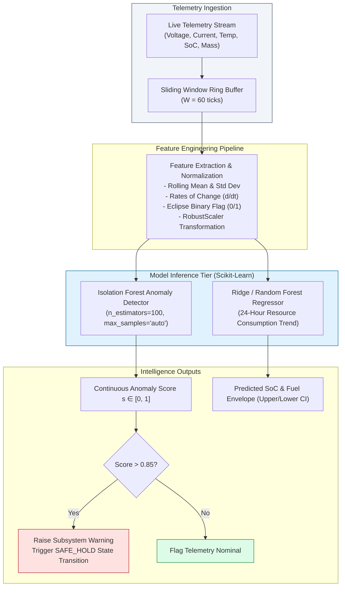

# 12 — OrbitOS AI/ML Telemetry Intelligence System

> **Document Status:** Baseline Approved  
> **Owner:** Lead AI/ML Engineer & Systems Telemetry Specialist  
> **Target Path:** `docs/02-intelligence-and-planning/12-ai-ml-intelligence-system.md`  
> **Last Updated:** 2026-11-03  
> **Traceability Anchor:** `DOC-AIML-001`

---

## 1. Executive Summary & Purpose

This document specifies the architecture, feature engineering pipelines, algorithmic models, training procedures, and explainability frameworks for the **OrbitOS AI/ML Intelligence Subsystem**.

Modern satellite constellations generate high-dimensional telemetry streams that exceed human operator monitoring capacity. OrbitOS deploys lightweight, interpretable machine learning models powered by **Scikit-learn** ([ADR-006](file:///home/kashifhm333/Desktop/Project/orbit/docs/ARCHITECTURE_DECISIONS.md#adr-006-scikit-learn-with-synthetic-feature-engineering-for-initial-telemetry-ml)) to perform two mission-critical tasks:
1. **Multivariate Telemetry Anomaly Detection:** Real-time identification of subsystem degradations, thermal spikes, and electrical faults.
2. **Resource Consumption Forecasting:** Multi-hour predictive modeling of battery state of charge (SoC) and propellant reserves.

---

> [!CAUTION]
> **SIMULATION & BENCHMARK INTEGRITY NOTICE**  
> OrbitOS AI/ML models operate exclusively on synthetic telemetry and educational datasets. No claims of production aerospace flight readiness or fabricated accuracy metrics ($99.9\%$) are made. All models possess deterministic rule-based safety fallbacks.

---

## 2. Machine Learning Architecture & Pipeline



---

## 3. Telemetry Anomaly Detection Engine

### 3.1 Feature Vector Specification
On every simulation tick $t_k$, the engine extracts an 8-dimensional normalized feature vector $\mathbf{x}_k \in \mathbb{R}^8$ from the 60-tick rolling buffer:

| Index | Feature Symbol | Description | Units | Normalization |
| :--- | :--- | :--- | :--- | :--- |
| $x_1$ | $\bar{V}_{\text{bus}}$ | Mean Bus Voltage over window | Volts ($\text{V}$) | Zero-mean, unit-variance |
| $x_2$ | $\sigma(V_{\text{bus}})$ | Standard deviation of Bus Voltage | Volts ($\text{V}$) | RobustScaler |
| $x_3$ | $\bar{I}_{\text{load}}$ | Mean Total Bus Current | Amperes ($\text{A}$) | RobustScaler |
| $x_4$ | $d(\text{SoC})/dt$ | Numerical first derivative of battery SoC | $\%/\text{s}$ | Linear scaling |
| $x_5$ | $T_{\text{battery}}$ | Battery core temperature | Celsius ($^\circ\text{C}$) | Min-max $[ -20, +60 ]$ |
| $x_6$ | $T_{\text{avionics}}$ | Avionics payload temperature | Celsius ($^\circ\text{C}$) | Min-max $[ -10, +70 ]$ |
| $x_7$ | $I_{\text{eclipse}}$ | Solar Eclipse Indicator ($1 = \text{Shadow}, 0 = \text{Sun}$) | boolean | Discrete $\{0, 1\}$ |
| $x_8$ | $\bar{P}_{\text{net}}$ | Mean Net Power ($\bar{P}_{\text{solar}} - \bar{P}_{\text{load}}$) | Watts ($\text{W}$) | RobustScaler |

### 3.2 Isolation Forest Formulation
OrbitOS uses an **Isolation Forest** ensemble ($N_{\text{trees}} = 100$). Because anomalies are "few and different," they are isolated closer to the tree roots. 

The anomaly score $s(\mathbf{x}, n)$ for a sample $\mathbf{x}$ across $n$ samples is:
$$s(\mathbf{x}, n) = 2^{-\frac{\mathbb{E}(h(\mathbf{x}))}{c(n)}}$$
Where $\mathbb{E}(h(\mathbf{x}))$ is the average path length across all isolation trees, and $c(n)$ is the average path length of unsuccessful searches in a Binary Search Tree:
$$c(n) = 2 \ln(n - 1) + 0.5772156649\ (\text{Euler's constant}) - \frac{2(n - 1)}{n}$$

- If $s \to 1.0$: Instance is flagged as a high-confidence anomaly.
- If $s < 0.50$: Instance is classified as normal behavior.

---

## 4. Resource Consumption Forecasting

To prevent unexpected battery brownouts during extended eclipse seasons, OrbitOS deploys a **Ridge Regression** forecasting model:

$$\hat{y}(t + \Delta H) = \mathbf{w}^T \mathbf{x}(t) + b$$
$$\min_{\mathbf{w}} \|\mathbf{y} - \mathbf{X}\mathbf{w}\|_2^2 + \alpha \|\mathbf{w}\|_2^2 \quad (\alpha = 1.0)$$

The forecaster outputs the expected battery SoC trajectory over a 24-hour horizon with $95\%$ prediction intervals:
$$\hat{\text{SoC}}(t) \pm 1.96 \cdot \hat{\sigma}_{\text{residual}}$$

---

## 5. Synthetic Training Data Generation & Fault Injection

Because real flight anomaly datasets are proprietary and rare, OrbitOS provides an automated synthetic fault generator:

```python
class TelemetryFaultInjector:
    @staticmethod
    def inject_solar_cell_degradation(telemetry: dict, severity: float = 0.4):
        """Simulates micro-meteoroid damage reducing solar array efficiency by 40%."""
        telemetry["solar_power_watts"] *= (1.0 - severity)
        telemetry["battery_current_amps"] *= (1.0 - severity)
        return telemetry

    @staticmethod
    def inject_thermal_runaway(telemetry: dict, rate: float = 0.5):
        """Simulates radiator failure causing exponential temperature increase."""
        telemetry["battery_temp_celsius"] += rate
        return telemetry
```

Nominal baseline models are trained on 10,000 synthetic ticks of unperturbed orbit cycles (sunlight/eclipse transitions), then validated against injected fault scenarios.

---

## 6. Model Explainability & Fallback Governance

### 6.1 Feature Importance & Diagnostic Explanations
Whenever an anomaly is detected ($s > 0.85$), the system generates an explainable diagnostic payload indicating which feature contributed most to the anomaly score:

```json
{
  "satellite_id": "SAT-001",
  "timestamp": "2026-11-04T12:00:00Z",
  "anomaly_score": 0.92,
  "status": "ANOMALY_CONFIRMED",
  "primary_driver": "battery_temp_celsius",
  "feature_deviations": {
    "battery_temp_celsius": "+4.2 sigma above baseline",
    "bus_voltage": "-2.1 sigma below baseline",
    "net_power": "-3.8 sigma below baseline"
  },
  "recommended_action": "TRANSITION_TO_SAFE_HOLD"
}
```

### 6.2 Deterministic Safety Guardrail (Rule-Based Fallback)
If the ML model encounters an unhandled exception or inference latency exceeds $20\text{ ms}$, OrbitOS falls back immediately to deterministic hard-coded bounds:
- If $\text{SoC} < 15.0\% \implies$ Force `SAFE_HOLD`.
- If $T_{\text{battery}} > 55.0^\circ\text{C} \implies$ Force `DEGRADED`.

---

## 7. Acceptance Criteria & Test Cases

| Test Identifier | Scenario Description | Expected Outcome |
| :--- | :--- | :--- |
| **TC-AIML-001** | Nominal Orbit Cycling (1000 ticks) | False alarm rate $< 1.0\%$ on clean baseline telemetry. |
| **TC-AIML-002** | Solar Array Drop Injection ($40\%$ sudden loss) | Anomaly score rises $> 0.85$ within 3 ticks of fault injection. |
| **TC-AIML-003** | Inference Latency Ceiling | Batch inference for 20 satellites completes in $< 10\text{ ms}$ on laptop CPU. |
| **TC-AIML-004** | Deterministic Fallback on Model Failure | Corrupted model file triggers automatic fallback to rule-based safety checks without application crash. |

---

## 8. Cross-Document References

- **Requirements:** [02-requirements-specification.md](file:///home/kashifhm333/Desktop/Project/orbit/docs/00-project-foundation/02-requirements-specification.md) (`FR-AIML-001`, `002`)
- **System Architecture:** [04-system-architecture.md](file:///home/kashifhm333/Desktop/Project/orbit/docs/01-system-design/04-system-architecture.md)
- **Satellite Lifecycle:** [07-satellite-lifecycle-and-state-machines.md](file:///home/kashifhm333/Desktop/Project/orbit/docs/01-system-design/07-satellite-lifecycle-and-state-machines.md)
- **Database & API Contracts:** [14-database-and-api-contracts.md](file:///home/kashifhm333/Desktop/Project/orbit/docs/03-engineering-contracts/14-database-and-api-contracts.md)
- **Testing & Validation:** [17-testing-and-validation-strategy.md](file:///home/kashifhm333/Desktop/Project/orbit/docs/04-quality-and-operations/17-testing-and-validation-strategy.md)

