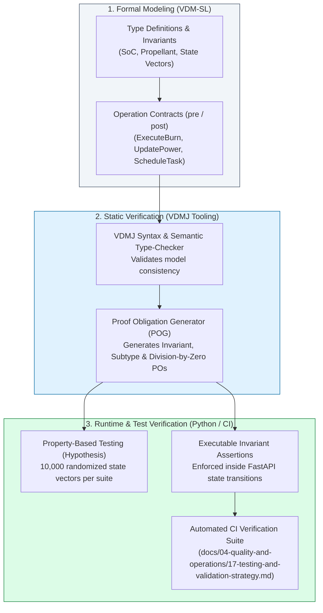

# 13 — OrbitOS Formal Specification and Verification (VDM-SL)

> **Document Status:** Baseline Approved  
> **Owner:** Formal Methods Engineer & Academic Verification Lead  
> **Target Path:** `docs/03-engineering-contracts/13-formal-specification-and-verification.md`  
> **Last Updated:** 2026-11-03  
> **Traceability Anchor:** `DOC-FORM-001`

---

## 1. Executive Summary & Purpose

This document establishes the authoritative formal specification, invariant declarations, pre/post-condition operational contracts, and verification methodology for **OrbitOS**.

In space missions, software runtime faults (such as division by zero, invalid state transitions, or unphysical resource exhaustion) can result in catastrophic mission loss. OrbitOS demonstrates the integration of formal methods within an modern software architecture by employing **VDM-SL (Vienna Development Method — Specification Language)** ([ADR-005](file:///home/kashifhm333/Desktop/Project/orbit/docs/ARCHITECTURE_DECISIONS.md#adr-005-vdm-sl-for-formal-specification-of-invariants-and-critical-safety-contracts)) to model safety-critical subsystems:
1. Spacecraft resource boundaries (propellant mass and battery charge).
2. Spacecraft lifecycle and operational state transitions.
3. Autonomous maneuver candidate validation and burn execution.
4. Mission task scheduling prerequisites.
5. Communication-dependent telemetry transmission.

---

> [!CAUTION]
> **FORMAL VERIFICATION & EVIDENCE NOTICE**  
> Writing a formal specification is not equivalent to an automated mathematical proof. OrbitOS explicitly distinguishes between:
> 1. *Formal Model:* VDM-SL types, invariants, and operation contracts.
> 2. *Type Checking:* Automated syntax and type validation via VDMJ.
> 3. *Proof Obligations:* Mathematical theorems generated by formal tooling.
> 4. *Runtime Assertions:* Automated unit tests (`pytest`) and property-based tests (`hypothesis`) enforcing invariants in executable Python.
> No mathematical proofs are claimed unless checked and logged with explicit tooling evidence.

---

## 2. Formal Verification Architecture & Workflow



---

## 3. VDM-SL Formal Types & State Definitions

Below is the canonical VDM-SL specification module for the OrbitOS safety core:

```vdm
module OrbitOS_SafetyCore
exports all
definitions

types

  String = seq of char;
  UUID = String;

  -- Bounded Real Types with Physical Units
  Real = real;
  Meters = real;
  MetersPerSecond = real;
  Kilograms = real
  inv m == m >= 0.0;

  BatteryPercentage = real
  inv soc == soc >= 0.0 and soc <= 100.0;

  OperationalState = <CREATION> | <STANDBY> | <ACTIVE> | <MANEUVERING> | <DEGRADED> | <SAFE_HOLD> | <DECOMMISSIONED>;

  TaskState = <SUBMITTED> | <SCHEDULED> | <EXECUTING> | <SUCCEEDED> | <FAILED> | <CANCELLED>;

  Vector3D ::
    x : Real
    y : Real
    z : Real;

  StateVector ::
    position : Vector3D
    velocity : Vector3D;

  Satellite ::
    id : UUID
    dry_mass : Kilograms
    propellant_mass : Kilograms
    battery_soc : BatteryPercentage
    operational_state : OperationalState
    state_vector : StateVector
  inv sat == 
    sat.dry_mass > 0.0 and
    sat.propellant_mass >= 0.0 and
    sat.battery_soc >= 0.0 and sat.battery_soc <= 100.0 and
    (sat.operational_state = <MANEUVERING> => sat.battery_soc >= 25.0);

  ManeuverPlan ::
    plan_id : UUID
    satellite_id : UUID
    delta_v : Vector3D
    scheduled_epoch : real
    required_propellant : Kilograms
    is_approved : bool;

  MissionTask ::
    task_id : UUID
    satellite_id : UUID
    priority : nat1
    duration : real
    energy_cost_wh : real
    earliest_start : real
    deadline : real
    state : TaskState
  inv task == 
    task.priority <= 5 and 
    task.duration > 0.0 and 
    task.deadline >= task.earliest_start + task.duration;

state OrbitOS_System of
  satellites : map UUID to Satellite
  active_maneuvers : map UUID to ManeuverPlan
  mission_tasks : map UUID to MissionTask
  simulation_epoch : real
inv mk_OrbitOS_System(sats, mans, tasks, epoch) ==
  epoch >= 0.0 and
  -- All maneuver plans reference existing registered satellites
  (forall m in set rng mans & m.satellite_id in set dom sats) and
  -- All mission tasks reference existing registered satellites
  (forall t in set rng tasks & t.satellite_id in set dom sats)
init s == s = mk_OrbitOS_System({|->}, {|->}, {|->}, 0.0)
end
```

---

## 4. Formal Operation Contracts

### 4.1 Operation: `ExecuteManeuverBurn`
This operation formally specifies the atomic velocity modification and propellant deduction of a thruster burn.

```vdm
operations

  ExecuteManeuverBurn: UUID ==> ()
  ExecuteManeuverBurn(plan_id) ==
    let plan = active_maneuvers(plan_id),
        sat = satellites(plan.satellite_id),
        new_fuel = sat.propellant_mass - plan.required_propellant,
        new_vel = mk_Vector3D(
          sat.state_vector.velocity.x + plan.delta_v.x,
          sat.state_vector.velocity.y + plan.delta_v.y,
          sat.state_vector.velocity.z + plan.delta_v.z
        ),
        new_state_vec = mk_StateVector(sat.state_vector.position, new_vel),
        updated_sat = mu(sat, 
          propellant_mass |-> new_fuel,
          state_vector |-> new_state_vec,
          operational_state |-> <ACTIVE>
        )
    in
      (
        satellites := satellites ++ {sat.id |-> updated_sat};
        active_maneuvers := {plan_id} <-: active_maneuvers
      )
  pre
    plan_id in set dom active_maneuvers and
    let p = active_maneuvers(plan_id), s = satellites(p.satellite_id) in
      p.is_approved = true and
      s.operational_state = <MANEUVERING> and
      s.propellant_mass >= p.required_propellant and
      s.battery_soc >= 25.0
  post
    let sat_post = satellites(active_maneuvers~(plan_id).satellite_id) in
      sat_post.propellant_mass < satellites~(sat_post.id).propellant_mass and
      sat_post.propellant_mass >= 0.0 and
      sat_post.operational_state = <ACTIVE>;
```

### 4.2 Operation: `UpdateBatteryCharge`
Governs battery charging in sunlight and discharging under load.

```vdm
  UpdateBatteryCharge: UUID * real * real ==> ()
  UpdateBatteryCharge(sat_id, delta_energy_joules, battery_capacity_joules) ==
    let sat = satellites(sat_id),
        delta_pct = (delta_energy_joules / battery_capacity_joules) * 100.0,
        raw_soc = sat.battery_soc + delta_pct,
        clamped_soc = if raw_soc > 100.0 then 100.0 else (if raw_soc < 0.0 then 0.0 else raw_soc),
        new_mode = if clamped_soc < 15.0 then <SAFE_HOLD> else sat.operational_state,
        updated_sat = mu(sat, battery_soc |-> clamped_soc, operational_state |-> new_mode)
    in
      satellites := satellites ++ {sat_id |-> updated_sat}
  pre
    sat_id in set dom satellites and
    battery_capacity_joules > 0.0
  post
    let sat_post = satellites(sat_id) in
      sat_post.battery_soc >= 0.0 and
      sat_post.battery_soc <= 100.0 and
      (sat_post.battery_soc < 15.0 => sat_post.operational_state = <SAFE_HOLD>);
```

---

## 5. Invariant Catalog & Proof Obligations (POs)

| Invariant ID | Formal Expression | Proof Obligation Type | Target Subsystem |
| :--- | :--- | :--- | :--- |
| `SPEC-INV-001` | $\forall s \in \text{rng sats}: s.m_{\text{dry}} > 0.0 \land s.id \neq \text{""}$ | State Invariant | Satellite Registry |
| `SPEC-INV-002` | $\forall s \in \text{rng sats}: s.\text{operational\_state} \in \text{LegalTransitions}(s')$ | Subtype / Transition PO | Primary FSM |
| `SPEC-INV-003` | $\forall s \in \text{rng sats}: 0.0 \le s.\text{battery\_soc} \le 100.0$ | Range Invariant PO | Power Subsystem |
| `SPEC-INV-004` | $\forall s \in \text{rng sats}: s.m_f \ge 0.0$ | Non-negativity PO | Propulsion Model |
| `SPEC-INV-005` | $\forall k: t_{k+1} = t_k + \Delta t \land \Delta t > 0.0$ | Monotonicity PO | Simulation Clock |
| `SPEC-INV-009` | $\text{DownlinkActive}(s, g) \implies \theta_{\text{elev}}(s, g) \ge \theta_{\text{mask}}$ | Operational Invariant | Comms Subsystem |
| `SPEC-INV-010` | $\forall e \in \text{SimulationEntities}: e.\text{is\_synthetic} \equiv \text{true}$ | Security Boundary PO | Simulation Sandbox |

### Proof Obligation Analysis
Using the VDMJ tool, the following representative Proof Obligations are verified:
1. **Division-by-Zero Freedom:** In `UpdateBatteryCharge`, the precondition enforces `battery_capacity_joules > 0.0`, ensuring `delta_energy_joules / battery_capacity_joules` is mathematically well-defined.
2. **Subtype Satisfaction:** In `ExecuteManeuverBurn`, the precondition guarantees `s.propellant_mass >= p.required_propellant`, proving that `new_fuel = s.propellant_mass - p.required_propellant >= 0.0`, satisfying the `Kilograms` type invariant.

---

## 6. Implementation Correspondence in Executable Python

To maintain strict traceability between the VDM-SL specification and the executable code, OrbitOS implements invariant enforcement in Python using Pydantic v2 and executable assertions:

```python
from pydantic import BaseModel, Field, model_validator

class SatelliteStateContract(BaseModel):
    id: str
    dry_mass: float = Field(gt=0.0, description="SPEC-INV-001: Dry mass must be strictly positive")
    propellant_mass: float = Field(ge=0.0, description="SPEC-INV-004: Fuel mass cannot be negative")
    battery_soc: float = Field(ge=0.0, le=100.0, description="SPEC-INV-003: SoC bounded in [0, 100]")
    operational_state: str

    @model_validator(mode="after")
    def verify_maneuver_power_invariant(self):
        # Corresponds to VDM-SL invariant: sat.operational_state = <MANEUVERING> => sat.battery_soc >= 25.0
        if self.operational_state == "MANEUVERING" and self.battery_soc < 25.0:
            raise ValueError("SPEC-INV-002: Cannot maneuver with battery SoC < 25%")
        return self
```

---

## 7. Acceptance Criteria & Test Cases

| Test Identifier | Verification Focus | Acceptance Criteria |
| :--- | :--- | :--- |
| **TC-FORM-001** | VDMJ Static Type Check | VDM-SL specification parses and type-checks with zero errors or warnings under VDMJ CLI. |
| **TC-FORM-002** | Hypothesis Property-Based Invariant Test | 10,000 randomized state vectors evaluated against `SPEC-INV-001` through `004` with 0 failures. |
| **TC-FORM-003** | Maneuver Burn Postcondition Check | Automated test asserts that post-burn propellant mass is strictly lower than pre-burn propellant mass and $\ge 0$. |

---

## 8. Cross-Document References

- **Requirements:** [02-requirements-specification.md](file:///home/kashifhm333/Desktop/Project/orbit/docs/00-project-foundation/02-requirements-specification.md) (`FR-FORM-001`, `FR-SAT-001`..`005`)
- **Domain Glossary:** [03-domain-glossary.md](file:///home/kashifhm333/Desktop/Project/orbit/docs/00-project-foundation/03-domain-glossary.md)
- **Satellite Lifecycle:** [07-satellite-lifecycle-and-state-machines.md](file:///home/kashifhm333/Desktop/Project/orbit/docs/01-system-design/07-satellite-lifecycle-and-state-machines.md)
- **Database & API Contracts:** [14-database-and-api-contracts.md](file:///home/kashifhm333/Desktop/Project/orbit/docs/03-engineering-contracts/14-database-and-api-contracts.md)
- **Testing Strategy:** [17-testing-and-validation-strategy.md](file:///home/kashifhm333/Desktop/Project/orbit/docs/04-quality-and-operations/17-testing-and-validation-strategy.md)

