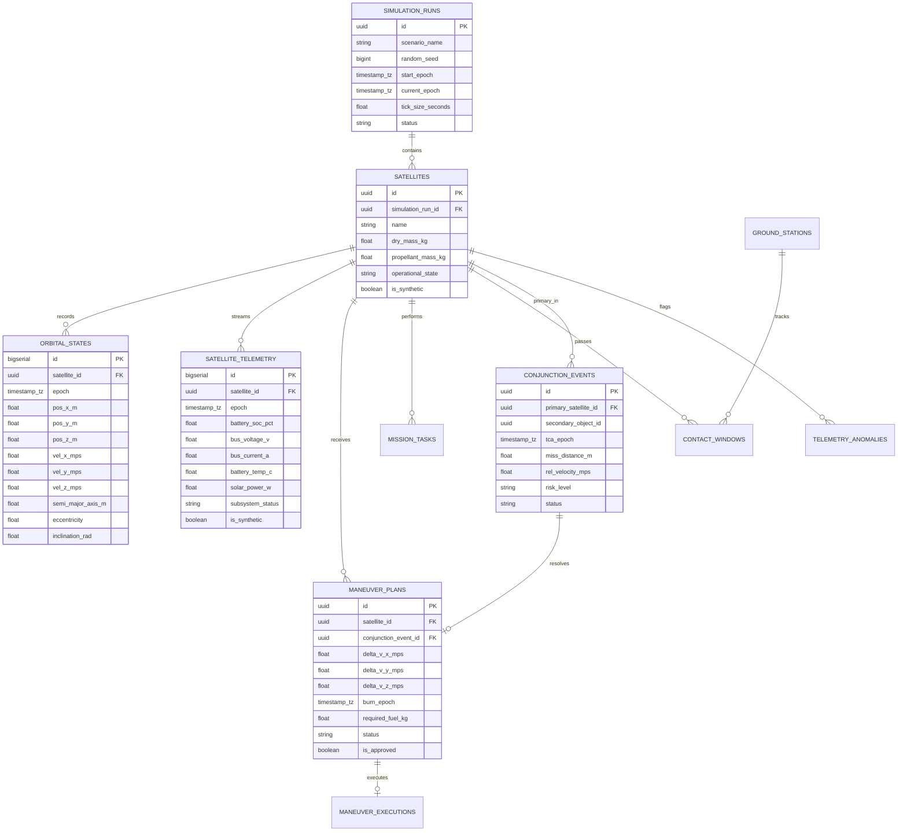

# 14 — OrbitOS Database and API Contracts Specification

> **Document Status:** Baseline Approved  
> **Owner:** Backend Architect & Lead Database Engineer  
> **Target Path:** `docs/03-engineering-contracts/14-database-and-api-contracts.md`  
> **Last Updated:** 2026-11-03  
> **Traceability Anchor:** `DOC-API-001`

---

## 1. Executive Summary & Purpose

This document specifies the relational database schema, data integrity constraints, REST API specifications, and WebSocket streaming protocols for **OrbitOS**.

OrbitOS standardizes on **PostgreSQL 16** managed via **SQLAlchemy 2.0 async engine** and **Alembic** migrations ([ADR-003](file:///home/kashifhm333/Desktop/Project/orbit/docs/ARCHITECTURE_DECISIONS.md#adr-003-fastapi-pydantic-v2-and-sqlalchemy-postgresql-for-core-backend-services)). The API tier is implemented in **FastAPI** with rigid runtime request/response validation powered by **Pydantic v2**.

---

## 2. Relational Database Schema (Entity-Relationship Model)



---

## 3. Database Table Definitions & Integrity Constraints

### 3.1 Table: `satellites`
```sql
CREATE TABLE satellites (
    id UUID PRIMARY KEY DEFAULT gen_random_uuid(),
    simulation_run_id UUID NOT NULL REFERENCES simulation_runs(id) ON DELETE CASCADE,
    name VARCHAR(100) NOT NULL,
    dry_mass_kg DOUBLE PRECISION NOT NULL CHECK (dry_mass_kg > 0.0),
    propellant_mass_kg DOUBLE PRECISION NOT NULL CHECK (propellant_mass_kg >= 0.0),
    operational_state VARCHAR(30) NOT NULL DEFAULT 'STANDBY',
    is_synthetic BOOLEAN NOT NULL DEFAULT TRUE,
    created_at TIMESTAMP WITH TIME ZONE NOT NULL DEFAULT CURRENT_TIMESTAMP
);
CREATE INDEX idx_satellites_run ON satellites(simulation_run_id);
```

### 3.2 Table: `orbital_states`
```sql
CREATE TABLE orbital_states (
    id BIGSERIAL PRIMARY KEY,
    satellite_id UUID NOT NULL REFERENCES satellites(id) ON DELETE CASCADE,
    epoch TIMESTAMP WITH TIME ZONE NOT NULL,
    pos_x_m DOUBLE PRECISION NOT NULL,
    pos_y_m DOUBLE PRECISION NOT NULL,
    pos_z_m DOUBLE PRECISION NOT NULL,
    vel_x_mps DOUBLE PRECISION NOT NULL,
    vel_y_mps DOUBLE PRECISION NOT NULL,
    vel_z_mps DOUBLE PRECISION NOT NULL,
    semi_major_axis_m DOUBLE PRECISION NOT NULL CHECK (semi_major_axis_m > 6378137.0),
    eccentricity DOUBLE PRECISION NOT NULL CHECK (eccentricity >= 0.0 AND eccentricity < 1.0),
    inclination_rad DOUBLE PRECISION NOT NULL CHECK (inclination_rad >= 0.0 AND inclination_rad <= 3.1415926535)
);
CREATE INDEX idx_orbital_states_sat_epoch ON orbital_states(satellite_id, epoch DESC);
```

### 3.3 Table: `external_records`
```sql
CREATE TABLE external_records (
    id UUID PRIMARY KEY DEFAULT gen_random_uuid(),
    provider VARCHAR(50) NOT NULL, -- 'NASA_DONKI', 'CELESTRAK', 'JPL_HORIZONS'
    source_identifier VARCHAR(100) NOT NULL,
    retrieval_epoch TIMESTAMP WITH TIME ZONE NOT NULL DEFAULT CURRENT_TIMESTAMP,
    data_format VARCHAR(20) NOT NULL, -- 'JSON', 'TLE', 'CSV'
    raw_payload JSONB NOT NULL,
    validation_checksum VARCHAR(64) NOT NULL,
    is_synthetic BOOLEAN NOT NULL DEFAULT FALSE
);
CREATE INDEX idx_external_records_provider_id ON external_records(provider, source_identifier);
```

---

## 4. REST API Endpoints Specification

All REST APIs are served under base path `/api/v1`. All endpoints enforce `Content-Type: application/json`.

### 4.1 Standard Response Wrapper & Error Envelope
Successful responses return HTTP `200 OK` or `201 Created`. Failed responses return standard RFC 7807 problem details:

```json
{
  "status_code": 422,
  "error_type": "UnprocessableEntity",
  "message": "SPEC-INV-004: Propellant mass cannot be negative",
  "timestamp": "2026-11-04T12:00:00Z",
  "details": [
    {
      "field": "required_fuel_kg",
      "issue": "Requested 1.5 kg exceeds available fuel 1.0 kg"
    }
  ]
}
```

### 4.2 Endpoint Inventory

| HTTP Method | Path | Description | Request Body | Response Codes |
| :--- | :--- | :--- | :--- | :--- |
| `POST` | `/api/v1/simulations/control` | Control engine (PLAY, PAUSE, STEP, RESET) | `SimulationControlRequest` | `200`, `400` |
| `GET` | `/api/v1/simulations/status` | Get current simulation epoch & clock rate | None | `200` |
| `POST` | `/api/v1/satellites` | Register a new virtual satellite | `CreateSatelliteRequest` | `201`, `422` |
| `GET` | `/api/v1/satellites` | List all satellites in current scenario | None | `200` |
| `GET` | `/api/v1/satellites/{id}` | Get satellite telemetry & physical status | None | `200`, `404` |
| `GET` | `/api/v1/satellites/{id}/orbit`| Get current Keplerian elements & ECI state | None | `200`, `404` |
| `GET` | `/api/v1/conjunctions` | Screen and retrieve active conjunctions | Query params: `horizon_hours` | `200` |
| `POST` | `/api/v1/maneuvers/plan` | Generate candidate avoidance maneuvers | `PlanManeuverRequest` | `200`, `422` |
| `POST` | `/api/v1/maneuvers/{id}/execute`| Authorize and execute scheduled maneuver | None | `200`, `409` |
| `POST` | `/api/v1/missions` | Submit a new mission task | `CreateTaskRequest` | `201`, `422` |
| `GET` | `/api/v1/missions/schedule` | Retrieve scheduled mission timeline | None | `200` |
| `GET` | `/api/v1/ground-stations/contacts`| Get predicted contact windows | Query params: `sat_id` | `200` |
| `POST` | `/api/v1/intelligence/detect` | Run anomaly detection on telemetry | `TelemetryInferenceRequest` | `200` |
| `POST` | `/api/v1/external/sync` | Trigger cached import from provider | `SyncExternalRequest` | `200`, `502` |

---

## 5. WebSocket Telemetry Streaming Contract

### 5.1 Endpoint: `/ws/telemetry`
Real-time simulation state snapshots are broadcast to connected frontend clients at $10\text{ Hz}$ frequency:

```json
{
  "type": "SIMULATION_TICK_SNAPSHOT",
  "simulation_epoch": "2026-11-04T12:00:10.000Z",
  "tick_number": 1420,
  "clock_state": "RUNNING",
  "time_acceleration": 10.0,
  "satellites": [
    {
      "satellite_id": "8f8b89e3-2e20-410a-85d7-d7b1b3b24f5a",
      "operational_state": "ACTIVE",
      "position_eci_m": [6878137.0, 0.0, 0.0],
      "velocity_eci_mps": [0.0, 7612.4, 0.0],
      "battery_soc_pct": 94.2,
      "propellant_mass_kg": 14.85,
      "in_eclipse": false,
      "active_ground_contact": "GS-SVAL",
      "anomaly_score": 0.12
    }
  ],
  "active_alerts": []
}
```

---

## 6. Acceptance Criteria & Test Cases

| Test Identifier | Test Target | Acceptance Criteria |
| :--- | :--- | :--- |
| **TC-API-001** | Pydantic Schema Validation | Sending negative mass returns HTTP 422 with field-level error details. |
| **TC-API-002** | Database Foreign Key Cascading | Deleting a simulation run cascades cleanly to all related satellites and telemetry records. |
| **TC-API-003** | WebSocket Throughput Budget | WebSocket sustains 100 continuous messages without client disconnects or buffer overflows. |
| **TC-API-004** | Idempotent External Sync | Repeating `/api/v1/external/sync` within cache TTL returns cached response without duplicate API calls. |

---

## 7. Cross-Document References

- **Requirements:** [02-requirements-specification.md](file:///home/kashifhm333/Desktop/Project/orbit/docs/00-project-foundation/02-requirements-specification.md) (`FR-SAT-*`, `FR-SIM-*`, `FR-COL-*`)
- **System Architecture:** [04-system-architecture.md](file:///home/kashifhm333/Desktop/Project/orbit/docs/01-system-design/04-system-architecture.md)
- **Frontend Design:** [15-frontend-and-visualization-design.md](file:///home/kashifhm333/Desktop/Project/orbit/docs/03-engineering-contracts/15-frontend-and-visualization-design.md)
- **External Integration:** [16-external-data-sources-and-api-integration.md](file:///home/kashifhm333/Desktop/Project/orbit/docs/03-engineering-contracts/16-external-data-sources-and-api-integration.md)

