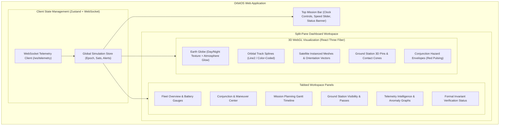

# 15 — OrbitOS Frontend and 3D Visualization Design Specification

> **Document Status:** Baseline Approved  
> **Owner:** Lead Frontend Architect & 3D WebGL Visualization Specialist  
> **Target Path:** `docs/03-engineering-contracts/15-frontend-and-visualization-design.md`  
> **Last Updated:** 2026-11-03  
> **Traceability Anchor:** `DOC-UI-001`

---

## 1. Executive Summary & Purpose

This document specifies the user experience (UX) architecture, component hierarchy, 3D WebGL rendering engine, state management, and accessibility standards for the **OrbitOS Frontend Application**.

The frontend provides an intuitive, aerospace-grade mission control dashboard. Built with **React 18, TypeScript, Vite, TailwindCSS**, and **Three.js via React Three Fiber (`@react-three/fiber`)** ([ADR-004](file:///home/kashifhm333/Desktop/Project/orbit/docs/ARCHITECTURE_DECISIONS.md#adr-004-react-18-typescript-and-threejs--react-three-fiber-for-3d-earth-orbital-visualization)), it renders real-time 3D Earth and orbital tracks while displaying synchronized telemetry, conjunction hazards, and autonomous maneuver plans.

---

## 2. Frontend Component Architecture



---

## 3. 3D WebGL Orbital Canvas Specification

### 3.1 Scene Composition & Coordinate Scaling
Because orbital dimensions (thousands of kilometers) exceed standard WebGL clipping planes, the 3D scene enforces a fixed coordinate scale:
$$1.0\text{ Three.js World Unit} = 1000.0\text{ km} = 1.0 \times 10^6\text{ m}$$

- **Earth Sphere Radius:** $R_{\text{scene}} = 6.378137\text{ units}$.
- **LEO Satellite Orbit (altitude $500\text{ km}$):** Orbital radius $r_{\text{scene}} = 6.878137\text{ units}$.
- **Camera Configuration:** Perspective camera, Field of View (FOV) $= 45^\circ$, near clipping plane $= 0.1$, far clipping plane $= 1000.0$.
- **Camera Controls:** OrbitControls with smooth damping ($0.05$), bounded distance $[7.0, 50.0]$ units to prevent clipping through Earth's surface.

### 3.2 Visual Styling & Color Coding
- **Earth Shaders:** Photorealistic daytime texture map combined with nighttime city light emission map on the shadowed hemisphere, wrapped in a custom atmospheric scattering shader.
- **Orbital Splines:** Rendered using `@react-three/drei` `Line` component:
  - `ACTIVE` satellite: Cyan (`#06b6d4`).
  - `MANEUVERING` satellite: Purple (`#a855f7`).
  - `SAFE_HOLD` / `DEGRADED`: Amber (`#f59e0b`).
  - Secondary Debris Object: Light Gray (`#94a3b8`).
- **Conjunction Hazard Marker:** When $d_{\text{miss}} < 5\text{ km}$, a pulsing red sphere (`#ef4444`) with transparent encounter vector lines is rendered at $t_{\text{TCA}}$.
- **Ground Station Contact Cones:** Translucent green frustum cones (`#22c55e`, opacity $0.20$) projecting upwards from ground station pins at the minimum elevation angle ($\theta_{\text{mask}} = 10^\circ$).

---

## 4. UI Dashboard Wireframe & Layout

```text
+----------------------------------------------------------------------------------------------------+
|  ORBITOS MISSION CONTROL  [Scenario: LEO-Conjunction-Lab]  [Status: RUNNING]  [UTC: 2026-11-04T12:00:10Z]  |
|  [ |<< RESET ]  [ |> PLAY ]  [ || PAUSE ]  [ >>| STEP ]  Speed: [ 10x ] =========O                  |
+-------------------------------------------------------+--------------------------------------------+
|                                                       | [ Fleet ] [ Conjunction ] [ Missions ] [ ML ] |
|                                                       +--------------------------------------------+
|                                                       | SATELLITE FLEET STATUS                     |
|                                                       |                                            |
|                  3D ORBITAL CANVAS                    | SAT-001 (Sun-Sync LEO)                     |
|                                                       |   State: [ ACTIVE ]    SoC: [ 94% ]        |
|             (Interactive Earth Sphere,                |   Fuel:  14.85 kg      Alt: 500.2 km       |
|               Orbital Ellipses, and                   |                                            |
|              Ground Station Pins)                     | SAT-002 (Polar Imaging)                    |
|                                                       |   State: [ ACTIVE ]    SoC: [ 78% ]        |
|                                                       |   Fuel:  12.10 kg      Alt: 502.1 km       |
|                                                       +--------------------------------------------+
|                                                       | ACTIVE CONJUNCTION ALERTS (1)              |
|                                                       | [CRITICAL] SAT-001 vs DEBRIS-4491          |
|                                                       |   TCA in: 03h 42m   Miss Dist: 561 m       |
|                                                       |   Action: [ Review Avoidance Maneuver ]    |
|                                                       +--------------------------------------------+
|                                                       | FORMAL INVARIANTS: ALL SATISFIED (10/10)   |
+-------------------------------------------------------+--------------------------------------------+
```

---

## 5. Client State Management (Zustand Architecture)

```typescript
import { create } from 'zustand';

interface SatelliteTelemetry {
  satellite_id: string;
  operational_state: 'ACTIVE' | 'STANDBY' | 'MANEUVERING' | 'SAFE_HOLD' | 'DECOMMISSIONED';
  position_eci_m: [number, number, number];
  velocity_eci_mps: [number, number, number];
  battery_soc_pct: number;
  propellant_mass_kg: number;
  in_eclipse: boolean;
  anomaly_score: number;
}

interface OrbitOSStore {
  simulationEpoch: string;
  clockState: 'RUNNING' | 'PAUSED' | 'STOPPED';
  timeAcceleration: number;
  satellites: Record<string, SatelliteTelemetry>;
  activeConjunctions: any[];
  setTickSnapshot: (snapshot: any) => void;
  setClockState: (state: 'RUNNING' | 'PAUSED' | 'STOPPED') => void;
}

export const useOrbitOSStore = create<OrbitOSStore>((set) => ({
  simulationEpoch: '2026-11-04T12:00:00Z',
  clockState: 'STOPPED',
  timeAcceleration: 1.0,
  satellites: {},
  activeConjunctions: [],
  setTickSnapshot: (snapshot) =>
    set({
      simulationEpoch: snapshot.simulation_epoch,
      clockState: snapshot.clock_state,
      timeAcceleration: snapshot.time_acceleration,
      satellites: Object.fromEntries(snapshot.satellites.map((s: any) => [s.satellite_id, s])),
      activeConjunctions: snapshot.active_alerts,
    }),
  setClockState: (state) => set({ clockState: state }),
}));
```

---

## 6. Performance & Accessibility Standards

1. **Target Frame Rate (`NFR-PERF-003`):** WebGL animation loop maintains $\ge 45\text{ FPS}$ on standard Intel Iris / AMD Radeon integrated graphics. If performance drops below $30\text{ FPS}$, antialiasing and bloom shaders are automatically toggled off.
2. **2D Lightweight Fallback View (`NFR-ACC-002`):** Users on low-power devices can toggle into a full 2D dashboard mode that disables the WebGL canvas, replacing it with an SVG ground-track world map.
3. **Color Accessibility (`NFR-ACC-001`):** All telemetry gauges and status badges meet WCAG 2.1 AA contrast requirements ($\ge 4.5:1$ text contrast ratio). Red alerts always pair color with explicit text labels and warning icons.

---

## 7. Acceptance Criteria & Test Cases

| Test Identifier | Test Focus | Acceptance Criteria |
| :--- | :--- | :--- |
| **TC-UI-001** | WebSocket State Sync | Inbound WebSocket tick updates Zustand store without triggering full-page DOM re-renders. |
| **TC-UI-002** | 3D Camera Bounding Box | OrbitControls cannot be zoomed inside the Earth's radius ($r < 6.378$ units). |
| **TC-UI-003** | 2D Fallback Activation | Clicking "Toggle 2D Mode" unmounts the Three.js Canvas and renders the 2D SVG map cleanly. |
| **TC-UI-004** | Responsive Screen Scaling | Layout renders cleanly without horizontal scrollbars on viewports from $1280 \times 720$ up to $3840 \times 2160$. |

---

## 8. Cross-Document References

- **Requirements:** [02-requirements-specification.md](file:///home/kashifhm333/Desktop/Project/orbit/docs/00-project-foundation/02-requirements-specification.md) (`NFR-ACC-*`, `NFR-PERF-003`)
- **System Architecture:** [04-system-architecture.md](file:///home/kashifhm333/Desktop/Project/orbit/docs/01-system-design/04-system-architecture.md)
- **Database & API Contracts:** [14-database-and-api-contracts.md](file:///home/kashifhm333/Desktop/Project/orbit/docs/03-engineering-contracts/14-database-and-api-contracts.md)
- **Deployment & Operations:** [19-deployment-and-operations.md](file:///home/kashifhm333/Desktop/Project/orbit/docs/04-quality-and-operations/19-deployment-and-operations.md)

