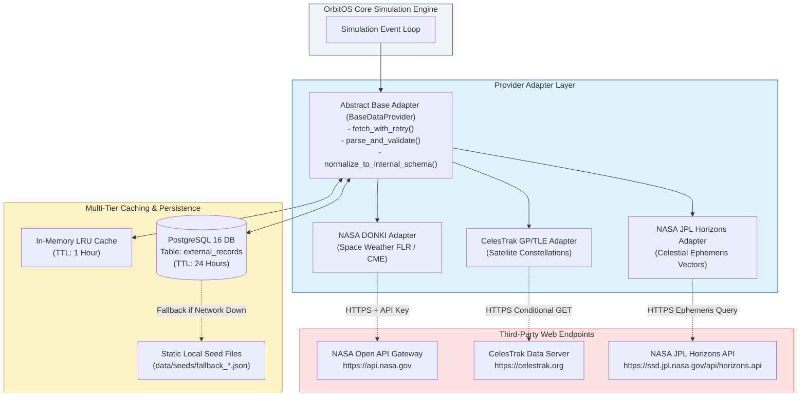
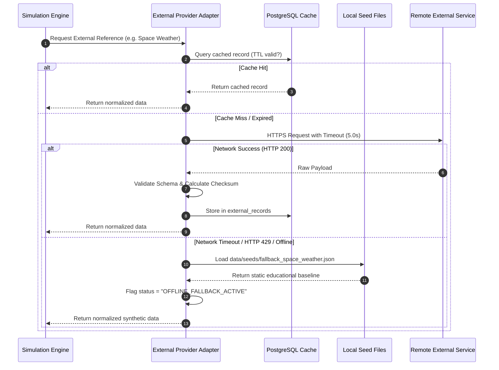

# 16 — OrbitOS External Data Sources and API Integration Specification

> **Document Status:** Baseline Approved  
> **Owner:** Lead Integration Architect & External Data Engineer  
> **Target Path:** `docs/03-engineering-contracts/16-external-data-sources-and-api-integration.md`  
> **Last Updated:** 2026-11-03  
> **Traceability Anchor:** `DOC-EXT-001`

---

## 1. Executive Summary & Purpose

This document specifies the integration architecture, provider adapters, caching tiers, rate-limiting policies, error-handling protocols, and data provenance mechanisms for the three external data providers utilized by **OrbitOS**:
1. **NASA Open APIs (DONKI):** Space weather events (Solar Flares, Coronal Mass Ejections) for simulating communications and sensor degradations.
2. **CelesTrak:** Real-world General Perturbations (GP) Two-Line Element (TLE) datasets for populating reference satellite constellations and space debris catalogs.
3. **NASA JPL Horizons:** Ephemeris state vectors for Earth, Moon, and planetary celestial reference objects.

---

> [!CAUTION]
> **OFFLINE-FIRST SIMULATION GUARANTEE (ADR-007)**  
> External data feeds are strictly supplementary reference inputs. The OrbitOS simulation engine **never** requires external internet connectivity to initialize or advance simulation ticks. If external APIs are unavailable, rate-limited, or offline, the platform automatically utilizes bundled synthetic fallback datasets.

---

## 2. Provider Adapter Architecture & Common Interface

To prevent external API dependencies from leaking into the core simulation engine, OrbitOS employs the **Provider Adapter Pattern**:



### 2.1 Python Base Adapter Specification
```python
from abc import ABC, abstractmethod
from typing import Any, Optional
import pydantic

class BaseDataProvider(ABC):
    """Abstract interface for all third-party orbital and environmental providers."""

    @abstractmethod
    async def fetch(self, identifier: str, **kwargs) -> dict[str, Any]:
        """Fetches raw data using multi-tier cache, falling back to network."""
        pass

    @abstractmethod
    def validate_schema(self, raw_data: dict[str, Any]) -> pydantic.BaseModel:
        """Enforces rigorous schema validation and SHA-256 checksums."""
        pass

    @abstractmethod
    def normalize_to_orbitos(self, validated_model: pydantic.BaseModel) -> dict[str, Any]:
        """Maps third-party payloads into canonical SI-unit OrbitOS models."""
        pass

    @abstractmethod
    def get_fallback_data(self, identifier: str) -> dict[str, Any]:
        """Provides local offline synthetic data when network is unreachable."""
        pass
```

---

## 3. External Provider Specifications

### 3.1 NASA Open APIs (DONKI Space Weather)
- **Official Documentation:** [https://api.nasa.gov](https://api.nasa.gov) / [NASA Space Weather Database Of Notifications, Knowledge, Information (DONKI)](https://ccmc.gsfc.nasa.gov/donki/)
- **Target Endpoints:**
  - Solar Flares: `GET /DONKI/FLR?startDate={start}&endDate={end}&api_key={key}`
  - Coronal Mass Ejections: `GET /DONKI/CME?startDate={start}&endDate={end}&api_key={key}`
- **Authentication:** Injected via environment variable `NASA_API_KEY` (defaults to `DEMO_KEY` with rate limit of 30 requests/hour; authenticated keys allow 1,000 requests/hour).
- **OrbitOS Simulation Role:** Simulates solar flare flux and geomagnetic storm severity ($K_p$ index), dynamically modifying ground station link budgets and injecting sensor noise into satellite telemetry.
- **Caching Policy:** Cached in PostgreSQL for $6\text{ hours}$.

### 3.2 CelesTrak (General Perturbations / TLE Catalog)
- **Official Source:** [https://celestrak.org](https://celestrak.org)
- **Target Endpoints:**
  - Active Satellites GP: `GET /NORAD/elements/gp.php?GROUP=active&FORMAT=json`
  - Space Stations (ISS): `GET /NORAD/elements/gp.php?CATNR=25544&FORMAT=tle`
- **Rate-Limiting Hygiene:** CelesTrak strictly requests clients avoid automated high-frequency polling. OrbitOS enforces:
  1. A minimum cache duration of $24\text{ hours}$.
  2. HTTP conditional headers (`If-Modified-Since`) on all requests.
  3. Pre-filtering by NORAD Catalog Number to avoid bulk multi-megabyte downloads.
- **OrbitOS Simulation Role:** Populates secondary reference orbits and orbital debris fields for realistic conjunction screening scenarios.

### 3.3 NASA JPL Horizons (Celestial Ephemeris)
- **Official Source:** [https://ssd.jpl.nasa.gov/api/horizons.api](https://ssd.jpl.nasa.gov/api/horizons.api)
- **Target Endpoint:** `GET /horizons.api?format=json&COMMAND='301'&CENTER='@399'&MAKE_EPHEM='YES'&EPHEM_TYPE='VECTORS'&REF_PLANE='FRAME'`
- **Parameters:**
  - `COMMAND='301'`: Moon center.
  - `CENTER='@399'`: Geocentric observer (Earth center).
  - `REF_PLANE='FRAME'`: Earth Mean Equator and Equinox of J2000.
- **Units & Coordinate Normalization:** JPL Horizons outputs positions in $\text{km}$ and $\text{km/s}$ relative to the requested reference center. The adapter converts all outputs into internal SI units ($\text{m}$ and $\text{m/s}$).
- **OrbitOS Simulation Role:** Provides high-accuracy lunar and solar position vectors for eclipse shadow geometry and advanced third-body gravitational perturbations.
- **Caching Policy:** Cached in PostgreSQL for $7\text{ days}$.

---

## 4. Data Provenance & Synthetic Flagging Standard

Every imported external record stored in the OrbitOS database must preserve complete provenance metadata to satisfy `SAF-BND-001`:

```json
{
  "provider": "CELESTRAK",
  "source_identifier": "NORAD-25544-ISS",
  "retrieval_epoch": "2026-11-04T08:30:00Z",
  "data_format": "TLE",
  "validation_checksum_sha256": "e3b0c44298fc1c149afbf4c8996fb92427ae41e4649b934ca495991b7852b855",
  "is_synthetic": false,
  "normalized_data": {
    "semi_major_axis_m": 6797137.0,
    "eccentricity": 0.000624,
    "inclination_rad": 0.9012
  }
}
```

---

## 5. Network Failure Handling & Offline Fallback Sequence



---

## 6. Acceptance Criteria & Test Cases

| Test Identifier | Test Focus | Acceptance Criteria |
| :--- | :--- | :--- |
| **TC-EXT-001** | CelesTrak TLE Checksum Validation | Invalid TLE line checksum raises `ValidationError`; bad data never persists. |
| **TC-EXT-002** | NASA API Key Environment Injection | Reads key from `.env`; masks key in all application log outputs. |
| **TC-EXT-003** | Total Offline Operation | Disabling internet network adapter causes 100% of adapter queries to resolve via local seed files without crashing the simulation. |
| **TC-EXT-004** | Provenance Immutability | All records in `external_records` have valid SHA-256 checksums and `is_synthetic = false`. |

---

## 7. Cross-Document References

- **Requirements:** [02-requirements-specification.md](file:///home/kashifhm333/Desktop/Project/orbit/docs/00-project-foundation/02-requirements-specification.md) (`FR-EXT-001`, `002`, `003`)
- **System Architecture:** [04-system-architecture.md](file:///home/kashifhm333/Desktop/Project/orbit/docs/01-system-design/04-system-architecture.md)
- **Database & API Contracts:** [14-database-and-api-contracts.md](file:///home/kashifhm333/Desktop/Project/orbit/docs/03-engineering-contracts/14-database-and-api-contracts.md)
- **Security & Safety Model:** [18-security-and-safety-model.md](file:///home/kashifhm333/Desktop/Project/orbit/docs/04-quality-and-operations/18-security-and-safety-model.md)

