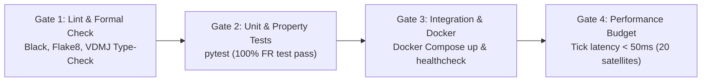

# 17 — OrbitOS Testing and Validation Strategy

> **Document Status:** Baseline Approved  
> **Owner:** Lead Software Quality Assurance Engineer & Verification Lead  
> **Target Path:** `docs/04-quality-and-operations/17-testing-and-validation-strategy.md`  
> **Last Updated:** 2026-11-03  
> **Traceability Anchor:** `DOC-TEST-001`

---

## 1. Executive Summary & Quality Objectives

This document establishes the comprehensive software testing, scientific validation, property-based verification, and quality assurance framework for **OrbitOS**.

OrbitOS employs a multi-tiered testing strategy engineered to guarantee that:
1. **Software Correctness (Verification):** The codebase implements all requirements (`FR-*`, `NFR-*`) and API/DB contracts without regressions or memory leaks.
2. **Scientific Adequacy (Validation):** The numerical astrodynamic and subsystem models behave consistently with Keplerian orbital mechanics, Tsiolkovsky rocket dynamics, and electrical power conservation.
3. **Formal Invariant Preservation:** All formal invariants (`SPEC-INV-001` through `010`) hold unconditionally under property-based fuzzing and stress testing.

---

## 2. Test Pyramid & Quality Gate Hierarchy

```mermaid
flowchart TD
    subgraph TestPyramid["OrbitOS Testing Pyramid"]
        E2E["End-to-End System Scenarios (Playwright)\nMulti-satellite conjunction & burn execution"]
        Integration["Integration & API Contract Tests (pytest / TestClient)\nFastAPI endpoints, PostgreSQL async sessions, WebSockets"]
        ScientificVal["Scientific & Numerical Astrodynamic Validation\nOrbital energy conservation, analytical Kepler benchmarks"]
        PropertyBased["Property-Based Testing (Hypothesis)\n10,000 randomized state vectors per suite"]
        UnitTests["Unit Tests (pytest / vitest)\nPure math functions, state transitions, Pydantic schemas"]
        FormalChecks["Static Formal Verification (VDMJ CLI)\nVDM-SL type-checking & proof obligation generation"]
    end

    FormalChecks --> UnitTests
    UnitTests --> PropertyBased
    PropertyBased --> ScientificVal
    ScientificVal --> Integration
    Integration --> E2E

    style FormalChecks fill:#f1f5f9,stroke:#475569;
    style UnitTests fill:#e0f2fe,stroke:#0369a1;
    style ScientificVal fill:#fef3c7,stroke:#d97706;
    style Integration fill:#dcfce7,stroke:#15803d;
    style E2E fill:#fee2e2,stroke:#b91c1c;
```



---

## 3. Comprehensive Test Case Catalog

### 3.1 Satellite Bus & Subsystem Tests (`TC-SAT`)
- **`TC-SAT-001` (Dry Mass Positivity):** Attempts to create satellite with $m_{\text{dry}} = 0.0\text{ kg}$ and $m_{\text{dry}} = -50.0\text{ kg}$; verifies HTTP 422 rejection.
- **`TC-SAT-002` (Telemetry Status Enum):** Asserts all generated subsystem statuses are valid enum strings.
- **`TC-SAT-003` (Battery SoC Boundedness):** Propagates 500 ticks in continuous eclipse; verifies battery SoC stays $\ge 0.0\%$ and triggers `SAFE_HOLD` at $15\%$.
- **`TC-SAT-004` (Propellant Non-Negativity):** Executes maneuver demanding more fuel than available; verifies `SPEC-PRE-002` rejection.
- **`TC-SAT-005` (Primary FSM Transition Matrix):** Executes all 36 state transitions; verifies only the 10 permitted transitions succeed.

### 3.2 Orbital Mechanics & Dynamics Tests (`TC-ORB`)
- **`TC-ORB-001` (Keplerian Period Benchmark):** Circular orbit at altitude $500\text{ km}$; asserts simulated period $T$ matches $2\pi\sqrt{a^3/\mu}$ within $< 0.01\text{ s}$.
- **`TC-ORB-002` (ECI $\leftrightarrow$ ECEF Isometry):** Asserts transformation matrix preserves vector norm: $|\vec{r}_{\text{ECEF}}| = |\vec{r}_{\text{ECI}}|$ within $10^{-5}\text{ m}$.
- **`TC-ORB-003` (Two-Body Energy Conservation):** Integrates 100 orbits under unperturbed 2-body dynamics with RK4; verifies relative energy drift $|\Delta \mathcal{E}/\mathcal{E}_0| < 10^{-6}$.
- **`TC-ORB-004` ($J_2$ Nodal Precession Benchmark):** Propagates sun-synchronous orbit over 30 days; asserts nodal precession rate $\dot{\Omega}$ matches theoretical rate within $0.5\%$.

### 3.3 Simulation Engine Tests (`TC-SIM`)
- **`TC-SIM-001` (Clock Monotonicity):** Asserts $t_{k+1} > t_k$ strictly across 10,000 consecutive ticks.
- **`TC-SIM-002` (Clock State Machine Transitions):** Exercises `PLAY`, `PAUSE`, `STEP`, `RESET`; asserts exact tick counts match expected intervals.
- **`TC-SIM-003` (Deterministic Replay Hash):** Replays two independent simulation runs with identical random seed; verifies identical SHA-256 telemetry digest.

### 3.4 Conjunction & Maneuver Tests (`TC-COL`, `TC-MAN`)
- **`TC-COL-001` (Altitude Filter Pruning):** Non-overlapping orbital shells ($a_A = 6800\text{ km}$, $a_B = 7500\text{ km}$) are rejected in Tier 1 in $0\text{ ms}$.
- **`TC-COL-002` (TCA Root-Finding Accuracy):** Evaluates synthetic encounter; asserts $t_{\text{TCA}}$ satisfies $\vec{r}_{\text{rel}} \cdot \vec{v}_{\text{rel}} \approx 0$ within $10^{-4}\text{ m}^2/\text{s}$.
- **`TC-MAN-001` (Avoidance Burn Miss Distance):** Executes candidate in-track burn; verifies miss distance increases from $400\text{ m}$ to $> 5000\text{ m}$.
- **`TC-MAN-002` (Tsiolkovsky Mass Deduction):** Verifies post-burn mass matches analytical rocket equation formula within $10^{-5}\text{ kg}$.

### 3.5 Ground Stations & Telemetry AI Tests (`TC-GND`, `TC-AIML`)
- **`TC-GND-001` (Overhead Pass Geometry):** Asserts elevation angle reaches peak at minimum slant range.
- **`TC-GND-002` (Horizon Mask Enforcement):** Zero bytes transmitted when $\theta_{\text{elev}} < 10.0^\circ$.
- **`TC-AIML-001` (Nominal False Alarm Rate):** Clean baseline telemetry generates anomaly score $< 0.85$ on $\ge 99\%$ of ticks.
- **`TC-AIML-002` (Fault Injection Detection):** Solar array failure injection causes anomaly score to rise $> 0.85$ within 3 ticks.

### 3.6 Safety Boundary Tests (`TC-SAFE`)
- **`TC-SAFE-001` (Simulation Isolation Guard):** Scans entire repository; asserts zero imports of physical hardware comms (e.g., `pyserial`, raw socket uplinks).
- **`TC-SAFE-002` (Synthetic Metadata Flag):** Asserts 100% of generated simulation entities have `is_synthetic = true`.

---

## 4. Property-Based Testing Strategy (Hypothesis)

OrbitOS deploys the `hypothesis` framework to test mathematical invariants over wide random input spaces:

```python
from hypothesis import given, strategies as st
import numpy as np

@given(
    a=st.floats(min_value=6600000.0, max_value=42164000.0),
    e=st.floats(min_value=0.0, max_value=0.8),
    i=st.floats(min_value=0.0, max_value=np.pi)
)
def test_orbital_energy_conservation(a, e, i):
    """SPEC-INV-011: Specific orbital energy must be strictly negative for bound orbits."""
    mu = 3.986004418e14
    energy = -mu / (2.0 * a)
    assert energy < 0.0, f"Energy must be negative for bound orbit, got {energy}"
```

---

## 5. CI/CD Quality Gates & Release Criteria

In GitHub Actions (`.github/workflows/ci.yml`), every Pull Request must pass four mandatory verification gates:



### Exit Criteria for Baseline Release:
1. **100% Pass Rate** on all `TC-*` test cases.
2. **Zero Invariant Violations** in 10,000 property-based fuzz iterations.
3. **Zero Unhandled Server Exceptions (HTTP 500)** across all API routes.
4. **Clean Docker Deployment:** `docker compose up --build` initializes backend, database, and frontend within $60\text{ seconds}$ on a clean runner.

---

## 6. Cross-Document References

- **Requirements:** [02-requirements-specification.md](file:///home/kashifhm333/Desktop/Project/orbit/docs/00-project-foundation/02-requirements-specification.md)
- **Orbital Dynamics:** [05-orbital-mechanics-model.md](file:///home/kashifhm333/Desktop/Project/orbit/docs/01-system-design/05-orbital-mechanics-model.md)
- **Simulation Engine:** [06-simulation-engine-design.md](file:///home/kashifhm333/Desktop/Project/orbit/docs/01-system-design/06-simulation-engine-design.md)
- **Formal Verification:** [13-formal-specification-and-verification.md](file:///home/kashifhm333/Desktop/Project/orbit/docs/03-engineering-contracts/13-formal-specification-and-verification.md)
- **Security & Safety:** [18-security-and-safety-model.md](file:///home/kashifhm333/Desktop/Project/orbit/docs/04-quality-and-operations/18-security-and-safety-model.md)

