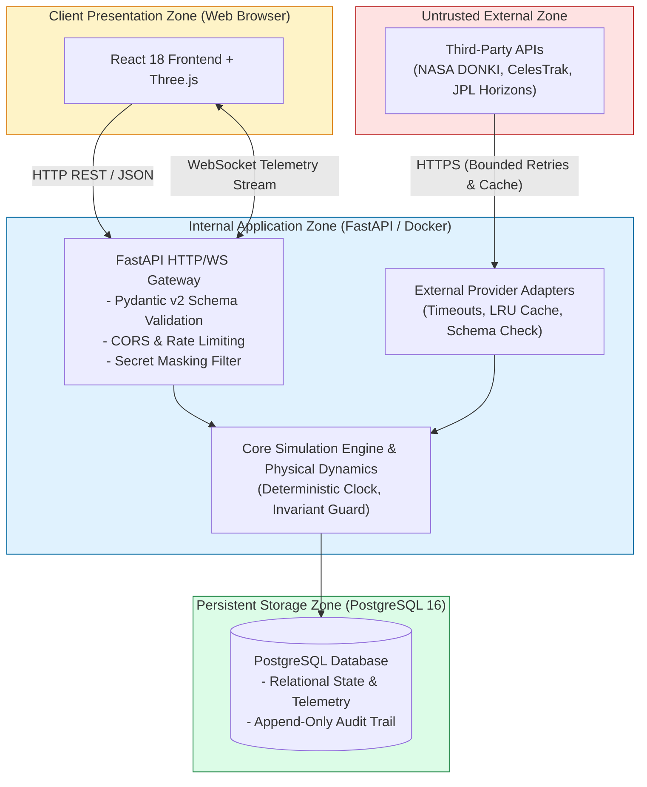

# 18 — OrbitOS Security and Safety Model

> **Document Status:** Baseline Approved  
> **Owner:** Lead Security Architect & Systems Safety Engineer  
> **Target Path:** `docs/04-quality-and-operations/18-security-and-safety-model.md`  
> **Last Updated:** 2026-11-03  
> **Traceability Anchor:** `DOC-SEC-001`

---

## 1. Executive Summary & Core Safety Mandate

This document establishes the security architecture, threat model, trust boundaries, defensive controls, and non-negotiable simulation safety guardrails for **OrbitOS**.

OrbitOS is an educational simulator. The primary safety imperative is twofold:
1. **Physical World Isolation:** Ensure that simulated commands, burns, and autonomous decisions **never** escape the simulated software boundary or interact with operational spacecraft ([ADR-008](file:///home/kashifhm333/Desktop/Project/orbit/docs/ARCHITECTURE_DECISIONS.md#adr-008-strict-simulation-only-sandboxing-and-command-isolation-boundary)).
2. **Local Application Security:** Protect the local host environment against denial-of-service, secret leakage, or malicious input injection via REST/WebSocket interfaces.

---

> [!CAUTION]
> ### NON-NEGOTIABLE SIMULATION SAFETY BOUNDARY (`SAF-BND-001`)
> 1. **Zero Hardware Telecommand Interfaces:** The codebase contains zero radio uplink drivers, hardware serial ports, or communication protocol adapters (e.g., CCSDS, AX.25, SpaceWire).
> 2. **Synthetic Data Tagging:** All simulation entities carry an immutable flag (`is_synthetic = true`). Imported reference datasets carry `is_synthetic = false` with cryptographic checksums.
> 3. **Non-Authoritative Warning:** Conjunction alerts generated by OrbitOS must never be used for operational space navigation or active satellite collision avoidance.

---

## 2. Trust Boundaries & Security Architecture



---

## 3. STRIDE Threat Model & Mitigations

The STRIDE threat modeling framework was applied to OrbitOS to evaluate application vulnerabilities:

| Threat Category | Potential Attack / Vulnerability | Impact | Mitigation Strategy in OrbitOS |
| :--- | :--- | :--- | :--- |
| **Spoofing** | Adversary submits forged scenario state or malicious telemetry updates via REST API. | Corrupts simulation state and grading evaluations. | Rigid Pydantic v2 schema validation; state updates accepted only from authenticated internal clock loop. |
| **Tampering** | Modifying historical audit logs or collision risk records. | Compromises auditability and research reproducibility. | Append-only PostgreSQL audit table (`audit_events`) with strict constraint checks and timestamp triggers. |
| **Repudiation** | Operator denies authorizing an avoidance maneuver burn. | Lack of accountability for automated decisions. | Every maneuver approval records user ID, timestamp, and client IP in immutable audit record. |
| **Information Disclosure** | Leakage of NASA Open API keys in source code, client bundles, or error logs. | Depletion of rate limits; credential revocation. | Keys injected strictly via `.env`; masked in all logs (`NASA_API_KEY=mCB7...`); never served to frontend. |
| **Denial of Service** | Submitting scenario with $1,000,000$ satellites or step size $\Delta t = 10^{-9}\text{ s}$ causing CPU freeze. | Application crash; laptop resource exhaustion. | Pydantic validation rejects $N > 100$ satellites or $\Delta t < 0.1\text{ s}$; enforces strict request timeouts. |
| **Elevation of Privilege** | Exploiting SQLAlchemy ORM injection to execute arbitrary SQL on host database. | Data loss; unauthorized database modification. | SQLAlchemy 2.0 parameterized queries exclusively; zero raw string SQL interpolation. |

---

## 4. Input Validation & Defensive Engineering

### 4.1 Rigid Schema Validation via Pydantic v2
All user-supplied numerical inputs undergo physical range validation before entering the simulation engine:

```python
from pydantic import BaseModel, Field

class OrbitalElementsInput(BaseModel):
    semi_major_axis_m: float = Field(
        gt=6478137.0, 
        le=42164000.0,
        description="Orbit must be above Earth surface (h > 100km) and below GEO"
    )
    eccentricity: float = Field(
        ge=0.0, 
        lt=0.95,
        description="Only bound elliptical orbits are permitted in MVP"
    )
    inclination_deg: float = Field(
        ge=0.0, 
        le=180.0,
        description="Inclination bounded between 0 and 180 degrees"
    )
```

Any request violating these constraints is rejected with HTTP `422 Unprocessable Entity` before triggering any physical calculation.

---

## 5. Secret Management & Sensitive Data Handling

1. **Environment-Based Injection:** Third-party credentials (e.g., `NASA_API_KEY`) are stored in `.env` and loaded using `pydantic-settings`.
2. **Log Masking Standard:** Structured log formatters automatically redact known secret patterns before writing to console or file:
   ```python
   def mask_api_key(key: str) -> str:
       if len(key) <= 8:
           return "********"
       return f"{key[:4]}...{key[-4:]}"
   ```
3. **Zero Secret Persistence:** API keys are never stored in the PostgreSQL database or transmitted over client WebSockets.

---

## 6. Failure Containment & Resiliency

To prevent subsystem anomalies from crashing the simulation core:
- **Adapter Isolation:** If an external API query fails or times out ($> 5.0\text{ s}$), the adapter catches the exception, logs a warning, and returns the local static fallback dataset without halting the tick loop.
- **AI/ML Isolation:** If the Scikit-learn anomaly detector encounters a numerical NaN or exception, it logs the failure and automatically defaults to deterministic threshold checking (`SoC < 15% -> SAFE_HOLD`).
- **Database Connection Retries:** If PostgreSQL is temporarily unavailable during startup, the backend retries connection up to 10 times with exponential backoff before exiting.

---

## 7. Acceptance Criteria & Test Cases

| Test Identifier | Test Focus | Acceptance Criteria |
| :--- | :--- | :--- |
| **TC-SEC-001** | Parameterized SQL Injection Resistance | Attempting `' OR 1=1; --` in satellite name returns 422 or treats as literal string; zero SQL injection. |
| **TC-SEC-002** | Secret Masking in Logs | Inbound request with API key generates log output where key appears only as `mCB7...kJg`. |
| **TC-SEC-003** | Simulation Isolation Check | Codebase audit verifies zero imports of hardware communication packages (`pyserial`, `socket` raw uplinks). |
| **TC-SEC-004** | DoS Payload Rejection | Submitting a satellite creation request with $m_{\text{dry}} = 10^{20}\text{ kg}$ is rejected with HTTP 422. |

---

## 8. Cross-Document References

- **Requirements:** [02-requirements-specification.md](file:///home/kashifhm333/Desktop/Project/orbit/docs/00-project-foundation/02-requirements-specification.md) (`NFR-SEC-*`, `SAF-BND-001`)
- **System Architecture:** [04-system-architecture.md](file:///home/kashifhm333/Desktop/Project/orbit/docs/01-system-design/04-system-architecture.md)
- **External Integration:** [16-external-data-sources-and-api-integration.md](file:///home/kashifhm333/Desktop/Project/orbit/docs/03-engineering-contracts/16-external-data-sources-and-api-integration.md)
- **Deployment & Operations:** [19-deployment-and-operations.md](file:///home/kashifhm333/Desktop/Project/orbit/docs/04-quality-and-operations/19-deployment-and-operations.md)

