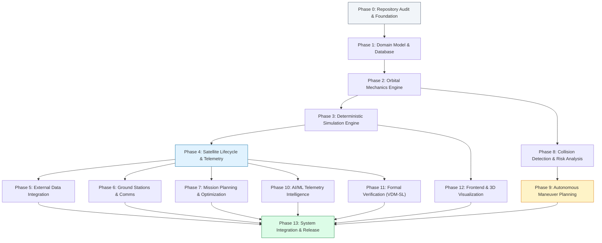

# 20 — OrbitOS Implementation Roadmap and Execution Plan

> **Document Status:** Baseline Approved  
> **Owner:** Technical Program Manager & Staff Systems Engineer  
> **Target Path:** `docs/20-implementation-roadmap.md`  
> **Last Updated:** 2026-11-03  
> **Traceability Anchor:** `DOC-ROADMAP-001`

---

## 1. Executive Summary & Delivery Strategy

This document establishes the phased, dependency-aware implementation roadmap for **OrbitOS — Autonomous Space Mission Management Simulator**. 

To balance technical rigor with rapid feedback, development is organized into **14 sequential phases (Phase 0 through Phase 13)** grouped into three macro milestones:
1. **Milestone 1: Core Physical MVP (Phases 0 – 4):** A fully functional local simulator modeling satellite orbits, discrete-time clock stepping, and bus telemetry in PostgreSQL.
2. **Milestone 2: Constellation Operations & Intelligence (Phases 5 – 10):** Conjunction screening, autonomous maneuver recommendation, mission task scheduling, ground station contacts, and AI anomaly detection.
3. **Milestone 3: Formal Verification, 3D Visualization & Release (Phases 11 – 13):** VDM-SL formal proof checks, React Three Fiber 3D interactive frontend, and end-to-end educational scenario packaging.

---

## 2. Master Phase Dependency Graph

---

## 3. Detailed Phase Breakdown

### Phase 0: Repository Audit and Foundation
- **Goal:** Establish local Python, Docker Compose, Git hooks, and CI/CD foundations.
- **Dependencies:** None.
- **Tasks:**
  - `TASK-0.1`: Initialize Git repository, `.gitignore`, and branch protection rules.
  - `TASK-0.2`: Configure Docker Compose stack (`backend`, `database`, `frontend`) with health checks.
  - `TASK-0.3`: Set up Python 3.11 virtual environment with Poetry/pip, Pytest, Black, Flake8, and Alembic.
  - `TASK-0.4`: Configure GitHub Actions workflow (`.github/workflows/ci.yml`).
- **Deliverables:** Working containerized development environment; clean passing CI pipeline.
- **Definition of Done:** `docker compose up --build` brings up backend and PostgreSQL with healthy status.

---

### Phase 1: Domain Model and Database
- **Goal:** Implement persistent relational data schemas and baseline Pydantic models.
- **Dependencies:** Phase 0.
- **Tasks:**
  - `TASK-1.1`: Create SQLAlchemy 2.0 models for `simulation_runs`, `satellites`, `orbital_states`, and `satellite_telemetry`.
  - `TASK-1.2`: Implement initial Alembic migration (`001_initial_schema.py`).
  - `TASK-1.3`: Create Pydantic v2 schemas for all entity models with boundary constraints.
  - `TASK-1.4`: Implement database session dependency and transactional rollback handlers.
- **Deliverables:** Relational database tables with foreign keys and check constraints; passing unit test suite.
- **Definition of Done:** 100% of schema constraints validated in `tests/test_database_schema.py`.

---

### Phase 2: Orbital Mechanics Engine
- **Goal:** Implement two-body Keplerian dynamics, coordinate conversions, and numerical propagators.
- **Dependencies:** Phase 1.
- **Tasks:**
  - `TASK-2.1`: Implement Keplerian-to-Cartesian and Cartesian-to-Keplerian analytical converters (`astrodynamics/converters.py`).
  - `TASK-2.2`: Implement Newton-Raphson analytical Kepler equation solver (`astrodynamics/kepler_solver.py`).
  - `TASK-2.3`: Implement ECI (J2000) to ECEF (WGS84) coordinate frame rotation matrix (`astrodynamics/frames.py`).
  - `TASK-2.4`: Implement 4th-Order Runge-Kutta (RK4) numerical integrator with $J_2$ geopotential perturbations.
- **Deliverables:** Stateless orbital propagation library with $< 10^{-6}$ energy conservation.
- **Definition of Done:** `TC-ORB-001` through `TC-ORB-004` pass with zero numerical regressions.

---

### Phase 3: Deterministic Simulation Engine
- **Goal:** Implement discrete-time clock loop, state machine, event queue, and WebSocket broadcaster.
- **Dependencies:** Phase 2.
- **Tasks:**
  - `TASK-3.1`: Implement Simulation Clock finite state machine (`STOPPED`, `READY`, `RUNNING`, `PAUSED`, `STEPPING`).
  - `TASK-3.2`: Implement Min-Heap priority event queue for scheduled events (`simulation/event_queue.py`).
  - `TASK-3.3`: Construct the 10-stage tick execution pipeline in `simulation/engine.py`.
  - `TASK-3.4`: Implement FastAPI WebSocket telemetry stream manager (`api/websockets/telemetry.py`).
- **Deliverables:** Deterministic simulation engine advancing virtual time at $1\times$ to $100\times$ acceleration.
- **Definition of Done:** Identical seeded runs generate identical SHA-256 telemetry digests (`TC-SIM-003`).

---

### Phase 4: Satellite Lifecycle and Telemetry
- **Goal:** Model spacecraft bus power balance, battery SoC, thermal states, and primary operational FSM.
- **Dependencies:** Phase 3.
- **Tasks:**
  - `TASK-4.1`: Implement primary spacecraft FSM (`CREATION` $\to$ `STANDBY` $\to$ `ACTIVE` $\to$ `SAFE_HOLD`).
  - `TASK-4.2`: Implement cylindrical Earth shadow eclipse calculation (`bus/eclipse.py`).
  - `TASK-4.3`: Implement Electrical Power Subsystem (EPS) charging/discharging loop (`bus/power.py`).
  - `TASK-4.4`: Implement Tsiolkovsky propellant mass deduction for maneuver burns (`bus/propulsion.py`).
- **Deliverables:** Satellite bus telemetry updating dynamically on each simulation tick.
- **Definition of Done:** `TC-SAT-001` through `TC-SAT-005` passing; Core MVP Milestone achieved.

---

### Phase 5: External Data Integration
- **Goal:** Integrate NASA DONKI, CelesTrak GP/TLE, and NASA JPL Horizons adapters with multi-tier caching.
- **Dependencies:** Phase 4.
- **Tasks:**
  - `TASK-5.1`: Implement `BaseDataProvider` abstract class and PostgreSQL caching layer (`external/base.py`).
  - `TASK-5.2`: Implement NASA DONKI space weather adapter with `NASA_API_KEY` handling.
  - `TASK-5.3`: Implement CelesTrak TLE parser with checksum verification and HTTP conditional caching.
  - `TASK-5.4`: Implement NASA JPL Horizons vector query client.
  - `TASK-5.5`: Create local offline synthetic seed files for 100% offline fallback execution.
- **Deliverables:** Robust external data ingestion layer with zero startup network dependency.
- **Definition of Done:** Offline simulation test passes cleanly with network disabled (`TC-EXT-003`).

---

### Phase 6: Ground Stations and Communications
- **Goal:** Implement ground station geodesy, line-of-sight elevation, contact windows, and data downlinks.
- **Dependencies:** Phase 4.
- **Tasks:**
  - `TASK-6.1`: Implement Topocentric Horizon (SEZ) coordinate conversion (`ground/coordinates.py`).
  - `TASK-6.2`: Implement contact window detection algorithm (AOS, Max Elevation, LOS).
  - `TASK-6.3`: Implement simulated telemetry buffer downlink channel ($1\text{ Mbps}$).
  - `TASK-6.4`: Seed standard reference stations (Svalbard, Singapore, Santiago).
- **Deliverables:** Contact window scheduler and telemetry pass streaming service.
- **Definition of Done:** Contact windows verified against analytical pass geometries (`TC-GND-001`..`004`).

---

### Phase 7: Mission Planning and Optimization
- **Goal:** Implement mission task creation, resource validation, priority scheduling, and preemption.
- **Dependencies:** Phase 4.
- **Tasks:**
  - `TASK-7.1`: Create mission task models and REST endpoints (`api/routers/missions.py`).
  - `TASK-7.2`: Implement topological dependency sort and cycle-detection algorithm.
  - `TASK-7.3`: Implement priority-weighted greedy Earliest-Deadline-First (EDF) scheduler.
  - `TASK-7.4`: Implement avoidance maneuver task preemption logic.
- **Deliverables:** Constellation mission scheduling engine with explainable diagnostic logs.
- **Definition of Done:** Overlapping task conflicts resolve according to priority rules (`TC-MIS-001`..`004`).

---

### Phase 8: Collision Detection and Risk Analysis
- **Goal:** Implement 3-tier conjunction screening, TCA root-finding, and geometric risk classification.
- **Dependencies:** Phase 2.
- **Tasks:**
  - `TASK-8.1`: Implement Tier 1 apogee-perigee altitude shell overlap filter (`conjunction/sieve.py`).
  - `TASK-8.2`: Implement Tier 2 coarse time-mesh screening loop ($H = 24\text{ hours}$).
  - `TASK-8.3`: Implement Tier 3 Brent's root-finding minimization for precise TCA and miss distance.
  - `TASK-8.4`: Implement risk categorization logic (`INFO`, `WATCH`, `WARNING`, `CRITICAL`).
- **Deliverables:** Automated conjunction screening service executing in $< 100\text{ ms}$ for 20 satellites.
- **Definition of Done:** Synthetic close approaches correctly detected with sub-second TCA accuracy (`TC-COL-001`..`004`).

---

### Phase 9: Autonomous Maneuver Planning
- **Goal:** Implement candidate $\Delta \vec{v}$ generation, Tsiolkovsky fuel optimization, and execution guardrails.
- **Dependencies:** Phase 8, Phase 4.
- **Tasks:**
  - `TASK-9.1`: Implement in-track prograde/retrograde and cross-track maneuver generators (`maneuver/generator.py`).
  - `TASK-9.2`: Implement multi-objective utility scoring function ($d_{\text{miss}} \ge 5\text{ km}$, min $\Delta v$).
  - `TASK-9.3`: Implement simulated approval policy (Manual Operator vs Autonomous Auto-Approve).
  - `TASK-9.4`: Implement burn execution handler updating orbital states and logging audit records.
- **Deliverables:** Autonomous avoidance maneuver planning engine.
- **Definition of Done:** Maneuvers increase miss distance $> 5.0\text{ km}$ while verifying fuel sufficiency (`TC-MAN-001`..`004`).

---

### Phase 10: AI/ML Telemetry Intelligence
- **Goal:** Implement Scikit-learn Isolation Forest anomaly detector and resource trend forecaster.
- **Dependencies:** Phase 4.
- **Tasks:**
  - `TASK-10.1`: Construct 60-tick sliding window feature extraction pipeline (`ml/features.py`).
  - `TASK-10.2`: Train Isolation Forest anomaly detection model on nominal baseline telemetry.
  - `TASK-10.3`: Implement synthetic fault injection generator (solar degradation, thermal runaway).
  - `TASK-10.4`: Implement Ridge regression 24-hour battery SoC forecaster.
  - `TASK-10.5`: Implement deterministic rule-based safety fallback handlers.
- **Deliverables:** Real-time telemetry anomaly inference engine with explainable diagnostic outputs.
- **Definition of Done:** Fault injection triggers anomaly scores $> 0.85$ within 3 ticks (`TC-AIML-001`..`004`).

---

### Phase 11: Formal Verification (VDM-SL)
- **Goal:** Validate VDM-SL formal specifications, generate proof obligations, and run property-based tests.
- **Dependencies:** Phase 4.
- **Tasks:**
  - `TASK-11.1`: Write formal VDM-SL module `OrbitOS_SafetyCore.vdm` covering all state invariants.
  - `TASK-11.2`: Configure VDMJ CLI tool in CI pipeline for automated syntax and type verification.
  - `TASK-11.3`: Generate and catalog formal Proof Obligations (POs).
  - `TASK-11.4`: Implement Hypothesis property-based testing suite enforcing invariants in Python.
- **Deliverables:** Formally verified specification suite and property-based runtime assertion test suite.
- **Definition of Done:** 10,000 Hypothesis test iterations pass with zero invariant violations (`TC-FORM-001`..`003`).

---

### Phase 12: Frontend and 3D Visualization
- **Goal:** Build React 18 / Three.js dashboard, 3D Earth canvas, orbital tracks, and telemetry widgets.
- **Dependencies:** Phase 3.
- **Tasks:**
  - `TASK-12.1`: Initialize React 18, Vite, TypeScript, and TailwindCSS frontend project.
  - `TASK-12.2`: Build Top Mission Control Bar with simulation clock playback controls.
  - `TASK-12.3`: Build Three.js 3D WebGL Canvas using React Three Fiber (Earth, orbits, ground pins, hazard markers).
  - `TASK-12.4`: Build tabbed workspace panels (Fleet Status, Conjunction Center, Mission Timeline).
  - `TASK-12.5`: Connect Zustand state store to live WebSocket `/ws/telemetry` stream.
  - `TASK-12.6`: Implement lightweight 2D SVG fallback dashboard mode.
- **Deliverables:** Interactive WebGL mission control web application maintaining $\ge 45\text{ FPS}$.
- **Definition of Done:** Frontend renders live satellite constellation and conjunction hazards cleanly (`TC-UI-001`..`004`).

---

### Phase 13: System Integration and Release
- **Goal:** End-to-end scenario validation, documentation audit, and final package release.
- **Dependencies:** All previous phases.
- **Tasks:**
  - `TASK-13.1`: Execute full multi-satellite conjunction and avoidance maneuver E2E test.
  - `TASK-13.2`: Verify memory footprint stays $< 2.5\text{ GB}$ RAM under peak 50-satellite scenario.
  - `TASK-13.3`: Audit all 20 technical documents and governance files against repository implementation.
  - `TASK-13.4`: Package seed database scenarios and author user onboarding guide.
- **Deliverables:** OrbitOS Version 1.0.0 Baseline Release.
- **Definition of Done:** All acceptance criteria satisfied; final review report approved.

---

## 4. End-to-End Demonstration Scenarios

| Scenario ID | Scenario Name | Primary Capabilities Demonstrated | Expected Demo Duration |
| :--- | :--- | :--- | :--- |
| **DEMO-01** | LEO Constellation Operations & Ground Passes | 3 Satellites in Sun-synchronous orbit, Earth shadow eclipses, battery discharge, Svalbard station pass, telemetry downlink. | $5\text{ minutes}$ |
| **DEMO-02** | Autonomous Collision Detection & Evasion | High-speed orbital debris conjunction ($d_{\text{miss}} = 450\text{ m}$), red critical alert, autonomous in-track burn plan, fuel verification, simulated burn execution, hazard clearance ($d_{\text{miss}} > 5\text{ km}$). | $7\text{ minutes}$ |
| **DEMO-03** | Telemetry Degradation & AI/ML Safe-Hold | Injected solar panel failure, battery voltage drop, Isolation Forest anomaly detection, automatic transition to `SAFE_HOLD`, ground recovery command. | $5\text{ minutes}$ |
| **DEMO-04** | Formal Invariant & Proof Obligation Audit | Demonstration of VDM-SL specification, VDMJ static type check, and Hypothesis property-based testing run proving fuel non-negativity and state transitions. | $5\text{ minutes}$ |

---

## 5. Scope-Control & "Do Not Implement in MVP" Register

To prevent scope creep and preserve laptop-friendly performance, the following items are strictly **deferred** beyond the Core MVP:

1. **Relativistic Orbital Corrections:** General relativity Schwarzschild precession is excluded.
2. **Atmospheric Density Micro-Models:** NRLMSISE-00 atmospheric drag modeling is deferred.
3. **Deep Learning GPUs (PyTorch/TensorFlow):** Heavy deep neural networks are prohibited in favor of Scikit-learn.
4. **Distributed Kubernetes / Service Meshes:** Replaced by single-node Docker Compose.
5. **Real Spacecraft RF Uplinks:** Strictly prohibited by non-negotiable safety policy (`SAF-BND-001`).

---

## 6. Suggested Incremental LLM Implementation Sequence

For AI coding agents or human developers implementing OrbitOS incrementally, follow this prompt order:

1. **Step 1:** Implement Phase 0 (Docker Compose, `.env`, FastAPI skeleton).
2. **Step 2:** Implement Phase 1 (SQLAlchemy models, Alembic migrations, Pydantic schemas).
3. **Step 3:** Implement Phase 2 (Astrodynamics library, Kepler solver, ECI/ECEF frames).
4. **Step 4:** Implement Phase 3 (Deterministic simulation clock loop, WebSocket manager).
5. **Step 5:** Implement Phase 4 (Satellite bus power, eclipse geometry, FSM).
6. **Step 6:** Implement Phase 8 & 9 (Conjunction detection, maneuver planner).
7. **Step 7:** Implement Phase 6 & 7 (Ground stations, mission task scheduler).
8. **Step 8:** Implement Phase 10 & 11 (Scikit-learn intelligence, VDM-SL invariants).
9. **Step 9:** Implement Phase 12 (React 18, Three.js 3D visualization canvas).
10. **Step 10:** Implement Phase 13 (E2E integration tests, seed scenarios).

---

## 7. Cross-Document References

- **Project Charter:** [01-project-charter.md](file:///home/kashifhm333/Desktop/Project/orbit/docs/00-project-foundation/01-project-charter.md)
- **Requirements Specification:** [02-requirements-specification.md](file:///home/kashifhm333/Desktop/Project/orbit/docs/00-project-foundation/02-requirements-specification.md)
- **System Architecture:** [04-system-architecture.md](file:///home/kashifhm333/Desktop/Project/orbit/docs/01-system-design/04-system-architecture.md)
- **Traceability Matrix:** [DOCUMENTATION_TRACEABILITY.md](file:///home/kashifhm333/Desktop/Project/orbit/docs/DOCUMENTATION_TRACEABILITY.md)
- **Architecture Decisions:** [ARCHITECTURE_DECISIONS.md](file:///home/kashifhm333/Desktop/Project/orbit/docs/ARCHITECTURE_DECISIONS.md)

