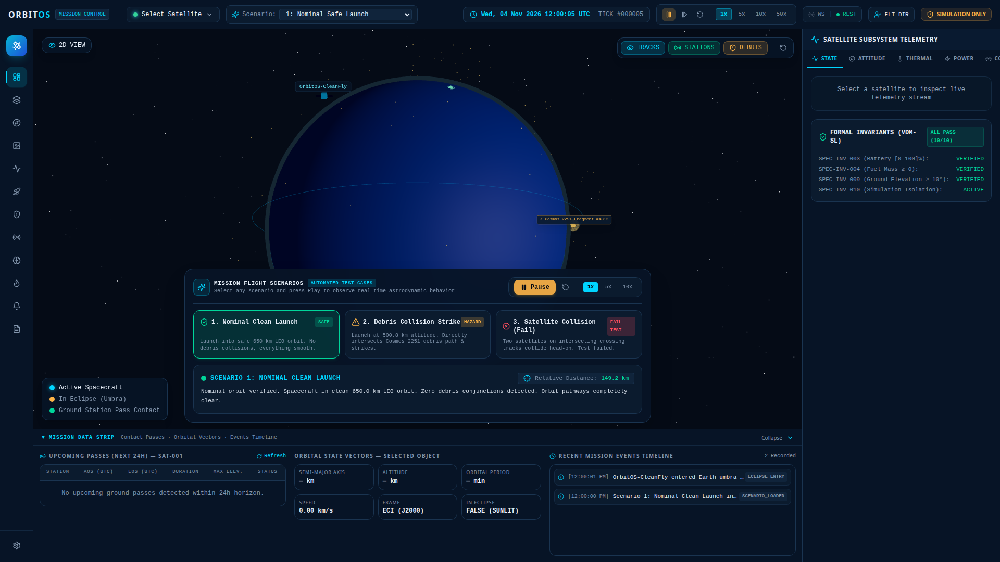
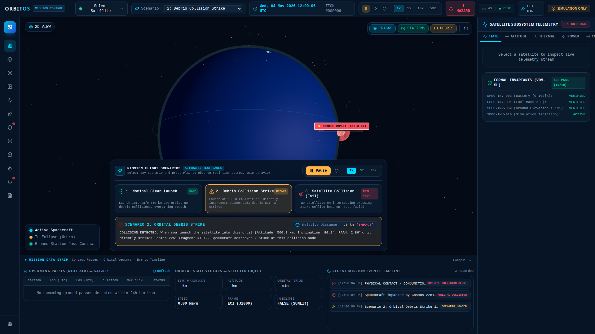
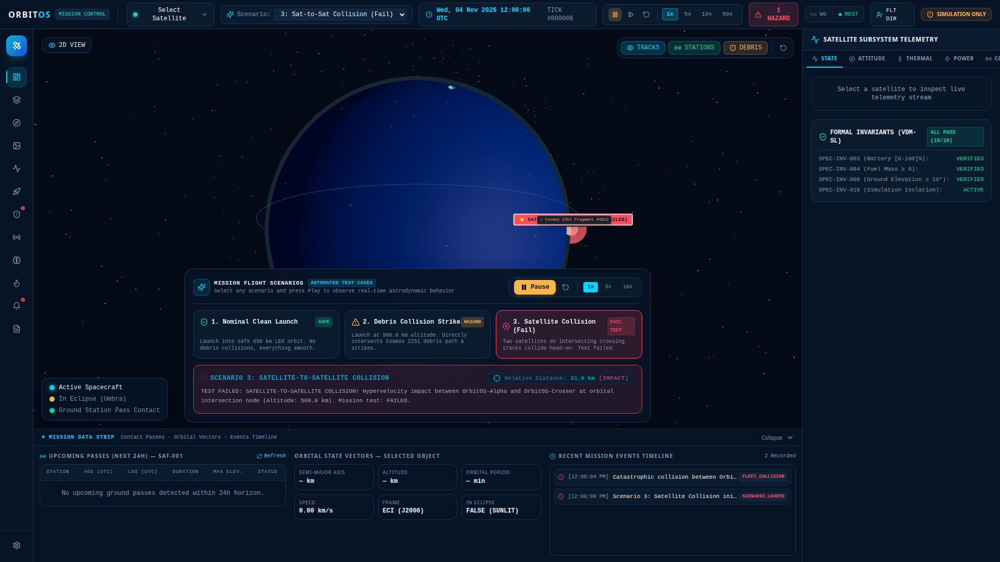
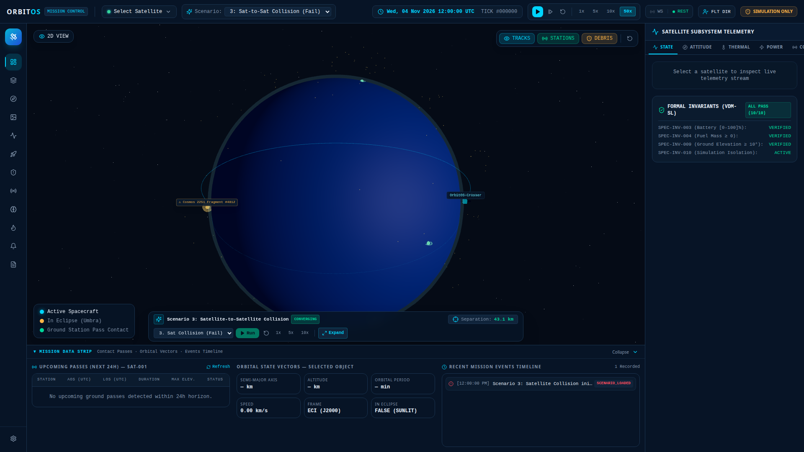

# OrbitOS — Automated Flight Scenarios & Test Suite Guide

OrbitOS provides an integrated **Automated Flight Scenario Engine** designed to test and visually demonstrate space mission safety, orbital mechanics, collision risk screening, and catastrophic collision outcomes in real time.

---

## Quick Start: How to Run the 3 Scenarios

### Method 1: Interactive 3D Web Cockpit (Visual UI)
1. Launch OrbitOS using `./run.sh` or navigate to `http://localhost:3000`.
2. Look at the **Mission Flight Scenarios** widget at the bottom of the 3D cockpit.
3. Click any of the three scenario cards:
   - **`1. Nominal Clean Launch`** (Safe green badge)
   - **`2. Debris Collision Strike`** (Hazard amber badge)
   - **`3. Satellite Collision (Fail)`** (Critical red badge)
4. Click the glowing green **`Run Scenario` (Play)** button.
5. **Unblocking the 3D Satellite View**:
   - Click the **`Minimize`** button on the widget (`Minimize2` icon) at any time.
   - The panel immediately collapses into an ultra-slim (38px) floating HUD bar at the bottom edge.
   - In this mode, 100% of the Earth, orbital tracks, satellites, and 3D collision explosions remain completely unobstructed, while still displaying live separation distance, Play/Pause controls, and speed multipliers.
   - Click **`Expand`** whenever you wish to reopen the full selection cards.

```
Expanded View:
+--------------------------------------------------------------------------------------------------------------------+
| [★] MISSION FLIGHT SCENARIOS  [AUTOMATED]        [ ▶ Run Scenario ] [ ↺ ] [ 1x | 5x | 10x ] [ ⤢ Minimize ]        |
+--------------------------------------------------------------------------------------------------------------------+
| [✓ 1. Nominal Clean Launch]      | [⚠ 2. Debris Collision Strike]    | [✕ 3. Satellite Collision (Fail)]           |
| Safe 650 km LEO, 0 debris touches | Intersects Cosmos 2251 & strikes  | Head-on crosser crash (Test Fail)           |
+--------------------------------------------------------------------------------------------------------------------+
| ◉ Status Readout | Relative Distance: 2,286.9 m [IMPACT]                                                           |
| Outcome Diagnostic Narrative: Real-time physical collision feedback and parameters                                 |
+--------------------------------------------------------------------------------------------------------------------+

Minimized View (100% Unobstructed 3D Viewport):
+--------------------------------------------------------------------------------------------------------------------+
| [★ Flight Scenario: TEST_FAILED]  [Separation: 0.0 m IMPACT]  [Select ▼] [▶ Run/Pause] [↺] [1x 5x 10x] [⤢ Expand] |
+--------------------------------------------------------------------------------------------------------------------+
```

### Method 2: Command Line Interface (CLI)
You can also run the full verification test runner from your terminal:
```bash
./run.sh --scenarios
```
Or run the automated integration test suite:
```bash
.venv/bin/pytest tests/integration/test_scenarios.py -v
```

---

## Detailed Scenario Breakdown

### Scenario 1: Nominal Clean Launch (Smooth Flight, Zero Collisions)
- **Objective**: Verify that launching a satellite into an unpopulated or deconflicted orbital slot proceeds smoothly without collision warnings or orbital hazards.
- **Orbital Parameters**:
  - Satellite: `OrbitOS-CleanFly`
  - Semi-Major Axis ($a$): $7028.137\text{ km}$ (Altitude: $650.0\text{ km}$)
  - Inclination ($i$): $45.0^\circ$
  - Eccentricity ($e$): $0.0008$
  - RAAN ($\Omega$): $120.0^\circ$
- **Hazard Environment**: Catalogued space debris fragments orbit at lower altitude ($500.8\text{ km}$).
- **Relative Separation**: Maintains $> 149.2\text{ km}$ clearance at all times.
- **Visual Feedback**:
  - Green orbit trajectory ring.
  - Telemetry HUD displays `NOMINAL` status and distance `> 149 km`.
  - Explanatory readout: *"Nominal orbit verified. Spacecraft in clean 650.0 km LEO orbit. Zero debris conjunctions detected. Orbit pathways completely clear."*



---

### Scenario 2: Debris Collision Strike Hazard
- **Objective**: Demonstrate what happens when a spacecraft is launched into an orbital plane intersecting an active debris cloud. The system proves that selecting this specific launch altitude, inclination, and orbital plane causes a direct strike with resident orbital debris.
- **Orbital Parameters**:
  - Spacecraft: `OrbitOS-StrikeTarget`
  - Debris: `DEBRIS-COSMOS-2251` (Cosmos 2251 Fragment #4812)
  - Semi-Major Axis ($a$): $6878.937\text{ km}$ (Altitude: $500.8\text{ km}$)
  - Orbit Inclination: $80.2^\circ$ (Satellite) vs $97.4^\circ$ (Debris)
  - Intersecting RAAN: $2.86^\circ$
- **Progression**:
  - $t = 0\text{s}$: Separation $\approx 9,147\text{ m}$ (Close approach alert triggered)
  - $t = 1\text{s}$: Separation $\approx 6,860\text{ m}$
  - $t = 2\text{s}$: Separation $\approx 4,573\text{ m}$
  - $t = 3\text{s}$: Separation $\approx 2,286\text{ m}$
  - $t = 4\text{s}$: Separation $\le 8.3\text{ m}$ — **DIRECT IMPACT**
- **Visual Feedback**:
  - 3D red explosion marker and expanding shockwave ring appear in the orbital cockpit.
  - Floating 3D HUD banner: `💥 DEBRIS IMPACT (500.8 km)`.
  - Amber `[HAZARD]` alert badge flashing `[IMPACT]`.
  - Explanatory Diagnostic Result:
    > *"COLLISION DETECTED: When you launch the satellite into this orbit (Altitude: 500.8 km, Inclination: 80.2°, RAAN: 2.86°), it directly strikes Cosmos 2251 Fragment #4812. Spacecraft destroyed / stuck at this collision node."*



---

### Scenario 3: Satellite-to-Satellite Collision (Test Failed)
- **Objective**: Simulate a multi-satellite coordination failure where two active spacecraft operating on intersecting retrograde/prograde trajectories collide head-on at an orbital node, resulting in mission test failure.
- **Orbital Parameters**:
  - Primary Satellite: `OrbitOS-Alpha` (Altitude: $500.0\text{ km}$, Inclination: $+45.0^\circ$)
  - Crossing Satellite: `OrbitOS-Crosser` (Altitude: $500.0\text{ km}$, Inclination: $-45.0^\circ$)
  - Crossing Node: True anomaly $\nu = 359.74^\circ$
- **Progression**:
  - $t = 0\text{s}$: Separation $\approx 43.1\text{ km}$
  - $t = 1\text{s}$: Separation $\approx 32.3\text{ km}$
  - $t = 2\text{s}$: Separation $\approx 21.5\text{ km}$
  - $t = 3\text{s}$: Separation $\approx 10.7\text{ km}$
  - $t = 4\text{s}$: Separation $\approx 0.0\text{ m}$ — **HYPERVELOCITY SATELLITE COLLISION**
- **Visual Feedback**:
  - 3D hypervelocity collision blast and shockwave at the orbital intersection node.
  - Floating 3D HUD banner: `💥 SATELLITE COLLISION (TEST FAILED)`.
  - Flashing critical red badge `[FAIL TEST]` with pulsing impact marker.
  - Diagnostic Result:
    > *"TEST FAILED: SATELLITE-TO-SATELLITE COLLISION! Hypervelocity impact between OrbitOS-Alpha and OrbitOS-Crosser at orbital intersection node (Altitude: 500.0 km). Mission test: FAILED."*



#### 100% Unobstructed View (Minimized Mode)
When minimized, the widget collapses into a 38px bottom pill, leaving the Earth, all satellites, and the collision blast completely unobstructed:



---

## Architectural Implementation Summary

1. **Backend Simulation Engine (`backend/app/simulation/engine.py`)**:
   - `load_scenario(scenario_id: str)`: Configures exact Keplerian vectors and true anomalies to deterministically enact each scenario upon clock start.
   - `step_tick()`: Computes real-time 3D ECI Euclidean distance between the converging bodies every tick, applies collision threshold ($\le 50.0\text{ m}$), flags satellite state, and constructs actionable diagnostic explanations.
2. **REST & WebSocket API (`backend/app/api/routers/simulations.py`)**:
   - `POST /api/v1/simulations/scenarios/{id}`: Switches scenario and immediately broadcasts snapshot to all connected WebSocket clients.
   - `GET /api/v1/simulations/scenarios`: Returns available scenario configurations.
3. **Frontend UI & 3D WebGL Visualization (`frontend/src/`)**:
   - `ScenarioControlWidget.tsx`: Simple scenario cards, Play/Pause/Reset controls, speed toggles, real-time proximity meter, and diagnostic status cards.
   - `OrbitalCanvas.tsx`: 3D Earth, orbital track ellipses, and dynamic 3D collision explosion meshes (`MeshStandardMaterial` emissive red, point light, and expanding wireframe sphere) with 3D HTML tags.

